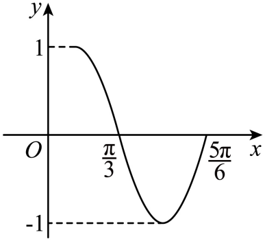

# Mathematics - 题目 432

**ID**: fdbfa68d766a4d76914e8bf98617c14c
**年级**: Grade 11
**难度**: Medium
**题型**: Calculation

## 题目
如图是函数 $f\left ({x}\right )=A{\rm{s}}{\rm{i}}{\rm{n}}\left ({ωx+φ}\right )\left ({A>0,ω>0,\left |{φ}\right |\leqslant \frac {{\rm{π}}}{2}}\right )$ 的部分图象.​​​​​​​‌（1）求函数 $g\left ({x}\right )=2f\left ({\frac {x}{2}}\right )+1$ 在区间 $\left ({-\frac {{\rm{π}}}{6},\frac {{\rm{π}}}{2}}\right ]$ 上的值域；（2）若 $f\left ({α}\right )=\frac {4}{5}$ ，且 $α\in \left ({\frac {{\rm{π}}}{12},\frac {{\rm{π}}}{3}}\right )$ ，求 ${\rm{c}}{\rm{o}}{\rm{s}}2α$ 的值.

## 解答

1. （1）由图可知： $A=1,\frac {T}{2}=\frac {5{\rm{π}}}{6}-\frac {{\rm{π}}}{3}=\frac {{\rm{π}}}{2}$ ，即 $T={\rm{π}}$ ，
2. 所以 $ω=2,f\left ({x}\right )={\rm{s}}{\rm{i}}{\rm{n}}\left ({2x+φ}\right )$ ，又由图可知 $\left ({\frac {{\rm{π}}}{3},0}\right )$ 是五点作图法中的第三点，
3. 所以 $2\times \frac {{\rm{π}}}{3}+φ={\rm{π}}+2k{\rm{π}},k\in {\mathbf{Z}}$ ，又 $\left |{φ}\right |\leqslant \frac {{\rm{π}}}{2}$ ，
4. 所以 $φ=\frac {{\rm{π}}}{3}$ ， $f\left ({x}\right )={\rm{s}}{\rm{i}}{\rm{n}}\left ({2x+\frac {{\rm{π}}}{3}}\right )$ ，
5. 则 $g\left ({x}\right )=2f\left ({\frac {x}{2}}\right )+1=2{\rm{s}}{\rm{i}}{\rm{n}}\left ({x+\frac {{\rm{π}}}{3}}\right )+1$ ，因为 $x\in \left ({-\frac {{\rm{π}}}{6},\frac {{\rm{π}}}{2}}\right ]$ ，
6. 所以 $\left ({x+\frac {{\rm{π}}}{3}}\right )\in \left ({\frac {{\rm{π}}}{6},\frac {5{\rm{π}}}{6}}\right ]$ ，则 $\frac {1}{2}\leqslant {\rm{s}}{\rm{i}}{\rm{n}}\left ({x+\frac {{\rm{π}}}{3}}\right )\leqslant 1$ ，故 $g\left ({x}\right )\in \left [2,3\right ]$ ，
7. 即函数 $g\left ({x}\right )=2f\left ({\frac {x}{2}}\right )+1$ 在区间 $\left ({-\frac {{\rm{π}}}{6},\frac {{\rm{π}}}{2}}\right ]$ 上的值域为 $\left [2,3\right ]$ .
8. （2）由（1）知 $f\left ({α}\right )={\rm{s}}{\rm{i}}{\rm{n}}\left ({2α+\frac {{\rm{π}}}{3}}\right )=\frac {4}{5}$ ，因为 $α\in \left ({\frac {{\rm{π}}}{12},\frac {{\rm{π}}}{3}}\right )$ ，所以 $2α+\frac {{\rm{π}}}{3}\in \left ({\frac {{\rm{π}}}{2},{\rm{π}}}\right )$ ，
9. 所以 ${\rm{c}}{\rm{o}}{\rm{s}}\left ({2α+\frac {{\rm{π}}}{3}}\right )=-\sqrt {1-{\rm{s}}{\rm{i}}{\rm{n}}{^{2}}\left ({2α+\frac {{\rm{π}}}{3}}\right )}=-\sqrt {1-{\left({\frac {4}{5}}\right)^{2}}}=-\frac {3}{5}$ ，
10. 所以 ${\rm{c}}{\rm{o}}{\rm{s}}2α={\rm{c}}{\rm{o}}{\rm{s}}\left [\left ({2α+\frac {{\rm{π}}}{3}}\right )-\frac {{\rm{π}}}{3}\right ]={\rm{c}}{\rm{o}}{\rm{s}}\left ({2α+\frac {{\rm{π}}}{3}}\right )\cdot {\rm{c}}{\rm{o}}{\rm{s}}\frac {{\rm{π}}}{3}+{\rm{s}}{\rm{i}}{\rm{n}}\left ({2α+\frac {{\rm{π}}}{3}}\right )\cdot {\rm{s}}{\rm{i}}{\rm{n}}\frac {{\rm{π}}}{3}$
11. $=-\frac {3}{5}\cdot \frac {1}{2}+\frac {4}{5}\cdot \frac {\sqrt {3}}{2}=\frac {4\sqrt {3}-3}{10}{{.}}$

## 知识点

**中文**:
  - 两角和与差的余弦公式
  - 函数y=Asin（ωx＋φ）的图象和性质

**English**:
  - Cosine of Sum and Difference
  - Graph and Properties of y=Asin(ωx+φ)

---
