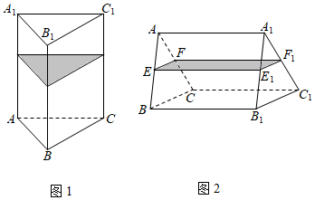

# Mathematics - 题目 2639

**ID**: 1c9d810d81184533b88720793e43bc7c
**年级**: Grade 11
**难度**: Medium
**题型**: Fill-in-the-blank

## 题目
一个封闭的正三棱柱容器的高为2a，内装水若干(如图（1），底面处于水平状态)．将容器放倒(如图（2），—个侧面处于水平状态)，若此时水面与各棱的交点 ${\rm \mathit{E}，\mathit{F}，}F{{}_{1}}$ ， $E{{}_{1}}$ 分别为所在棱的中点，则图（1）中水面的高度为．​​​​​​​‌

## 解答

1. 设正三棱柱的底面积为 $\mathrm{S}$ ，图（1）中水面的高度为 $h$ ，则水的体积 $V{{}_{1}}=Sh$ .因为 ${\rm \mathit{E}，\mathit{F}，}F{{}_{1}}$ ， $E{{}_{1}}$ 分别为所在棱的中点，所以 $\mathrm{S}{{}_{\mathrm{△}AEF}}=\frac {1}{4}S$ ， $S{{}_{BCFE}}=\frac {3}{4}S$ ，所以图（2）中水的体积 $V{{}_{2}}=(\frac {3}{4}S)\times (2a)=\frac {3}{2}Sa$ .又 $V{{}_{1}}=V{{}_{2}}$ ，所以 $h=\frac {3}{2}a$ .

## 知识点

**中文**:
  - 棱柱

**English**:
  - Prism

---
