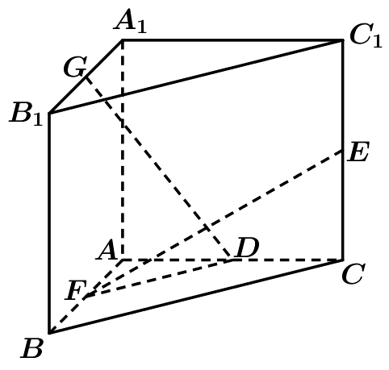

# Mathematics - 题目 581

**ID**: a90b611428d44f7fb1e5e3eb906de923
**年级**: Grade 11
**难度**: Medium
**题型**: Fill-in-the-blank

## 题目
如图，在直三棱柱 $ABC-A{{}_{1}}B{{}_{1}}C{{}_{1}}$ 中， $\angle BAC=90{^{\circ }}$ ， $AB=AC=AA{{}_{1}}=2$ ，点 $G$ ､ $E$ ､ $F$ 分别是 $A{{}_{1}}B{{}_{1}}$ ､ $CC{{}_{1}}$ ､ $AB$ 的中点，点 $D$ 是 $AC$ 上的动点.​​​​​​​‌若 $GD\bot EF$ ，则线段 $DF$ 长度为.

## 解答

1. 因为三棱柱 $ABC-A{{}_{1}}B{{}_{1}}C{{}_{1}}$ 是直三棱柱，且 $\angle BAC=90{^{\circ }}$
2. 所以以 $\mathrm{A}$ 为原点，建立如图所示的空间直角坐标系，
3. 因为 $AB=AC=AA{{}_{1}}=2$ ，点 $G$ ､ $E$ ､ $F$ 分别是 $A{{}_{1}}B{{}_{1}}$ ､ $CC{{}_{1}}$ ､ $AB$ 的中点，
4. 所以 $E\left ({0,2,1}\right )$ ， $G\left ({1,0,2}\right )$ ， $F\left ({1,0,0}\right )$ ，
5. 因为点 $D$ 是 $AC$ 上的动点，设 $D\left ({0,y,0}\right )$ ，所以 $\overrightarrow {{GD}}=\left ({-1,y,-2}\right )$ ， $\overrightarrow {{EF}}=\left ({1,-2,-1}\right )$
6. 因为 $GD\bot EF$ ，所以 $\overrightarrow {{GD}}\cdot \overrightarrow {{EF}}=-1\times 1-2y+2=0$ ，解得： $y=\frac {1}{2}$ ，
7. 所以 $D\left ({0,\frac {1}{2},0}\right )$ ， $\overrightarrow {{DF}}=\left ({1,-\frac {1}{2},0}\right )$ ，
8. 所以 $\left |{\overrightarrow {{DF}}}\right |=\sqrt {1{^{2}}+{\left({-\frac {1}{2}}\right)^{2}}+0{^{2}}}=\frac {\sqrt {5}}{2}$ ，即线段 $DF$ 长度为 $\frac {\sqrt {5}}{2}$ .
9. 

## 知识点

**中文**:
  - 空间向量模的坐标计算公式

**English**:
  - Modulus Calculation

---
