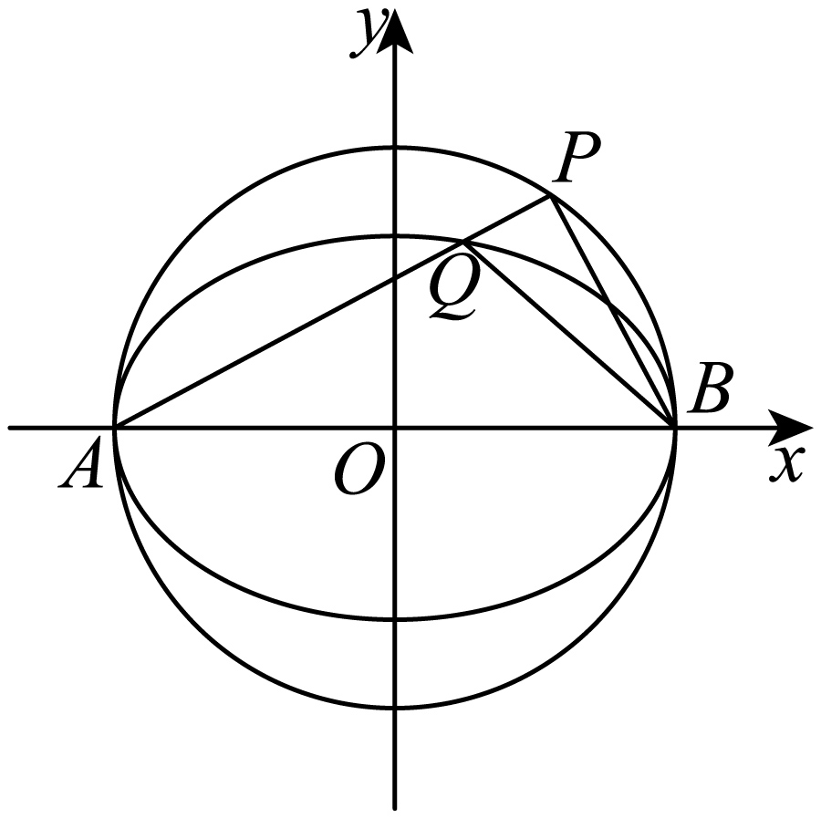

# Mathematics - 题目 500

**ID**: b95a1a6ea5574b02b1ca052194462d0e
**年级**: Grade 11
**难度**: Medium
**题型**: Fill-in-the-blank

## 题目
如图， $A,B$ 是椭圆 $C:\frac {x{^{2}}}{a{^{2}}}+\frac {y{^{2}}}{b{^{2}}}=1(a>b>0)$ 的左、右顶点，P是 $\odot O:x{^{2}}+y{^{2}}=a{^{2}}$ 上不同于 $A,B$ 的动点，线段 $PA$ 与椭圆C交于点Q，若 ${\tan}\angle PBA=3{\tan}\angle QBA$ ，则椭圆的离心率为．​​​​​​​‌

## 解答

1. 根据椭圆以及圆的对称性，不妨设P点在第一象限，设 $Q\left ({a{\cos}θ,b\sin θ}\right )$ ，
2. 则 ${\tan}\angle PAB={\tan}\angle QAB=\frac {b\sin θ}{a{\cos}θ+a}$ ，
3. ${\tan}\angle QBA=\frac {b\sin θ}{a-a{\cos}θ}$ ，
4. 两式相乘得 ${\tan}\angle PAB\cdot {\tan}\angle QBA=\frac {b{^{2}}}{a{^{2}}}$ ①,
5. 因为直径所对的角是直角，所以 $\angle PAB+\angle PBA=\frac {{\rm{π}}}{2}$ ，
6. 所以 ${\tan}\angle PAB\cdot {\tan}\angle PBA=1$ ②，结合 ${\tan}\angle PBA=3{\tan}\angle QBA$ ，
7. ①除以②得 $\frac {{\tan}\angle QBA}{{\tan}\angle PBA}=\frac {b{^{2}}}{a{^{2}}}=\frac {1}{3}$ ，故 $e=\frac {c}{a}=\sqrt {1-\frac {b{^{2}}}{a{^{2}}}}=\sqrt {1-\frac {1}{3}}=\frac {\sqrt {6}}{3}$ ，
8. 故答案为： $\frac {\sqrt {6}}{3}$

## 知识点

**中文**:
  - 椭圆的离心率

**English**:
  - Eccentricity

---
