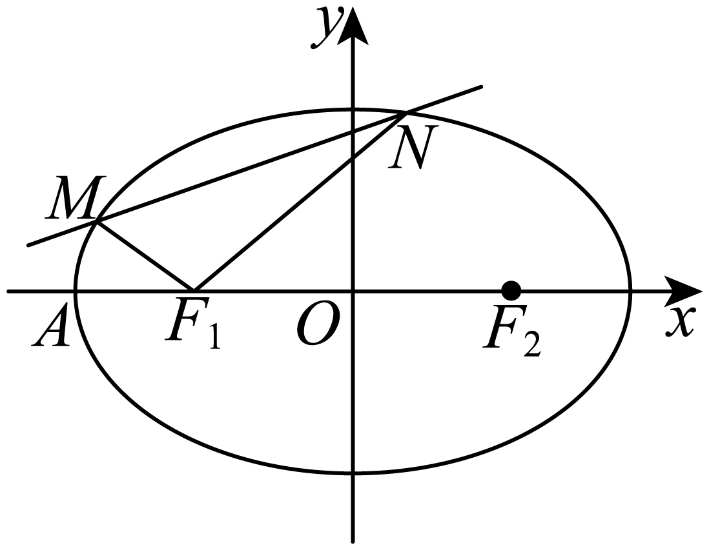

# Mathematics - 题目 3046

**ID**: 0f2e5734bf0d4c7688c68ce41cb594f5
**年级**: Grade 11
**难度**: Medium-Hard
**题型**: Calculation

## 题目
已知椭圆C： $\frac {x{^{2}}}{a{^{2}}}+\frac {y{^{2}}}{b{^{2}}}=1\left ({a>b>0}\right )$ 的左、右焦点分别为 $F{{}_{1}},F{{}_{2}}$ ， $\left |{F{{}_{1}}F{{}_{2}}}\right |=4$ ，过 $F{{}_{2}}$ 的直线l与椭圆C交于P，Q两点， $△PQF{{}_{1}}$ 的周长为 $8\sqrt {2}$ ．（1）求椭圆C的方程；​​​​​​​‌（2）如图，点 ${\rm \mathit{A}，}F{{}_{1}}$ 分别是椭圆C的左顶点、左焦点，直线m与椭圆C交于不同的两点M，N（M，N都在x轴上方）．且 $\angle AF{{}_{1}}M=\angle OF{{}_{1}}N$ ．证明直线m过定点，并求出该定点的坐标．

## 解答

1. （1）设椭圆C的焦距为2c，由题意知 $\left |{F{{}_{1}}F{{}_{2}}}\right |=2c=4$ ，解得c＝2．
2. 由椭圆的定义知， $△PQF{{}_{1}}$ 的周长为 $4a=8\sqrt {2}$ ，∴ $a=2\sqrt {2}$ ，故 $b{^{2}}=4$ ．
3. ∴椭圆C的方程为 $\frac {x{^{2}}}{8}+\frac {y{^{2}}}{4}=1$ ．
4. （2）由题意知，直线的斜率存在且不为0，设直线l： $y=kx+m$ ， $M\left ({x{{}_{1}},y{{}_{1}}}\right ),N\left ({x{{}_{2}},y{{}_{2}}}\right )$ ，
5. 把直线方程代入椭圆方程，整理可得 $\left ({1+2k{^{2}}}\right )x{^{2}}+4kmx+2m{^{2}}-8=0$ ，
6. $Δ=8\left ({8k{^{2}}-m{^{2}}+4}\right )>0$ ，即 $8k{^{2}}-m{^{2}}+4>0$ ，∴ $x{{}_{1}}+x{{}_{2}}=-\frac {4km}{1+2k{^{2}}},x{{}_{1}}x{{}_{2}}=\frac {2m{^{2}}-8}{1+2k{^{2}}}$ ．
7. ∵ $k{{}_{F{{}_{1}}M}}=\frac {y{{}_{1}}}{x{{}_{1}}+2},k{{}_{F{{}_{1}}N}}=\frac {y{{}_{2}}}{x{{}_{2}}+2}{\rm ，\mathit{M}，\mathit{N}}$ 都在x轴上方，且 $\angle AF{{}_{1}}M=\angle OF{{}_{1}}N$ ，∴ $k{{}_{F{{}_{1}}M}}=-k{{}_{F{{}_{1}}N}}$ ．
8. ∴ $\frac {y{{}_{1}}}{x{{}_{1}}+2}=-\frac {y{{}_{2}}}{x{{}_{2}}+2}$ ，即 $y{{}_{1}}\left ({x{{}_{2}}+2}\right )=-y{{}_{2}}\left ({x{{}_{1}}+2}\right )$ ．
9. 将 $y{{}_{1}}=kx{{}_{1}}+m,y{{}_{2}}=kx{{}_{2}}+m$ 代入，
10. 整理可得 $2kx{{}_{1}}x{{}_{2}}+\left ({2k+m}\right )\left ({x{{}_{1}}+x{{}_{2}}}\right )+4m=0$ ，又 $x{{}_{1}}x{{}_{2}}=\frac {2m{^{2}}-8}{1+2k{^{2}}},x{{}_{1}}+x{{}_{2}}=-\frac {4km}{1+2k{^{2}}}$ ，
11. 即 $4km{^{2}}-16k-8k{^{2}}m-4km{^{2}}+8k{^{2}}m+4m=0$ ，整理可得 $m=4k$ ，
12. ∴直线l为 $y=kx+4k=k\left ({x+4}\right )$ ．∴直线l过定点 $\left ({-4,0}\right )$ ．

## 知识点

**中文**:
  - 定点定值定直线问题
  - 椭圆的标准方程及应用
  - 直线与椭圆的位置关系

**English**:
  - Fixed Point, Value, Line Problems
  - Standard Equation and Applications
  - Line-Ellipse Relationship

---
