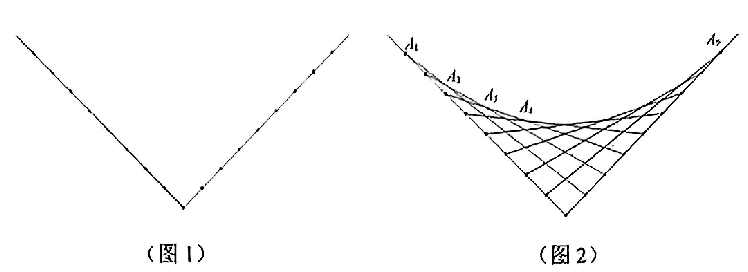

# Mathematics - 题目 942

**ID**: 273336628e0c4732b7d7054ede77fb9a
**年级**: Grade 11
**难度**: Medium-Hard
**题型**: Calculation

## 题目
“绣曲线”指的是由多条线段构成的看似曲线的图案．如：在一个角的两边各取一些点（如图1），将这些点两两连成线段（如图2），就得到由线段构成的“绣曲线” $A{{}_{1}}A{{}_{2}}A{{}_{3}}A{{}_{4}}\cdot \cdot \cdot A{{}_{9}}$ ．“绣曲线”与直线族及其包络有关，直线族是指具有某种共同性质的直线的全体．如：方程 $y=kx+1$ ，当k取定时，表示一条直线；​​​​​​​‌当k变化时，表示过点 $\left ({0,1}\right )$ 的直线（除y轴外）的直线族．直线族的包络被定义为这样一条曲线：直线族中的每一条直线都是该曲线上某点处的切线，且该曲线上每一点处的切线都是该直线族中的某条直线．已知：在直角坐标系中，点A的坐标是 $\left ({a,a}\right )$ ，点B的坐标是 $\left ({a-9,9-a}\right )$ ．当实数a变化时，动直线AB组成的直线族记为 $Γ$ ．（1）判断点 $P\left ({0,4}\right )$ 是否在 $Γ$ 中的某条直线上，并说明理由；（2）点 $C\left ({1,y{{}_{0}}}\right )$ 不在 $Γ$ 中的任意一条直线上，求 $y{{}_{0}}$ 的取值范围；（3）写出 $Γ$ 的包络的方程，并给出证明．

## 解答

1. （1）由 $A\left ({a,a}\right )$ ， $B\left ({a-9,9-a}\right )$ ，则直线 $AB$ 的斜率 $k=\frac {a-\left ({9-a}\right )}{a-\left ({a-9}\right )}=\frac {2a-9}{9}$ ，
2. 所以直线AB的方程为 $y=\frac {2a-9}{9}\left ({x-a}\right )+a$
3. 将 $P\left ({0,4}\right )$ 的坐标代入AB的方程，得到关于a的方程 $4=\frac {2a-9}{9}\left ({0-a}\right )+a$ ，
4. 即 $a{^{2}}-9a+18=0$ ，因为 ${\rm{Δ}}={\left({-9}\right)^{2}}-4\times 18=9>0$ ，所以此方程有实数解，
5. 因此点 $P\left ({0,4}\right )$ 在 $Γ$ 中的某条直线上．
6. （2）点 $C\left ({1,y{{}_{0}}}\right )$ 不在 $Γ$ 中的任意一条直线上，
7. 所以关于a的方程 $y{{}_{0}}=\frac {2a-9}{9}\left ({1-a}\right )+a$ 无实数解，即 $2a{^{2}}-20a+9\left ({1+y{{}_{0}}}\right )=0$ 无实数解．
8. 因此 ${\rm{Δ}}=400-72\left ({1+y{{}_{0}}}\right )<0$ ，解得 $y{{}_{0}}>\frac {1}{18}+\frac {9}{2}=\frac {41}{9}$ ．
9. 因此， $y{{}_{0}}$ 的取值范围是 $\left ({\frac {41}{9},+∞}\right )$ ．
10. （3） $Γ$ 的包络是抛物线 $y=\frac {x{^{2}}}{18}+\frac {9}{2}$ ．
11. 证明如下：
12. 过点 $\left ({a,a}\right )$ 和 $\left ({a-9,9-a}\right )$ 的直线的方程是 $y=\frac {2a-9}{9}\left ({x-a}\right )+a$ ，
13. 该直线与抛物线 $y=\frac {x{^{2}}}{18}+\frac {9}{2}$ 切于点 $\left ({2a-9,\frac {{\left({2a-9}\right)^{2}}}{18}+\frac {9}{2}}\right )$ ．
14. 设 $T\left ({x{{}_{1}},y{{}_{1}}}\right )$ 为抛物线 $y=\frac {x{^{2}}}{18}+\frac {9}{2}$ 上任意一点，由函数 $y=\frac {x{^{2}}}{18}+\frac {9}{2}$ 求导可得 $y^{′}=\frac {x}{9}$ ，
15. 在 $T\left ({x{{}_{1}},y{{}_{1}}}\right )$ 处的切线方程是 $y=\frac {x{{}_{1}}}{9}\left ({x-x{{}_{1}}}\right )+y{{}_{1}}$ ，
16. 将 $y{{}_{1}}=\frac {x{{}_{1}^{2}}}{18}+\frac {9}{2}$ 代入整理得， $y=\frac {x{{}_{1}}}{9}x-\frac {x{{}_{1}^{2}}}{18}+\frac {9}{2}$ ．
17. 取 $a=\frac {9+x{{}_{1}}}{2}$ ，该切线方程为 $y=\frac {2a-9}{9}x-\frac {{\left({2a-9}\right)^{2}}}{18}+\frac {9}{2}$ ，
18. 整理得 $y=\frac {2a-9}{9}\left ({x-a}\right )+a$ ，是过点 $\left ({a,a}\right )$ 和 $\left ({a-9,9-a}\right )$ 的直线．
19. 因此，抛物线 $y=\frac {x{^{2}}}{18}+\frac {9}{2}$ 是 $Γ$ 的包络．

## 知识点

**中文**:
  - 曲线与方程

**English**:
  - Curves and Equations

---
