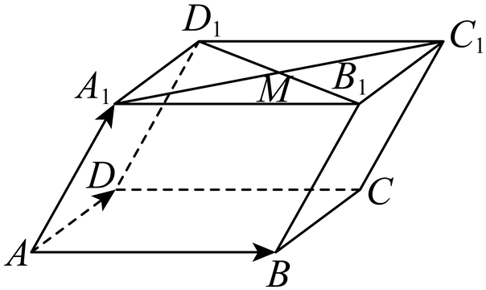

# Mathematics - 题目 1546

**ID**: 2def189c58ab49768d27048928c2aa8a
**年级**: Grade 11
**难度**: Medium-Hard
**题型**: Calculation

## 题目
如图，在平行六面体 $ABCD-A{{}_{1}}B{{}_{1}}C{{}_{1}}D{{}_{1}}$ 中，以顶点A为端点的三条棱长都是1，且它们彼此的夹角都是 $60{}\degree {\rm ，\mathit{M}}$ 为 $A{{}_{1}}C{{}_{1}}$ 与 $B{{}_{1}}D{{}_{1}}$ 的交点．若 $\overrightarrow {{AB}}=\overrightarrow a,\overrightarrow {{AD}}=\overrightarrow b,\overrightarrow {{AA{{}_{1}}}}=\overrightarrow c$ ．（1）求 ${\cos}\left \langle {\overrightarrow {{AC}},\overrightarrow {{AC{{}_{1}}}}}\right \rangle $ ；​​​​​​​‌（2）求证：直线 $A{{}_{1}}C\bot $ 平面 $BDD{{}_{1}}B{{}_{1}}$ ．

## 解答

1. （1）
2. 
3. 由题意得 $\overrightarrow {{AC}}=\overrightarrow {{AB}}+\overrightarrow {{AD}}=\overrightarrow {{a}}+\overrightarrow {{b}}$ ， $\overrightarrow {{AC{{}_{1}}}}=\overrightarrow {{AC}}+\overrightarrow {{CC{{}_{1}}}}=\overrightarrow {{a}}+\overrightarrow {{b}}+\overrightarrow {{c}}$ ，
4. 所以 $\overrightarrow {{AC}}\cdot \overrightarrow {{AC{{}_{1}}}}=\left ({\overrightarrow {{a}}+\overrightarrow {{b}}}\right )\cdot \left ({\overrightarrow {{a}}+\overrightarrow {{b}}+\overrightarrow {{c}}}\right )$
5. $=\left |{\overrightarrow {{a}}}\right |{^{2}}+2\overrightarrow {{a}}\cdot \overrightarrow {{b}}+\left |{\overrightarrow {{b}}}\right |{^{2}}+\overrightarrow {{a}}\cdot \overrightarrow {{c}}+\overrightarrow {{b}}\cdot \overrightarrow {{c}}$
6. $=1+1+1+\frac {1}{2}+\frac {1}{2}$
7. $=4$ ，
8. $\left |{\overrightarrow {{AC}}}\right |=\sqrt {\left |{\overrightarrow {{a}}}\right |+2\overrightarrow {{a}}\cdot \overrightarrow {{b}}+\left |{\overrightarrow {{b}}}\right |}=\sqrt {1+1+1}=\sqrt {3}$ ，
9. $\left |{\overrightarrow {{AC{{}_{1}}}}}\right |=\sqrt {\left |{\overrightarrow {{a}}}\right |{^{2}}+\left |{\overrightarrow {{b}}}\right |{^{2}}+\left |{\overrightarrow {{c}}}\right |{^{2}}+2\overrightarrow {{a}}\cdot \overrightarrow {{b}}+2\overrightarrow {{a}}\cdot \overrightarrow {{c}}+2\overrightarrow {{b}}\cdot \overrightarrow {{c}}}=\sqrt {1+1+1+1+1+1}=\sqrt {6}$ ，
10. 所以 ${\cos}\left \langle {\overrightarrow {{AC}},\overrightarrow {{AC{{}_{1}}}}}\right \rangle =\frac {\overrightarrow {{AC}}\cdot \overrightarrow {{AC{{}_{1}}}}}{\left |{\overrightarrow {{AC}}}\right |\left |{\overrightarrow {{AC{{}_{1}}}}}\right |}=\frac {4}{\sqrt {3}\times \sqrt {6}}=\frac {2\sqrt {2}}{3}$ .
11. （2） $\overrightarrow {{A{{}_{1}}C}}=-\overrightarrow {{AA{{}_{1}}}}+\overrightarrow {{AB}}+\overrightarrow {{AD}}=\overrightarrow {{a}}+\overrightarrow {{b}}-\overrightarrow {{c}}$ ， $\overrightarrow {{BD}}=\overrightarrow {{AD}}-\overrightarrow {{AB}}=-\overrightarrow {{a}}+\overrightarrow {{b}}$ ， $\overrightarrow {{BB{{}_{1}}}}=\overrightarrow {{AA{{}_{1}}}}=\overrightarrow {{c}}$ ，
12. 因为 $\overrightarrow {{A{{}_{1}}C}}\cdot \overrightarrow {{BD}}=\left ({\overrightarrow {{a}}+\overrightarrow {{b}}-\overrightarrow {{c}}}\right )\cdot \left ({-\overrightarrow {{a}}+\overrightarrow {{b}}}\right )=-\left |{\overrightarrow {{a}}}\right |{^{2}}+\left |{\overrightarrow {{b}}}\right |{^{2}}+\overrightarrow {{a}}\cdot \overrightarrow {{c}}-\overrightarrow {{b}}\cdot \overrightarrow {{c}}=-1+1+\frac {1}{2}-\frac {1}{2}=0$ ，
13. $\overrightarrow {{A{{}_{1}}C}}\cdot \overrightarrow {{BB{{}_{1}}}}=\left ({\overrightarrow {{a}}+\overrightarrow {{b}}-\overrightarrow {{c}}}\right )\cdot \overrightarrow {{c}}=\overrightarrow {{a}}\cdot \overrightarrow {{c}}+\overrightarrow {{b}}\cdot \overrightarrow {{c}}-\left |{\overrightarrow {{c}}}\right |{^{2}}=\frac {1}{2}+\frac {1}{2}-1=0$ ，
14. 所以 $A{{}_{1}}C\bot BD$ ， $A{{}_{1}}C\bot BB{{}_{1}}$ ，
15. 因为 $BD\cap BB{{}_{1}}=B$ ， $BD,BB{{}_{1}}\subset $ 平面 $BDD{{}_{1}}B{{}_{1}}$ ，
16. 所以 $A{{}_{1}}C\bot $ 平面 $BDD{{}_{1}}B{{}_{1}}$ .

## 知识点

**中文**:
  - 用向量证明垂直问题
  - 空间向量的数量积

**English**:
  - Proving Perpendicularity
  - Scalar Product of Spatial Vectors

---
