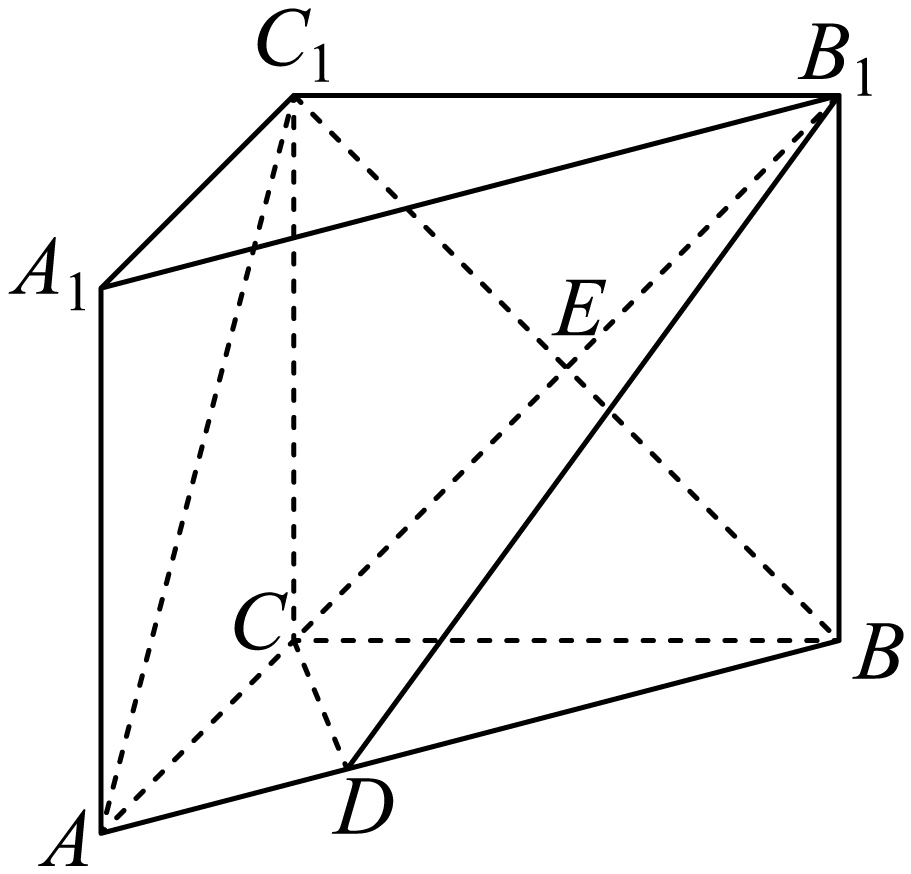

# Mathematics - 题目 2360

**ID**: 3c35cec7890d44f6bbdd90e37b381164
**年级**: Grade 11
**难度**: Medium-Hard
**题型**: Calculation

## 题目
如图，在三棱柱 $ABC-A{{}_{1}}B{{}_{1}}C{{}_{1}}$ 中， $AA{{}_{1}}\bot $ 平面 $ABC$ ， $AC=BC=AA{{}_{1}}$ ， $∠ACB=\frac {2{\rm{π}}}{3},D$ 是棱AB上的一点，且满足 $AB=3AD,BC{{}_{1}}$ 与 $B{{}_{1}}C$ 相交于点 $E$ .​​​​​​​‌（1）证明： $BC{{}_{1}}\bot $ 平面 $B{{}_{1}}CD$ ；（2）求二面角 $B-B{{}_{1}}D-C$ 的余弦值；（3）求直线 $AC{{}_{1}}$ 与平面 $B{{}_{1}}CD$ 所成的角的正弦值.

## 解答

1. （1） $BD{^{2}}={\left({\frac {2}{3}AB}\right)^{2}}=\frac {4}{9}\left ({AC{^{2}}+BC{^{2}}-2AC\cdot BC\cdot {\cos}\frac {2{\rm{π}}}{3}}\right )=\frac {4}{3}AC{^{2}}$ ，
2. $\angle CBD=\frac {{\rm{π}}-\frac {2{\rm{π}}}{3}}{2}=\frac {{\rm{π}}}{6}$ ，则 $CD{^{2}}=BD{^{2}}+BC{^{2}}-2BD\cdot BC\cdot {\cos}\frac {{\rm{π}}}{6}$
3. $=\frac {4}{3}AC{^{2}}+AC{^{2}}-\sqrt {3}\times \frac {2\sqrt {3}}{3}AC\cdot AC=\frac {1}{3}AC{^{2}}$ ，
4. 则 $CD{^{2}}+BC{^{2}}=\frac {1}{3}AC{^{2}}+AC{^{2}}=\frac {4}{3}AC{^{2}}=BD{^{2}}$ ，故 $DC\bot BC$ ，
5. 由 $AA{{}_{1}}\bot $ 平面 $ABC$ ， $AA{{}_{1}}//CC{{}_{1}}$ ，则 $CC{{}_{1}}\bot $ 平面 $ABC$ ，
6. 又 $BC\subset $ 平面 $ABC$ 、 $DC\subset $ 平面 $ABC$ ，故 $CC{{}_{1}}\bot BC$ ， $CC{{}_{1}}\bot DC$ ，
7. 又 $BC=AA{{}_{1}}$ ，则 $BC=CC{{}_{1}}$ ，故四边形 $BCC{{}_{1}}B{{}_{1}}$ 为正方形，则 $BC{{}_{1}}\bot B{{}_{1}}C$ ，
8. 又 $CC{{}_{1}}\cap CB=C$ ， $CC{{}_{1}}$ 、 $CB\subset $ 平面 $B{{}_{1}}C{{}_{1}}C$ ，故 $DC\bot $ 平面 $B{{}_{1}}C{{}_{1}}C$ ，
9. 又 $BC{{}_{1}}\subset $ 平面 $B{{}_{1}}C{{}_{1}}C$ ，故 $DC\bot BC{{}_{1}}$ ，
10. 又 $DC$ 、 $CC{{}_{1}}\subset $ 平面 $B{{}_{1}}CD$ ，且 $DC\cap CC{{}_{1}}=C$ ，故 $BC{{}_{1}}\bot $ 平面 $B{{}_{1}}CD$ ；
11. （2）过点 $C$ 作 $CF\bot B{{}_{1}}D$ 于点 $F$ ，过点 $F$ 作 $FG\bot B{{}_{1}}D$ ，交 $BD$ 于点 $G$ ，
12. 则 $\mathrm{∠}CFG$ 即为二面角 $B-B{{}_{1}}D-C$ 的平面角，
13. 
14. 由 $B{{}_{1}}D{^{2}}=CD{^{2}}+B{{}_{1}}C{^{2}}=\frac {1}{3}AC{^{2}}+2AC{^{2}}=\frac {7}{3}AC{^{2}}$ ，则 $B{{}_{1}}D=\frac {\sqrt {21}}{3}AC$ ，
15. 则 $\sin \angle CDF=\frac {CF}{CD}=\frac {CB{{}_{1}}}{DB{{}_{1}}}$ ，则有 $CF=\frac {CB{{}_{1}}}{DB{{}_{1}}}\cdot CD=\frac {\sqrt {2}AC}{\frac {\sqrt {21}}{3}AC}\cdot \frac {\sqrt {3}}{3}AC=\frac {\sqrt {14}}{7}AC$ ，
16. ${\cos}\angle CDF=\frac {DF}{CD}=\frac {CD}{DB{{}_{1}}}$ ，则有 $DF=\frac {CD{^{2}}}{DB{{}_{1}}}=\frac {\frac {1}{3}AC{^{2}}}{\frac {\sqrt {21}}{3}AC}=\frac {\sqrt {21}}{21}AC$ ，
17. ${\tan}\angle FDG=\frac {FG}{DF}=\frac {BB{{}_{1}}}{DB}$ ，则有 $FG=\frac {BB{{}_{1}}\cdot DF}{DB}=\frac {AC\cdot \frac {\sqrt {21}}{21}AC}{\frac {2\sqrt {3}}{3}AC}=\frac {\sqrt {7}}{14}AC$ ，
18. $\sin \angle FDG=\frac {FG}{DG}=\frac {BB{{}_{1}}}{DB{{}_{1}}}$ ，则有 $DG=\frac {DB{{}_{1}}\cdot FG}{BB{{}_{1}}}=\frac {\frac {\sqrt {21}}{3}AC\cdot \frac {\sqrt {7}}{14}AC}{AC}=\frac {\sqrt {3}}{6}AC$ ，
19. ${\cos}\angle CDG=\frac {CD}{BD}=\frac {\frac {\sqrt {3}}{3}AC}{\frac {2\sqrt {3}}{3}AC}=\frac {1}{2}$ ，
20. 则 $CG=\sqrt {CD{^{2}}+DG{^{2}}-2CD\cdot DG\cdot {\cos}\angle CDG}=\frac {1}{2}AC$ ，
21. 故 ${\cos}\angle CFG=\frac {CF{^{2}}+FG{^{2}}-CG{^{2}}}{2CF\cdot FG}=\frac {{\left({\frac {\sqrt {14}}{7}}\right)^{2}}+{\left({\frac {\sqrt {7}}{14}}\right)^{2}}-\frac {1}{4}}{2\times \frac {\sqrt {14}}{7}\times \frac {\sqrt {7}}{14}}=\frac {\frac {2}{7}+\frac {1}{28}-\frac {1}{4}}{\frac {\sqrt {2}}{7}}=\frac {\sqrt {2}}{4}$ ，
22. 即二面角 $B-B{{}_{1}}D-C$ 的余弦值为 $\frac {\sqrt {2}}{4}$ ；
23. （3）取线段 $C{{}_{1}}B$ 上靠近点 $C{{}_{1}}$ 的三等分点 $H$ ，连接 $DH$ ，连接 $HE$ ，
24. 由 $AB=3AD$ ，则 $AC{{}_{1}}//DH$ ，由（1）知 $BC{{}_{1}}\bot $ 平面 $B{{}_{1}}CD$ ，
25. 故 $\angle HDE$ 等于直线 $AC{{}_{1}}$ 与平面 $B{{}_{1}}CD$ 所成角，
26. 由 $DE\subset $ 平面 $B{{}_{1}}CD$ ，则 $HE\bot DE$ ，
27. $HE=\frac {1}{2}BC{{}_{1}}-\frac {1}{3}BC{{}_{1}}=\frac {1}{6}BC{{}_{1}}=\frac {\sqrt {2}}{6}AC$ ，
28. $DE=\sqrt {CD{^{2}}+CE{^{2}}}=\sqrt {\frac {1}{3}AC{^{2}}+\frac {1}{2}AC{^{2}}}=\frac {\sqrt {30}}{6}AC$ ，
29. 则 ${\tan}\angle HDE=\frac {HE}{DE}=\frac {\frac {\sqrt {2}}{6}AC}{\frac {\sqrt {30}}{6}AC}=\frac {\sqrt {15}}{15}$ ，
30. 则 $\sin \angle HDE=\sqrt {\frac {\sin {^{2}}\angle HDE}{\sin {^{2}}\angle HDE+{\cos}{^{2}}\angle HDE}}=\sqrt {\frac {{\tan}{^{2}}\angle HDE}{{\tan}{^{2}}\angle HDE+1}}=\sqrt {\frac {\frac {1}{15}}{\frac {1}{15}+1}}=\frac {1}{4}$ ，
31. 即直线 $AC{{}_{1}}$ 与平面 $B{{}_{1}}CD$ 所成的角的正弦值为 $\frac {1}{4}$ .
32. 

## 知识点

**中文**:
  - 二面角
  - 直线与平面垂直的判定
  - 直线与平面所成的角

**English**:
  - Dihedral Angle
  - Line-Plane Perpendicularity Determination
  - Line-Plane Angle

---
