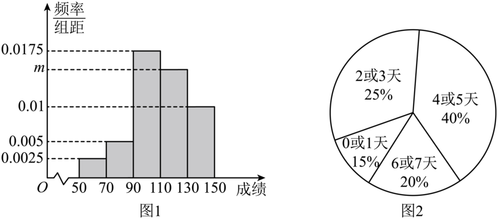

# Mathematics - 题目 1427

**ID**: 55e5040177f947f1b6f5e07b60f77ec9
**年级**: Grade 11
**难度**: Medium-Hard
**题型**: Calculation

## 题目
为了研究学生每天整理数学错题情况，某课题组在某市中学生中随机抽取了100名学生调查了他们期中考试的数学成绩和平时整理数学错题情况，并绘制了下列两个统计图表，图1为学生期中考试数学成绩的频率分布直方图，图2为学生一个星期内整理数学错题天数的扇形图．若本次数学成绩在110分及以上视为优秀，将一个星期有4天及以上整理数学错题视为“经常整理”，少于4天视为“不经常整理”．已知数学成绩优秀的学生中，经常整理错题的学生占70％．数学成绩优秀数学成绩不优秀合计经常整理不经常整理合计（1）求图1中m的值；（2）根据图1、图2中的数据，补全上方 $2\times 2$ 列联表，根据调查数据回答：在犯错误的概率不超过5％的前提下，可以认为数学成绩优秀与经常整理数学错题有关吗？（3）用频率估计概率，在全市中学生中按“经常整理错题”与“不经常整理错题”进行分层抽样，随机抽取5名学生，再从这5名学生中随机抽取2人进行座谈．这2名同学中经常整理错题且数学成绩优秀的人数X的分布列和数学期望．附： $χ{^{2}}=\frac {n(ad-bc){^{2}}}{(a+b)(c+d)(a+c)(b+d)}$ ， $n=a+b+c+d$ ．$α=P(χ{^{2}}\geqslant k)$0.​​​​​​​‌10.050.010.0050.001k2.7063.8416.6357.87910.828

## 解答

1. （1）由题意可得 $\left ({0.0025+0.005+0.0175+m+0.01}\right )\times 20=1$ ，
2. 解得 $m=0.015$ ；
3. （2）数学成绩优秀的有 $100\times 50\%=50$ 人，不优秀的人 $100\times 50\%=50$ 人，
4. 经常整理错题的有 $100\times \left ({40{\rm{\%}}+20{\rm{\%}}}\right )=60$ 人，不经常整理错题的是 $100-60=40$ 人，
5. 经常整理错题且成绩优秀的有 $50\times 70\%=35$ 人，则
6. 数学成绩优秀
7. 数学成绩不优秀
8. 合计
9. 经常整理
10. 35
11. 25
12. 60
13. 不经常整理
14. 15
15. 25
16. 40
17. 合计
18. 50
19. 50
20. 100
21. 零假设为 $H{{}_{0}}$ ：数学成绩优秀与经常整理数学错题无关，
22. 根据列联表中的数据，经计算得到可得 $χ{^{2}}=\frac {100(35\times 25-15\times 25){^{2}}}{50\times 50\times 60\times 40}=\frac {25}{6}\approx 4.167>3.841$ ，
23. 由于 $4.167>3.841$ ，所以在犯错误的概率不超过 ${\rm 5}％$ 的前提下，
24. 可以认为数学成绩优秀与经常整理数学错题有关联；
25. （3）由分层抽样知，随机抽取的5名学生中经常整理错题的有3人，
26. 不经常整理错题的有2人，则 $X$ 可能取为0，1，2，
27. 经常整理错题的3名学生中，恰抽到k人记为事件 $A{{}_{k}}\left ({k=0,1,2}\right )$ ，
28. 则 $P\left ({A{{}_{k}}}\right )=\frac {{\rm{C}}{{}_{3}^{k}}\cdot {\rm{C}}{{}_{2}^{2-k}}}{{\rm{C}}{{}_{5}^{2}}}(k=0,1,2,3)$
29. 参与座谈的2名学生中经常整理错题且数学成绩优秀的恰好抽到 $m$ 人记为事件 $B{{}_{m}}\left ({m=0,1,2}\right )$
30. 则 $P(B{{}_{0}}|A{{}_{0}})=1$ ， $P(B{{}_{0}}|A{{}_{1}})=\frac {5}{12}$ ， $P(B{{}_{0}}|A{{}_{2}})=(\frac {5}{12}){^{2}}=\frac {25}{144}$ ， $P(B{{}_{1}}|A{{}_{1}})=\frac {7}{12}$ ，
31. $P(B{{}_{1}}|A{{}_{2}})={\rm{C}}{{}_{2}^{1}}\frac {5}{12}\times \frac {7}{12}=\frac {35}{72}$ ， $P(B{{}_{2}}|A{{}_{2}})=(\frac {7}{12}){^{2}}=\frac {49}{144}$ ，
32. $P\left ({X=0}\right )=P\left ({A{{}_{0}}}\right )\cdot P(B{{}_{0}}\left |{A{{}_{0}})+P\left ({A{{}_{1}}}\right )\cdot P(B{{}_{0}}}\right |A{{}_{1}})+P\left ({A{{}_{2}}}\right )\cdot P(B{{}_{0}}|A{{}_{2}})$
33. $=\frac {{\rm{C}}{{}_{2}^{2}}}{{\rm{C}}{{}_{5}^{2}}}\times 1+\frac {{\rm{C}}{{}_{3}^{1}}{\rm{C}}{{}_{2}^{1}}}{{\rm{C}}{{}_{5}^{2}}}\times \frac {5}{12}+\frac {{\rm{C}}{{}_{3}^{2}}}{{\rm{C}}{{}_{5}^{2}}}\times \frac {25}{144}=\frac {193}{480}$ ，
34. $P\left ({X=1}\right )=P\left ({A{{}_{1}}}\right )\cdot P(B{{}_{1}}\left |{A{{}_{1}})+P\left ({A{{}_{2}}}\right )\cdot P(B{{}_{1}}}\right |A{{}_{2}})$
35. $=\frac {{\rm{C}}{{}_{3}^{1}}{\rm{C}}{{}_{2}^{1}}}{{\rm{C}}{{}_{5}^{2}}}\times \frac {7}{12}+\frac {{\rm{C}}{{}_{3}^{2}}}{{\rm{C}}{{}_{5}^{2}}}\times \frac {35}{72}=\frac {238}{480}$ ，
36. $P\left ({X=2}\right )=P\left ({A{{}_{2}}}\right )\cdot P(B{{}_{2}}|A{{}_{2}})=\frac {{\rm{C}}{{}_{3}^{2}}}{{\rm{C}}{{}_{5}^{2}}}\times \frac {49}{144}=\frac {49}{480}$ ，
37. 故X的分布列如下：
38. X
39. 0
40. 1
41. 2
42. P
43. $\frac {193}{480}$
44. $\frac {238}{480}$
45. $\frac {49}{480}$
46. 则可得X的数学期望为 $E\left ({X}\right )=0\times \frac {193}{480}+1\times \frac {238}{480}+2\times \frac {49}{480}=0.7$ ．

## 知识点

**中文**:
  - 独立性检验的应用
  - 离散型随机变量的分布列
  - 频率分布直方图
  - 百分位数

**English**:
  - Applications of Independence Test
  - Probability Distribution Table
  - Frequency Distribution Histogram
  - Percentile

---
