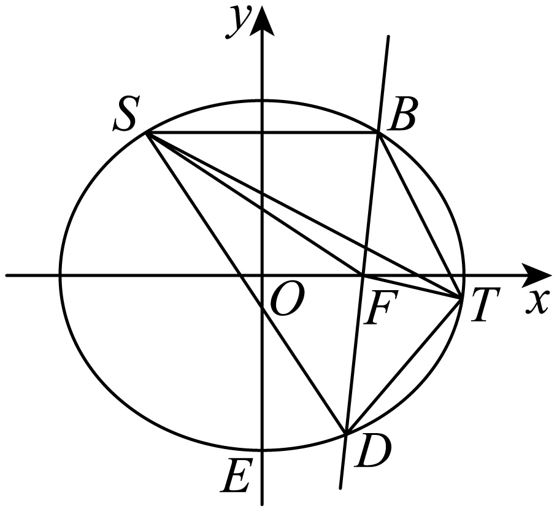

# Mathematics - 题目 2147

**ID**: 5acf75bbb03c47cca4db06c84086c14b
**年级**: Grade 11
**难度**: Medium-Hard
**题型**: Calculation

## 题目
阿波罗尼斯是古希腊著名数学家，他的主要研究成果集中在他的代表作《圆锥曲线》一书中．阿波罗尼斯圆是他的研究成果之一，指的是已知动点 $M$ 与两定点 $\mathbf{Q}$ ， $P$ 的距离之比 $\frac {\left |{MQ}\right |}{\left |{MP}\right |}=λ$ （ $λ>0$ ， $λ\ne 1$ ）， $λ$ 是一个常数，那么动点 $M$ 的轨迹就是阿波罗尼斯圆，圆心在直线 $PQ$ 上．当 $λ=\frac {\sqrt {2}}{2}$ 时，动点 $M$ 的轨迹是阿波罗尼斯圆，其方程为 $x{^{2}}+y{^{2}}=4$ ，定点分别为椭圆 $C$ ： $\frac {x{^{2}}}{a{^{2}}}+\frac {y{^{2}}}{b{^{2}}}=1$ （ $a>b>0$ ）的右焦点 $F$ 与右顶点 $A$ ，且椭圆 $C$ 的离心率为 $e=\frac {1}{2}$ ．（1）求椭圆 $C$ 的标准方程；​​​​​​​‌（2）如图，过右焦点 $F$ 斜率为 $k$ （ $k>0$ ）的直线 $l$ 与椭圆 $C$ 相交于 $B$ ， $D$ （点 $B$ 在 $x$ 轴上方），点 $\mathrm{S}$ ， $T$ 是椭圆 $C$ 上异于 $B$ ， $D$ 的两点， $SF$ 平分 $\angle BSD$ ， $TF$ 平分 $\angle BTD$ ．①求 $\frac {\left |{BS}\right |}{\left |{DS}\right |}$ 的取值范围；②将点 $\mathrm{S}$ 、 $F$ 、 $T$ 看作一个阿波罗尼斯圆上的三点，若 $\mathrm{△}SFT$ 外接圆的面积为 $\frac {81{\rm{\mathrm{π}}}}{8}$ ，求直线 $l$ 的方程．

## 解答

1. （1）设，由题意（常数），
2. 整理得： $x{^{2}}+y{^{2}}+\frac {2c-2aλ{^{2}}}{λ{^{2}}-1}x+\frac {λ{^{2}}a{^{2}}-c{^{2}}}{λ{^{2}}-1}=0$ ，
3. 故 $\begin{cases}\frac {2c-2aλ{^{2}}}{λ{^{2}}-1}=0\\\frac {λ{^{2}}a{^{2}}-c{^{2}}}{λ{^{2}}-1}=-4\end{cases}$ ，又 $\frac {c}{a}=\frac {1}{2}$ ，解得： $a=2\sqrt {2}$ ， $c=\sqrt {2}$ ，
4. ∴ $b{^{2}}=a{^{2}}-c{^{2}}=6$ ，椭圆 $C$ 的方程为 $\frac {x{^{2}}}{8}+\frac {y{^{2}}}{6}=1$ ．
5. （2）由 $\frac {S{{}_{\vartriangle SBF}}}{S{{}_{\vartriangle SDF}}}=\frac {\frac {1}{2}\left |{\left .{SB}\right |}\right .\cdot \left |{\left .{SF}\right |}\right .\cdot \sin \angle BSF}{\frac {1}{2}\left |{\left .{SD}\right |}\right .\cdot \left |{\left .{SF}\right |}\right .\cdot \sin \angle DSF}=\frac {\left |{\left .{SB}\right |}\right .}{\left |{\left .{SD}\right |}\right .}$ ，
6. 又 $\frac {S{{}_{\vartriangle SBF}}}{S{{}_{\vartriangle SDF}}}=\frac {\left |{\left .{BF}\right |}\right .}{\left |{\left .{DF}\right |}\right .}$ ，∴ $\frac {\left |{\left .{BS}\right |}\right .}{\left |{\left .{DS}\right |}\right .}=\frac {\left |{\left .{BF}\right |}\right .}{\left |{\left .{DF}\right |}\right .}$ ，
7. 令 $\frac {\left |{\left .{BF}\right |}\right .}{\left |{\left .{DF}\right |}\right .}=λ$ ，则 $\overrightarrow {{BF}}=λ\overrightarrow {{FD}}$ ，设，则有 $3x{{}_{0}^{2}}+4y{{}_{0}^{2}}=24$ ，
8. 又直线 $l$ 的斜率 $k>0$ ，则，
9. 将代入 $3x{^{2}}+4y{^{2}}-24=0$ 得：
10. ，
11. 即，
12. ∵ $λ>0$ ，∴．
13. ②由①知， $\frac {\left |{\left .{SB}\right |}\right .}{\left |{\left .{SD}\right |}\right .}=\frac {\left |{\left .{TB}\right |}\right .}{\left |{\left .{TD}\right |}\right .}=\frac {\left |{\left .{BF}\right |}\right .}{\left |{\left .{DF}\right |}\right .}$ ，由阿波罗尼斯圆定义知，
14. $\mathrm{S}$ ， $T$ ， $F$ 在以 $B$ ， $D$ 为定点得阿波罗尼斯圆上，
15. 设该圆圆心为 $C{{}_{1}}$ ，半径为 $r$ ，与直线 $l$ 的另一个交点为 $N$ ，
16. 则有 $\frac {\left |{\left .{BF}\right |}\right .}{\left |{\left .{DF}\right |}\right .}=\frac {\left |{\left .{NB}\right |}\right .}{\left |{\left .{ND}\right |}\right .}$ ，即 $\frac {\left |{\left .{BF}\right |}\right .}{\left |{\left .{DF}\right |}\right .}=\frac {2r-\left |{\left .{BF}\right |}\right .}{2r+\left |{\left .{DF}\right |}\right .}$ ，解得： $r=\frac {1}{\frac {1}{\left |{\left .{BF}\right |}\right .}-\frac {1}{\left |{\left .{DF}\right |}\right .}}$ ．
17. 又 $S{{}_{圆C{{}_{1}}}}=\mathrm{π}r{^{2}}=\frac {81}{8}\mathrm{π}$ ，故 $r=\frac {9}{2\sqrt {2}}$ ，∴ $\frac {1}{\left |{\left .{BF}\right |}\right .}-\frac {1}{\left |{\left .{DF}\right |}\right .}=\frac {2\sqrt {2}}{9}$ ，
18. 又，
19. ∴，
20. 解得： $x{{}_{0}}=-\frac {\sqrt {2}}{2}$ ， $y{{}_{0}}=-\sqrt {6-\frac {3}{4}x{{}_{0}^{2}}}=-\frac {3\sqrt {10}}{4}$ ，
21. ∴ $k=\frac {-y{{}_{0}}}{\sqrt {2}-x{{}_{0}}}=\frac {\sqrt {5}}{2}$ ，
22. ∴直线 $l$ 的方程为 $y=\frac {\sqrt {5}}{2}x-\frac {\sqrt {10}}{2}$ ．
23. 

## 知识点

**中文**:
  - 垂直平分问题
  - 由椭圆的几何性质求方程
  - 直线与椭圆的位置关系

**English**:
  - Perpendicular Bisector Problems
  - Finding Equation from Properties
  - Line-Ellipse Relationship

---
