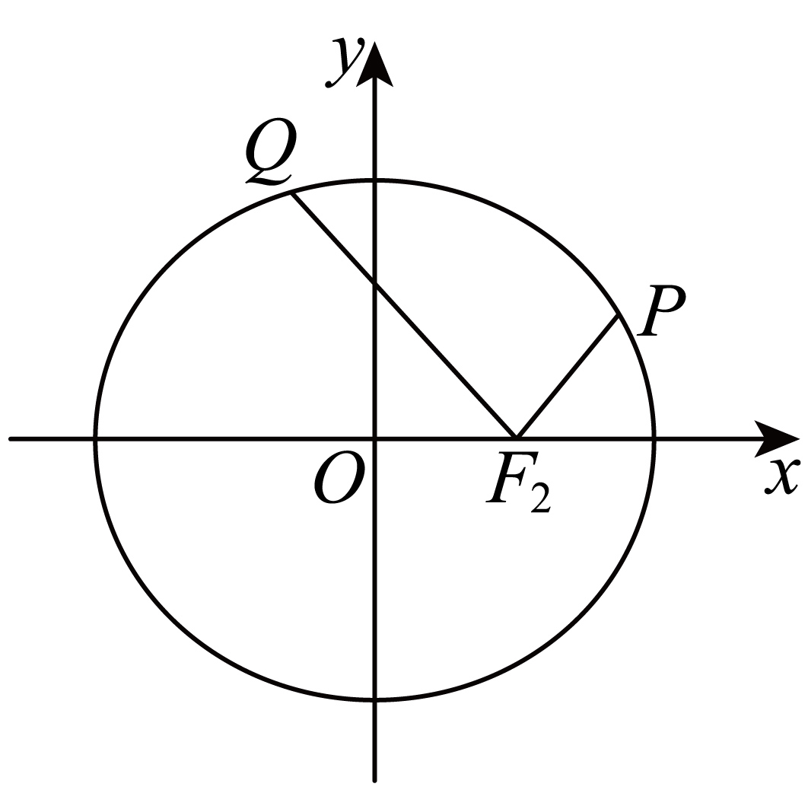

# Mathematics - 题目 3373

**ID**: 5ae595b5e70e471282ce16380e35aa08
**年级**: Grade 11
**难度**: Medium-Hard
**题型**: Calculation

## 题目
如图，从椭圆 $\frac {x{^{2}}}{4}+\frac {y{^{2}}}{3}=1$ 上一点 $P$ （异于椭圆的左、右顶点）射出的光线照射到椭圆的右焦点 $F{{}_{2}}$ 上，经 $x$ 轴反射，反射光线过椭圆上的另一点 $Q$ ．（1）写出 $F{{}_{2}}$ 的坐标；​​​​​​​‌（2）证明：直线 $PQ$ 过定点；（3） $O$ 、 $F{{}_{2}}$ 、 $P$ 、 $Q$ 四点能否共圆？请说明理由．

## 解答

1. （1）在椭圆 $\frac {x{^{2}}}{4}+\frac {y{^{2}}}{3}=1$ 中， $a=2$ ， $b=\sqrt {3}$ ，
2. 则 $c=\sqrt {a{^{2}}-b{^{2}}}=\sqrt {4-3}=1$ ，故 $F{{}_{2}}\left ({1,0}\right )$ .
3. （2）若直线 $PQ$ 的斜率不存在，则点 $P$ 、 $Q$ 重合，不合乎题意，
4. 若直线 $PQ$ 的斜率为零，则该直线与 $x$ 轴重合，与题意矛盾，
5. 故直线 $PQ$ 的斜率存在且不为零，
6. 设直线 $PQ$ 的方程为 $y=kx+m\left ({k\ne 0}\right )$ ，设点 $P\left ({x{{}_{1}},y{{}_{1}}}\right )$ 、 $Q\left ({x{{}_{2}},y{{}_{2}}}\right )$ ，
7. 由 $\begin{cases}y=kx+m\\\frac {x{^{2}}}{4}+\frac {y{^{2}}}{3}=1\end{cases}$ ，得 $\left ({3+4k{^{2}}}\right )x{^{2}}+8kmx+4\left ({m{^{2}}-3}\right )=0$ ，
8. ${\rm{Δ}}=64k{^{2}}m{^{2}}-4\left ({4k{^{2}}+3}\right )\times 4\left ({m{^{2}}-3}\right )=48\left ({4k{^{2}}+3-m{^{2}}}\right )>0$ ，
9. 由韦达定理可得 $x{{}_{1}}+x{{}_{2}}=-\frac {8km}{3+4k{^{2}}}$ ， $x{{}_{1}}x{{}_{2}}=\frac {4\left ({m{^{2}}-3}\right )}{3+4k{^{2}}}$ ．
10. 由 $k{{}_{PF{{}_{2}}}}+k{{}_{QF{{}_{2}}}}=0$ ，得 $\frac {y{{}_{1}}}{x{{}_{1}}-1}+\frac {y{{}_{2}}}{x{{}_{2}}-1}=0$ ，
11. 又 $y{{}_{i}}=kx{{}_{i}}+m\left ({i=1,2}\right )$ ，故 $\frac {kx{{}_{1}}+m}{x{{}_{1}}-1}+\frac {kx{{}_{2}}+m}{x{{}_{2}}-1}=\frac {\left ({kx{{}_{1}}+m}\right )\left ({x{{}_{2}}-1}\right )+\left ({kx{{}_{2}}+m}\right )\left ({x{{}_{1}}-1}\right )}{\left ({x{{}_{1}}-1}\right )\left ({x{{}_{2}}-1}\right )}=0$ ，
12. 即 $2kx{{}_{1}}x{{}_{2}}+\left ({m-k}\right )\left ({x{{}_{1}}+x{{}_{2}}}\right )-2m=0$ ，
13. 则 $2k\cdot \frac {4\left ({m{^{2}}-3}\right )}{3+4k{^{2}}}+\left ({m-k}\right )\left ({-\frac {8km}{3+4k{^{2}}}}\right )-2m=0$ ，
14. 化简整理得 $m=-4k$ ，于是直线 $PQ$ 的方程为 $y=k\left ({x-4}\right )$ ，
15. 因此直线 $PQ$ 过点 $\left ({4,0}\right )$ .
16. （3） $O$ 、 $F{{}_{2}}$ 、 $P$ 、 $Q$ 四点不能共圆，事实上， $F{{}_{2}}$ 总在 $△OPQ$ 的外接圆的内部．理由如下：
17. 
18. 线段 $OP$ 的垂直平分线方程为 $y=-\frac {x{{}_{1}}}{y{{}_{1}}}\left ({x-\frac {x{{}_{1}}}{2}}\right )+\frac {y{{}_{1}}}{2}=-\frac {x{{}_{1}}}{y{{}_{1}}}x+\frac {x{{}_{1}^{2}}+y{{}_{1}^{2}}}{2y{{}_{1}}}$  $=-\frac {x{{}_{1}}}{y{{}_{1}}}x+\frac {x{{}_{1}^{2}}+3\left ({1-\frac {x{{}_{1}^{2}}}{4}}\right )}{2y{{}_{1}}}$  $=-\frac {x{{}_{1}}}{y{{}_{1}}}x+\frac {\frac {x{{}_{1}^{2}}}{4}+3}{2y{{}_{1}}}$ ，即 $y=-\frac {x{{}_{1}}}{y{{}_{1}}}x+\frac {\frac {x{{}_{1}^{2}}}{4}+3}{2y{{}_{1}}}$ ．
19. 同理，线段 $OQ$ 的垂直平分线方程为 $y=-\frac {x{{}_{2}}}{y{{}_{2}}}x+\frac {\frac {x{{}_{2}^{2}}}{4}+3}{2y{{}_{2}}}$ ．
20. 联立上述两个方程，得 $△OPQ$ 的外心 $C$ 的横坐标为
21. $x{{}_{C}}=\frac {\left ({x{{}_{1}}+x{{}_{2}}}\right )-\frac {x{{}_{1}}x{{}_{2}}}{4}+3}{8}=\frac {\frac {32k{^{2}}}{3+4k{^{2}}}-\frac {1}{4}\cdot \frac {4\left ({16k{^{2}}-3}\right )}{3+4k{^{2}}}+3}{8}=\frac {1}{2}\cdot \frac {3+7k{^{2}}}{3+4k{^{2}}}$ ．
22. 因 $k{^{2}}>0$ ，故 $x{{}_{C}}=\frac {1}{2}\cdot \frac {3+7k{^{2}}}{3+4k{^{2}}}>\frac {1}{2}$ ，
23. 所以 $\left |{F{{}_{2}}C}\right |{^{2}}-\left |{OC}\right |{^{2}}={\left({x{{}_{C}}-1}\right)^{2}}+y{{}_{C}^{2}}-\left ({x{{}_{C}^{2}}+y{{}_{C}^{2}}}\right )=1-2x{{}_{C}}<0$ ，于是 $\left |{F{{}_{2}}C}\right |<\left |{OC}\right |$ ，
24. 所以 $F{{}_{2}}$ 在 $△OPQ$ 的外接圆的内部，故 $O$ 、 $F{{}_{2}}$ 、 $P$ 、 $Q$ 四点不能共圆.

## 知识点

**中文**:
  - 定点定值定直线问题
  - 椭圆的标准方程及应用
  - 直线与椭圆的位置关系

**English**:
  - Fixed Point, Value, Line Problems
  - Standard Equation and Applications
  - Line-Ellipse Relationship

---
