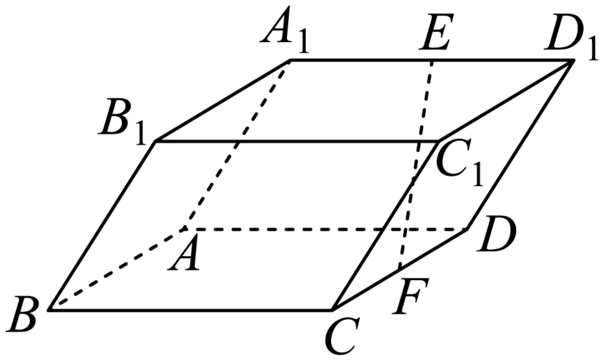

# Mathematics - 题目 168

**ID**: 63a54cef46614b3f914d3200f10d403b
**年级**: Grade 11
**难度**: Medium-Hard
**题型**: Calculation

## 题目
如图，在平行六面体 $ABCD-A{{}_{1}}B{{}_{1}}C{{}_{1}}D{{}_{1}}$ 中， $E，F$ 分别为棱 $A{{}_{1}}D{{}_{1}}，CD$ 的中点，记 $\overrightarrow {{BC}}$  $=\overrightarrow a，\overrightarrow {{BA}}=\overrightarrow b，\overrightarrow {{BB{{}_{1}}}}=\overrightarrow c$ ，满足 $\angle B{{}_{1}}BC=\angle B{{}_{1}}BA=\frac {{\rm{π}}}{3}，\angle CBA=\frac {{\rm{π}}}{2}，\left |{AB}\right |=\left |{BC}\right |=2$ ， $\left |{BB{{}_{1}}}\right |=3$ ．（1）求 $BD{{}_{1}}$ 的长度；​​​​​​​‌（2）求 $AC$ 与 $EF$ 夹角的余弦值．

## 解答

1. （1）因 $\overrightarrow {{BC}}=\overrightarrow a，\overrightarrow {{BA}}=\overrightarrow b，\overrightarrow {{BB{{}_{1}}}}=\overrightarrow c,$
2. 则 $<\overrightarrow {{a}},\overrightarrow {{b}}>=\frac {{\rm{π}}}{2},<\overrightarrow {{b}},\overrightarrow {{c}}>=<\overrightarrow {{a}},\overrightarrow {{c}}>=\frac {{\rm{π}}}{3}$ ， $\left |{\overrightarrow a}\right |=\left |{\overrightarrow b}\right |=2,\left |{\overrightarrow c}\right |=3$ ，
3. 于是 $\overrightarrow {{a}}\cdot \overrightarrow {{b}}=0,\overrightarrow {{b}}\cdot \overrightarrow {{c}}=\overrightarrow {{a}}\cdot \overrightarrow {{c}}=2\times 3\times {\cos}\frac {{\rm{π}}}{3}=3$ .
4. 又 $\overrightarrow {{BD{{}_{1}}}}=\overrightarrow {{BA}}+\overrightarrow {{BC}}+\overrightarrow {{BB{{}_{1}}}}=\overrightarrow a+\overrightarrow b+\overrightarrow c$ ，
5. 则 $\overrightarrow {{BD{{}_{1}}}}{^{2}}=(\overrightarrow a+\overrightarrow b+\overrightarrow c){^{2}}=\overrightarrow a{^{2}}+\overrightarrow b{^{2}}+\overrightarrow c{^{2}}+2(\overrightarrow {{a}}\cdot \overrightarrow {{b}}+\overrightarrow {{b}}\cdot \overrightarrow {{c}}+\overrightarrow {{a}}\cdot \overrightarrow {{c}})=4+4+9+2(3+3)=29$ ，
6. 故 $|\overrightarrow {{BD{{}_{1}}}}|=\sqrt {29}$ .
7. （2）因为 $\overrightarrow {{EF}}=\overrightarrow {{ED{{}_{1}}}}+\overrightarrow {{D{{}_{1}}D}}+\overrightarrow {{DF}}=\frac {1}{2}\overrightarrow {{BC}}-\overrightarrow {{BB{{}_{1}}}}-\frac {1}{2}\overrightarrow {{BA}}+=\frac {1}{2}\overrightarrow a-\frac {1}{2}\overrightarrow b-\overrightarrow c$ ，
8. 则 $|\overrightarrow {{EF}}|{^{2}}=(\frac {1}{2}\overrightarrow a-\frac {1}{2}\overrightarrow b-\overrightarrow c){^{2}}=\frac {1}{4}\overrightarrow a{^{2}}+\frac {1}{4}\overrightarrow b{^{2}}+\overrightarrow c{^{2}}-\frac {1}{2}\overrightarrow {{a}}\cdot \overrightarrow {{b}}+\overrightarrow {{b}}\cdot \overrightarrow {{c}}-\overrightarrow {{a}}\cdot \overrightarrow {{c}}=1+1+9=11$ ，
9. 故 $|\overrightarrow {{EF}}|=\sqrt {11}$ ，
10. 又 $\overrightarrow {{AC}}=\overrightarrow {{BC}}-\overrightarrow {{BA}}=\overrightarrow a-\overrightarrow b，$ 则 $|\overrightarrow {{AC}}|{^{2}}=(\overrightarrow a-\overrightarrow b){^{2}}=\overrightarrow a{^{2}}+\overrightarrow b{^{2}}-2\overrightarrow {{a}}\cdot \overrightarrow {{b}}=8$ ，故 $|\overrightarrow {{AC}}|=2\sqrt {2}$ ，
11. 则 $\overrightarrow {{AC}}\cdot \overrightarrow {{EF}}=(\overrightarrow a-\overrightarrow b)\cdot (\frac {1}{2}\overrightarrow a-\frac {1}{2}\overrightarrow b-\overrightarrow c)=\frac {1}{2}\overrightarrow a{^{2}}+\frac {1}{2}\overrightarrow b{^{2}}-\overrightarrow {{a}}\cdot \overrightarrow {{b}}+\overrightarrow {{b}}\cdot \overrightarrow {{c}}-\overrightarrow {{a}}\cdot \overrightarrow {{c}}=2+2+3-3=4$ ，
12. 则 ${\cos}\langle \overrightarrow {{AC}},\overrightarrow {{EF}}\rangle =\frac {\overrightarrow {{AC}}\cdot \overrightarrow {{EF}}}{|\overrightarrow {{AC}}|\cdot |\overrightarrow {{EF}}|}=\frac {4}{2\sqrt {2}\times \sqrt {11}}=\frac {\sqrt {22}}{11}>0$ ，
13. 故 $AC$ 与 $EF$ 夹角的余弦值为 $\frac {\sqrt {22}}{11}$ ．

## 知识点

**中文**:
  - 空间向量的数量积

**English**:
  - Scalar Product of Spatial Vectors

---
