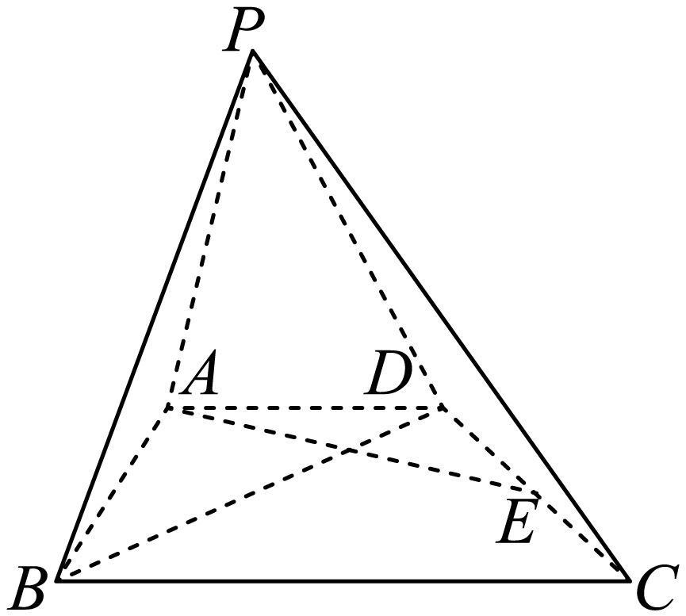

# Mathematics - 题目 3755

**ID**: 7e8bfe875a5946729925ae33e8fcb427
**年级**: Grade 11
**难度**: Medium-Hard
**题型**: Calculation

## 题目
已知四棱锥 $P-ABCD$ 的底面 $ABCD$ 是直角梯形， $AD//BC$ ， $AB\bot BC$ ， $BC=2AD=4$ ， $AB=2\sqrt {3}{\rm ，\mathit{E}}$ 为 $CD$ 的中点， $PB\bot AE$ .​​​​​​​‌(1)证明：平面 $PBD\bot $ 平面 $ABCD$ ；(2)若 $PB=PD$ ， $PC$ 与平面 $ABCD$ 所成的角为 $\frac {{\rm{π}}}{4}$ ，${\rm （I）}$ 求三棱锥 $P-BDC$ 的体积；${\rm （II）}$ 试问在侧面 $PCD$ 内是否存在一点 $N$ ，使得 $BN\bot $ 平面 $PCD$ ?若存在，求出点 $N$ 到直线 $PC$ 的距离；若不存在，请说明理由.

## 解答

1. （1）由四边形 $ABCD$ 是直角梯形， $AB=2\sqrt {3}$ ， $BC=2AD=4$ ， $AB\bot BC$
2. 可得 $DC=4$ ， $\angle BCD=\frac {{\rm{π}}}{3}$ ，从而 $\mathrm{△}BCD$ 是等边三角形，
3. $BD=4{\rm ，\mathit{BD}}$ 平分 $∠ADC$ .∵E为 $CD$ 的中点， $\therefore DE=AD=2$ ， $\therefore BD\bot AE$ ，
4. 又 $\because PB\bot AE$ ， $PB\cap BD=B$ ， $BD\subset $ 平面 $PBD$ ， $PB\subset $ 平面 $PBD$
5. $\therefore AE\bot $ 平面 $PBD$ ， $AE\subset $ 平面 $ABCD$ ，所以平面 $PBD\bot $ 平面 $ABCD$ .
6. （2）（I）在平面 $PBD$ 内作 $PO\bot BD$ 于 $O$ ，连接 $OC$ ，由（1）有 $AE\bot $ 平面 $PBD$ ，
7. 又 $\because AE\subset $ 平面 $ABCD$ ，∴平面 $PBD\bot $ 平面 $ABCD$ .
8. 因为平面 $PBD\cap $ 平面 $ABCD=BD$ ， $PO\subset $ 平面 $PBD$ ， $\therefore PO\bot $ 平面 $ABCD$
9. $\therefore \angle PCO$ 为 $PC$ 与平面 $ABCD$ 所成的角，则 $\angle PCO=\frac {{\rm{π}}}{4}$ ，
10. $\therefore $ 由题意得 $OP=OC=2\sqrt {3}$ ， $\because PB=PD$ ， $PO\bot BD$ ， $\therefore O$ 为 $BD$ 的中点，
11. $\therefore OC\bot BD$ .又 $BD=\sqrt {BA{^{2}}+AD{^{2}}}=\sqrt {12+4}=4$ ，
12. 所以三棱锥P-BDC的体积为 $V=\frac {1}{3}\cdot \frac {1}{2}BD\cdot OC\cdot PO=\frac {1}{6}\times 4\times 2\sqrt {3}\times 2\sqrt {3}=8$ ；
13. ${\rm （II）}$ 方法一：（向量法）以OB，OC，OP所在的直线分别为x，y，z轴建立空间直角坐标
14. 系，
15. 
16. 则 $B\left ({2,0,0}\right )$ ， $C\left ({0,2\sqrt {3},0}\right )$ ， $D\left ({-2,0,0}\right )$ ， $P\left ({0,0,2\sqrt {3}}\right )$ ，
17. 假设在侧面 $PCD$ 内存在点 $N$ ，使得 $BN\bot $ 平面 $PCD$ 成立，
18. 设 $\overrightarrow {{PN}}=λ\overrightarrow {{PD}}+μ\overrightarrow {{PC}}\left ({λ,μ\geqslant 0,λ+μ\leqslant 1}\right )$ ，
19. 由题意得 $N\left ({-2λ,2\sqrt {3}μ,-2\sqrt {3}\left ({λ+μ-1}\right )}\right )$ ，
20. $\overrightarrow {{BN}}=\left ({-2λ-2,2\sqrt {3}μ,-2\sqrt {3}\left ({λ+μ-1}\right )}\right )$ ， $\overrightarrow {{PC}}=\left ({0,2\sqrt {3},-2\sqrt {3}}\right )$ ，
21. $\overrightarrow {{PD}}=\left ({-2,0,-2\sqrt {3}}\right )$ ，由 $\begin{cases}\overrightarrow {{BN}}\cdot \overrightarrow {{PC}}=0\\\overrightarrow {{BN}}\cdot \overrightarrow {{PD}}=0\end{cases}$ ，得 $\begin{cases}3μ+3\left ({λ+μ-1}\right )=0\\λ+1+3\left ({λ+μ-1}\right )=0\end{cases}$ ，
22. 解得 $λ=\frac {1}{5}$ ， $μ=\frac {2}{5}$ ，
23. 满足题意， $\therefore N\left ({-\frac {2}{5},\frac {4\sqrt {3}}{5},\frac {4\sqrt {3}}{5}}\right )$ ，点N存在.
24. $\overrightarrow {{PC}}=\left ({0,2\sqrt {3},-2\sqrt {3}}\right )$ ， $P\left ({0,0,2\sqrt {3}}\right )$ ， $\overrightarrow {{NP}}=\left ({\frac {2}{5},-\frac {4\sqrt {3}}{5},\frac {6\sqrt {3}}{5}}\right )$ ，
25. 所以 $\left |{\overrightarrow {{NP}}}\right |=\frac {4}{5}\sqrt {10}$ ， $\left |{\overrightarrow {{PC}}}\right |=2\sqrt {6}$ ， $\overrightarrow {{NP}}\cdot \overrightarrow {{PC}}=3\times 4=12$ ，
26. 所以点 $N$ 到直线PC的距离 $d=\left |{\overrightarrow {{NP}}}\right |\cdot {\rm{s}}{\rm{i}}{\rm{n}}θ=\left |{\overrightarrow {{NP}}}\right |\sqrt {1-{\left({\frac {\overrightarrow {{NP}}\cdot \overrightarrow {{PC}}}{\left |{\overrightarrow {{NP}}}\right |\cdot \left |{\overrightarrow {{PC}}}\right |}}\right)^{2}}}=\frac {\sqrt {10}}{5}$
27. 方法二：（传统方法）由条件可知， $BP=BD=BC=2$ ，
28. 且三角形 $PDC$ 为 $PD=DC=4$ ， $PC=2\sqrt {6}$ 的等腰锐角三角形，
29. 所以点B在三角形 $PDC$ 内的射影N为等腰锐角三角形 $PDC$ 的外心，
30. 所以点N必在侧面PCD的内部.
31. 
32. 由 ${\rm （I）}$ 知三棱锥 $P-BDC$ 的体积为 $V=8$ ， $S{{}_{\vartriangle PDC}}=\frac {1}{2}\times 2\sqrt {6}\times \sqrt {4{^{2}}-{\left({\sqrt {6}}\right)^{2}}}=2\sqrt {15}$ ，
33. 由体积转化可得 $V{{}_{P-BDC}}=\frac {1}{3}\times S{{}_{\vartriangle PDC}}\times BN=8$ ， $\therefore BN=\frac {4\sqrt {15}}{5}$ ，
34. 在直角 $\mathrm{△}BPN$ 中，由勾股定理可得 $PN=\sqrt {BP{^{2}}-BN{^{2}}}=\frac {4\sqrt {10}}{5}$ ，
35. E为PC的中点， $PE=\sqrt {6}$
36. 所以点 $N$ 到直线PC的距离 $d=NE=\sqrt {\frac {4\sqrt {10}{^{2}}}{5}-{\left({\sqrt {6}}\right)^{2}}}=\frac {\sqrt {10}}{5}$

## 知识点

**中文**:
  - 向量法求距离-点线距离
  - 棱柱、棱锥、棱台的体积
  - 平面与平面垂直的判定

**English**:
  - Point-Line Distance
  - Volume of Polyhedra
  - Plane-Plane Perpendicularity Determination

---
