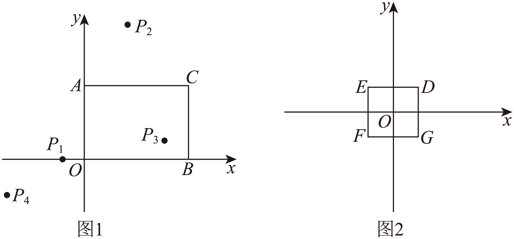

# Mathematics - 题目 2357

**ID**: 7f0ed0cfddf34e02ba993f9c04536661
**年级**: Grade 11
**难度**: Medium-Hard
**题型**: Calculation

## 题目
在平面直角坐标系 $xOy$ 中，图形 $W$ 上任意两点间的距离若有最大值，将这个最大值记为 $d.​​​​​​​‌$ 对于点 $P$ 和图形 $W$ 给出如下定义：点 $Q$ 是图形 $W$ 上任意一点，若 $P$ ， $Q$ 两点间的距离有最小值，且最小值恰好为 $d$ ，则称点 $P$ 为图形 $W$ 的“关联点”.（1）如图1，图形 $W$ 是矩形 $AOBC$ ，其中点 $A$ 的坐标为 $\left ({0,3}\right )$ ，点 $C$ 的坐标为 $\left ({4,3}\right )$ ，求出 $d$ 的值.在点 $P{{}_{1}}\left ({-1,0}\right )$ ， $P{{}_{2}}\left ({2,8}\right )$ ， $P{{}_{3}}\left ({3,1}\right )$ ， $P{{}_{4}}\left ({-\sqrt {21},-2}\right )$ 中，哪些点为矩形 $AOBC$ 的“关联点”？（2）如图2，图形 $W$ 是中心在原点的正方形 $DEFG$ ，其中点 $D$ 的坐标为 $\left ({1,1}\right ).$ 若直线 $y=x+b$ 上存在点 $P$ ，使点 $P$ 为正方形 $DEFG$ 的“关联点”，求 $b$ 的取值范围；（3）已知点 $M\left ({1,0}\right )$ ， $N\left ({0,\sqrt {3}}\right ).$ 图形 $W$ 是以 $T\left ({t,0}\right )$ 为圆心，1为半径的 $\odot T.$ 若线段 $MN$ 上存在点 $P$ ，使点 $P$ 为 $\odot T$ 的“关联点”，求 $t$ 的取值范围.

## 解答

1. （1）如图1，图形 $W$ 是矩形 $AOBC$ ，其中点 $A$ 的坐标为 $\left ({0,3}\right )$ ，点 $C$ 的坐标为 $\left ({4,3}\right )$ ，
2. 矩形 $AOBC$ 的对角线长为 $\sqrt {3{^{2}}+4{^{2}}}=5$ ，这也是矩形中任意两点距离的最大值，所以 $d=5$ ，
3. 对 $P{{}_{1}}\left ({-1,0}\right )$ ，矩形 $AOBC$ 中的点 $O\left ({0,0}\right )$ 到它的距离最小为1，不满足关联点的定义，
4. 不是关联点；
5. 对 $P{{}_{2}}\left ({2,8}\right )$ ，矩形 $AOBC$ 中的点到它的距离最小为 $8-3=5=d$ ，满足关联点的定义，是关联点；
6. 对 $P{{}_{3}}\left ({3,1}\right )$ ，矩形 $AOBC$ 中的点到它的距离最小为1，不满足关联点的定义，不是关联点；
7. 对 $P{{}_{4}}\left ({-\sqrt {21}\,,\,-2}\right )$ ，矩形 $AOBC$ 中的点 $O\left ({0,0}\right )$ 到它的距离最小为 $\sqrt {21+4}=5=d$ ，
8. 满足关联点的定义，是关联点；因此 $P{{}_{2}}$ ， $P{{}_{4}}$ 是关联点.
9. 
10. （2）如图2，图形 $W$ 是中心在原点的正方形 $DEFG$ ，其中点 $D$ 的坐标为 $\left ({1,1}\right )$ .
11. 若直线 $y=x+b$ 上存在点 $P$ ，使点 $P$ 为正方形 $DEFG$ 的“关联点”，
12. 可知正方形的边长为2，对角线长为 $2\sqrt {2}$ ，因此正方形 $DEFG$ 中， $d=2\sqrt {2}$ ，
13. 直线 $y=x+b$ 与对角线 $DF$ 平行，
14. 由已知 $E\left ({-1,1}\right )$ ， $F\left ({-1,-1}\right )$ ， $G\left ({1,-1}\right )$ ，设 $P\left ({x,y}\right )$ ，
15. 当 $-1\leqslant x\leqslant 1$ 时， $y=1+2\sqrt {2}$ 或 $y=-1-2\sqrt {2}$ 时，
16. $P$ 到正方形 $DEFG$ 上点的距离的最小值为 $2\sqrt {2}$ ，满足关联点的定义，为关联点；
17. 当 $-1\leqslant y\leqslant 1$ 时， $x=1+2\sqrt {2}$ 或 $x=-1-2\sqrt {2}$ 时，
18. $P$ 到正方形 $DEFG$ 上点的距离的最小值为 $2\sqrt {2}$ ，为关联点；
19. 当 $\left |{x}\right |>1$ 且 $\left |{y}\right |>1$ 时，如果 $P$ 在第一象限，
20. 则 $P$ 到正方形 $DEFG$ 上点的距离的最小值为 $\left |{PD}\right |=2\sqrt {2}$ ，
21. 因此有 $(x-1){^{2}}+(y-1){^{2}}=8$ ，
22. 即 $P$ 在圆 $(x-1){^{2}}+(y-1){^{2}}=8$ 的一段弧上 $(x>1,y>1)$ .
23. 同理点 $P$ 还在下列三段圆弧上：
24. $(x+1){^{2}}+(y-1){^{2}}=8\left ({x\left \langle {-1,y}\right \rangle 1}\right )$ ， $(x+1){^{2}}+(y+1){^{2}}=8(x<-1,y<-1)$ ，
25. $(x-1){^{2}}+(y+1){^{2}}=8(x>1,y<-1)$ ；
26. 直线 $y=x+b$ 与正方形的一条对角线 $DF$ 平行，
27. 直线 $y=x+b$ 与图中正方形 $DEFG$ 外围的图形（四段线段与四段圆弧组成）的公共点即为关联点；
28. 当直线 $y=x+b$ 与第二象限的一段圆弧相切时， $\frac {\left |{-1-1+b}\right |}{\sqrt {2}}=2\sqrt {2}$ ， $b=6$ （ $-2$ 舍去）；
29. 同理当直线 $y=x+b$ 与第四象限的一段圆弧相切时， $b=-6$ ；
30. 所以 $b$ 的取值范围是 $\left [-6,6\right ]$ .
31. 
32. （3）由题线段 $MN$ 所在直线方程为 $y=\frac {\sqrt {3}-0}{0-1}\left ({x-1}\right )$ ，即 $\sqrt {3}x+y-\sqrt {3}=0$ ，
33. 圆 $T$ 半径为 $1$ ，因此 $d=2$ ，
34. 点 $P$ 到圆 $T$ 上点的距离的最小值为2，则 $\left |{PT}\right |=2+1=3$ ，
35. 当 $t<0$ 时，令点 $T$ 到线段 $MN$ 所在直线距离为 $\frac {\left |{\sqrt {3}t-\sqrt {3}}\right |}{2}=3\Rightarrow t=1-2\sqrt {3}$ ，
36. 此时 $T(1-2\sqrt {3},0)$ ，
37. 令 $1-t=3\Rightarrow t=-2$ ， $T(-2,0)$ ； $\therefore $ 当 $1-2\sqrt {3}\leqslant t\leqslant -2$ 时，线段 $MN$ 上存在点 $P$ ，使点 $P$ 为 $\odot T$ 的“关联点”.
38. 当 $t>0$ 时，令 $\left |{NT}\right |-1=2\Rightarrow \sqrt {t{^{2}}+3}=3\Rightarrow t=\sqrt {6}$ ， $T(\sqrt {6},0)$ ，
39. 令 $\left |{MT}\right |=3\Rightarrow t-1=3\Rightarrow t=4$ ， $T(4,0)$ ，
40. $\therefore $ 当 $\sqrt {6}\leqslant t\leqslant 4$ 时，线段 $MN$ 上存在点 $P$ ，使点 $P$ 为 $\odot T$ 的“关联点”.
41. 如图：
42. 
43. 综上可知， $t$ 的取值范围是 $\left [1-2\sqrt {3},-2\left ]{\cup }\right [\sqrt {6},4\right ]$ .

## 知识点

**中文**:
  - 与直线有关的新定义问题

**English**:
  - New Definition Problems

---
