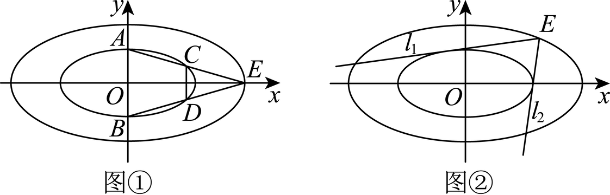

# Mathematics - 题目 1527

**ID**: 877acb0071a74ad8ab6bac415ba5215d
**年级**: Grade 11
**难度**: Medium-Hard
**题型**: Calculation

## 题目
已知椭圆 $Γ:\frac {x{^{2}}}{a{^{2}}}+\frac {y{^{2}}}{b{^{2}}}=1\left ({a>b>0}\right )$ 的离心率为 $\frac {\sqrt {3}}{2}$ ，过原点的直线 $l$ 交椭圆于 $\mathrm{A}$ 、 $B$ 两点，且 $\left |{AB}\right |$ 的最大值为 $4$ ．（1）求椭圆 $Γ$ 的方程；​​​​​​​‌（2）若点 $E$ 在椭圆 $Γ^{′}:\frac {x{^{2}}}{12}+\frac {y{^{2}}}{3}=1$ 上．（ⅰ）如图①，当 $\mathrm{A}$ 、 $B$ 是 $Γ$ 短轴端点， $E$ 为 $Γ^{′}$ 右顶点时， $AE$ 、 $BE$ 交 $Γ$ 于 $C$ 、 $D$ ，求 $\left |{CD}\right |$ 的长度；（ⅱ）如图②，过 $E\left ({x{{}_{0}},y{{}_{0}}}\right )$ 作 $Γ$ 两条切线 $l{{}_{1}}$ 、 $l{{}_{2}}$ ，若其斜率之积为 $1$ ，求 $x{{}_{0}^{2}}$ 的值．

## 解答

1. （1）由题意可得 $\begin{cases}2a=4\\\frac {c}{a}=\frac {\sqrt {3}}{2}\\a{^{2}}=b{^{2}}+c{^{2}}\end{cases}$ ，解得 $\begin{cases}a=2\\b=1\\c=\sqrt {3}\end{cases}$ ，故椭圆 $Γ$ 的方程为 $\frac {x{^{2}}}{4}+y{^{2}}=1$ .
2. （2）（i）由题意知 $A\left ({0,1}\right )$ 、 $B\left ({0,-1}\right )$ 、 $E\left ({2\sqrt {3},0}\right )$ ， $k{{}_{AE}}=-\frac {1}{2\sqrt {3}}$ ，
3. 所以直线 $AE$ 的方程为 $y=-\frac {1}{2\sqrt {3}}x+1$ ，
4. 联立 $\begin{cases}y=-\frac {1}{2\sqrt {3}}x+1\\x{^{2}}+4y{^{2}}=4\end{cases}$ 得 $x{^{2}}-\sqrt {3}x=0$ ，解得 $x=\sqrt {3}$ 或 $x=0$ ，即 $C\left ({\sqrt {3},\frac {1}{2}}\right )$ ，同理 $D\left ({\sqrt {3},-\frac {1}{2}}\right )$ ，
5. 故 $\left |{CD}\right |=1$ ；
6. ${\rm （ii）}$ 由题意可知，过点 $E\left ({x{{}_{0}},y{{}_{0}}}\right )$ 的椭圆 $Γ$ 切线的斜率存在，
7. 设过点 $E\left ({x{{}_{0}},y{{}_{0}}}\right )$ 的椭圆 $Γ$ 切线方程为 $y-y{{}_{0}}=k\left ({x-x{{}_{0}}}\right )$ ，即 $y=kx+\left ({y{{}_{0}}-kx{{}_{0}}}\right )$ ，
8. 联立 $\begin{cases}y=kx+\left ({y{{}_{0}}-kx{{}_{0}}}\right )\\x{^{2}}+4y{^{2}}=4\end{cases}$ ，可得 $\left ({1+4k{^{2}}}\right )x{^{2}}+8k\left ({y{{}_{0}}-kx{{}_{0}}}\right )x+4{\left({y{{}_{0}}-kx{{}_{0}}}\right)^{2}}-4=0$ ，
9. 则 $Δ=\left [8k\left ({y{{}_{0}}-kx{{}_{0}}}\right )\right ]{^{2}}-4\left ({1+4k{^{2}}}\right )\left [4{\left({y{{}_{0}}-kx{{}_{0}}}\right)^{2}}-4\right ]=0$ ，
10. 整理得 $\left ({x{{}_{0}^{2}}-4}\right )k{^{2}}-2x{{}_{0}}y{{}_{0}}k+y{{}_{0}^{2}}-1=0$ ，
11. 设两切线 $l{{}_{1}}$ 、 $l{{}_{2}}$ 的斜率分别为 $k{{}_{1}}$ 、 $k{{}_{2}}$ ，则 $k{{}_{1}}$ 、 $k{{}_{2}}$ 为关于 $k$ 的方程 $\left ({x{{}_{0}^{2}}-4}\right )k{^{2}}-2x{{}_{0}}y{{}_{0}}k+y{{}_{0}^{2}}-1=0$ 的两根，
12. 所以 $k{{}_{1}}k{{}_{2}}=\frac {y{{}_{0}^{2}}-1}{x{{}_{0}^{2}}-4}=1$ ，整理得 $y{{}_{0}^{2}}=x{{}_{0}^{2}}-3$ ，
13. 由 $\begin{cases}y{{}_{0}^{2}}=x{{}_{0}^{2}}-3\\\frac {x{{}_{0}^{2}}}{12}+\frac {y{{}_{0}^{2}}}{3}=1\end{cases}$ ，解得 $x{{}_{0}^{2}}=\frac {24}{5}$ .

## 知识点

**中文**:
  - 椭圆的标准方程及应用
  - 直线与椭圆的位置关系

**English**:
  - Standard Equation and Applications
  - Line-Ellipse Relationship

---
