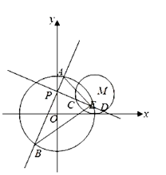

# Mathematics - 题目 3688

**ID**: 8952b4c5c10945b48eca9ce9e838c835
**年级**: Grade 11
**难度**: Medium-Hard
**题型**: Calculation

## 题目
在平面直角坐标系 $xOy$ 中，过点 $P(0,1)$ 且互相垂直的两条直线分别与圆 $O$ ： $x{^{2}}+y{^{2}}=4$ 交于点 $A$ ， $B$ ，与圆 $M$ ： $(x-2){^{2}}+(y-1){^{2}}=1$ 交于点 $C$ ， $D$ ．（1）若 $AB=\frac {3}{2}\sqrt {7}$ ，求 $CD$ 的长；​​​​​​​‌（2）若 $CD$ 中点为 $E$ ，求 $\Delta ABE$ 面积的取值范围．

## 解答

1. 解：（1）因为AB＝ $\frac {3}{2}\sqrt {7}$ ，圆O半径为2
2. 所以点O到直线AB的距离为 $\frac {1}{4}$
3. 显然AB、CD都不平行于坐标轴
4. 可设AB： ${\rm{y}}={\rm{k}}{\rm{x}}+1$ ，即 ${\rm{k}}{\rm{x}}-{\rm{y}}+1=0$
5. 则点O到直线AB的距离 ${\rm{d}}=\frac {1}{\sqrt {k{^{2}}+1}}=\frac {1}{4}$ ，解得 ${\rm{k}}=\pm \sqrt {15}$
6. 因为AB⊥CD，所以 ${\rm{k}}{{}_{CD}}=-\frac {1}{k}$
7. 所以CD： ${\rm{y}}=-\frac {1}{k}{\rm{x}}+1$ ，即 ${\rm{x}}+{\rm{k}}{\rm{y}}-{\rm{k}}=0$
8. 点M（2,1）到直线CD的距离 ${\rm{d}}^{′}=\frac {2}{\sqrt {k{^{2}}+1}}=\frac {1}{2}$
9. 所以 ${\rm{C}}{\rm{D}}=2\sqrt {1-d^{′}{^{2}}}=2\sqrt {1-{\left({\frac {1}{2}}\right)^{2}}}=\sqrt {3}$
10. （2）当AB⊥x轴，CD∥x轴时，此时AB=4，点E与点M重合，PM=2，所以△ABE的面积S=4
11. 当AB∥x轴，CD⊥x轴时，显然不存在，舍
12. 当AB与CD都不平行于坐标轴时
13. 由（1）知 ${\rm{A}}{\rm{B}}=2\sqrt {4-d{^{2}}}=2\sqrt {4-{\left({\frac {1}{\sqrt {k{^{2}}+1}}}\right)^{2}}}=2\sqrt {4-\frac {1}{k{^{2}}+1}}$
14. 因为 ${\rm{d}}{\rm{^{′}}}=\frac {2}{\sqrt {k{^{2}}+1}}\leqslant 1$ ，所以 $k{^{2}}\geqslant 3$
15. 因为点E是CD中点，所以ME⊥CD，
16. 所以 ${\rm{P}}{\rm{E}}=\sqrt {PM{^{2}}-d{^{^{′}2}}}=\sqrt {4-{\left({\frac {2}{\sqrt {k{^{2}}+1}}}\right)^{2}}}=\sqrt {4-\frac {4}{k{^{2}}+1}}$
17. 所以△ABE的面积 ${\rm{S}}=\frac {1}{2}{\rm{A}}{\rm{B}}\cdot {\rm{P}}{\rm{E}}=\sqrt {\left ({4-\frac {1}{k{^{2}}+1}}\right )\left ({4-\frac {4}{k{^{2}}+1}}\right )}$
18. 记 $\frac {1}{k{^{2}}+1}={\rm{t}}$ ，则 $0<{\rm{t}}\leqslant \frac {1}{4}$
19. 则 ${\rm{S}}=\sqrt {\left ({4-{\rm{t}}}\right )\left ({4-4{\rm{t}}}\right )}=2\sqrt {{\rm{t}}{^{2}}-5t+4}\in \left [{\frac {3\sqrt {5}}{2},4}\right )$
20. 综上所述： ${\rm{S}}\in \left [\frac {3\sqrt {5}}{2},4\right ]$

## 知识点

**中文**:
  - 两条直线垂直
  - 直线与圆的综合问题与实际应用

**English**:
  - Perpendicular Lines
  - Comprehensive Problems and Applications

---
