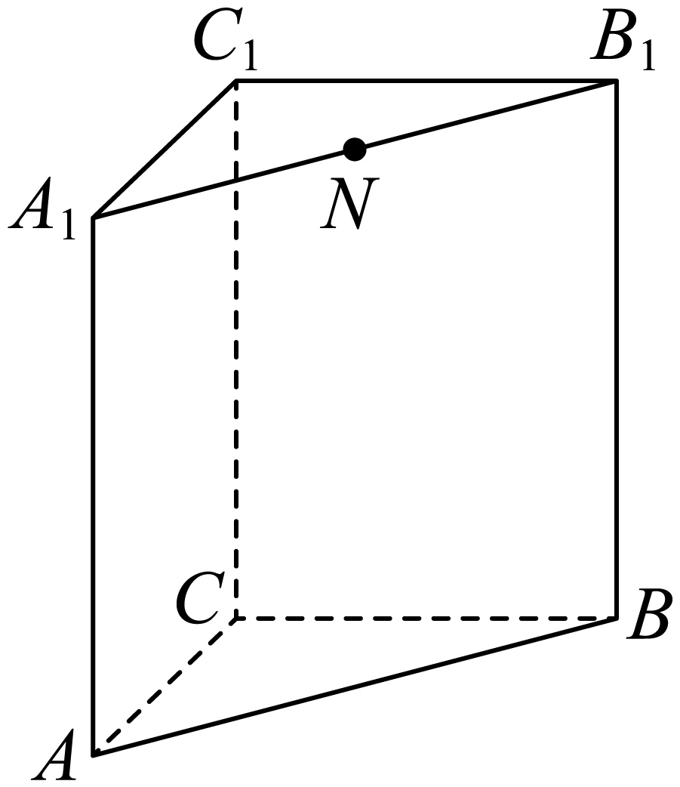

# Mathematics - 题目 711

**ID**: a62a88b6cc60414a9d3655048906c975
**年级**: Grade 11
**难度**: Medium-Hard
**题型**: Calculation

## 题目
如图，直三棱柱 $ABC-A{{}_{1}}B{{}_{1}}C{{}_{1}}$ ，底面 $\vartriangle ABC$ 中， $CA=CB=1$ ， $\angle BCA=90{^{\circ }}$ .​​​​​​​‌ $AA{{}_{1}}=2$ ， $N$ 是 $A{{}_{1}}B{{}_{1}}$ 的中点．（1）求证： $A{{}_{1}}B\bot C{{}_{1}}N$ ；（2） $F$ 为 $AB$ 上动点（含端点），则是否存在 $F$ 使得 $AB\bot $ 面 $CC{{}_{1}}F$ ，若存在，请求出 $\frac {AF}{FB}$ 的值，若不存在，请说明理由；（3）若 $M$ 为 $AB$ 中点， $G$ 为 $\vartriangle AMC$ 的重心， $H$ 为 $C{{}_{1}}G$ 上一点，且 $C{{}_{1}}H:HG=3:1$ ，过 $H$ 作任一平面分别交 $C{{}_{1}}A$ 、 $C{{}_{1}}C$ 、 $C{{}_{1}}M$ 于 $P$ 、 $Q$ 、 $R$ ，若 $\overrightarrow {{C{{}_{1}}P}}=m\overrightarrow {{C{{}_{1}}A}}$ ， $\overrightarrow {{C{{}_{1}}Q}}=n\overrightarrow {{C{{}_{1}}C}}$ ， $\overrightarrow {{C{{}_{1}}R}}=t\overrightarrow {{C{{}_{1}}M}}$ ，求证 $\frac {1}{m}+\frac {1}{n}+\frac {1}{t}$ 为定值，并求该定值．

## 解答

1. （1）以 $C$ 为原点，分别以 $CA$ 、 $CB$ 、 $CC{{}_{1}}$ 所在直线为 $x$ 、 $y$ 、 $z$ 轴建立空间直角坐标系，
2. $\because CA=CB=1$ ， $\angle BCA=90{^{\circ }}$ ， $AA{{}_{1}}=2$ ，
3. 则 $A\left ({1,0,0}\right )$ 、 $B\left ({0,1,0}\right )$ 、 $A{{}_{1}}\left ({1,0,2}\right )$ 、 $B{{}_{1}}\left ({0,1,2}\right )$ 、 $C{{}_{1}}\left ({0,0,2}\right )$ ，
4. $\because N$ 是 $A{{}_{1}}B{{}_{1}}$ 的中点，则 $N\left ({\frac {1}{2},\frac {1}{2},2}\right )$ ， $\overrightarrow {{A{{}_{1}}B}}=\left ({-1,1,-2}\right )$ ， $\overrightarrow {{C{{}_{1}}N}}=\left ({\frac {1}{2},\frac {1}{2},0}\right )$
5. $\because \overrightarrow {{A{{}_{1}}B}}\cdot \overrightarrow {{C{{}_{1}}N}}=-1\times \frac {1}{2}+1\times \frac {1}{2}+\left ({-2}\right )\times 0=0$ ， $\therefore \overrightarrow {{A{{}_{1}}B}}\bot \overrightarrow {{C{{}_{1}}N}}$ ，即 $A{{}_{1}}B\bot C{{}_{1}}N$ .
6. （2）设 $\overrightarrow {{AF}}=λ\overrightarrow {{AB}}=λ\left ({-1,1,0}\right )=\left ({-λ,λ,0}\right )$ ，其中 $0\mathrm{\leqslant }λ\mathrm{\leqslant }1$ ， $\overrightarrow {{AB}}=\left ({-1,1,0}\right )$ ，则 $F\left ({1-λ,λ,0}\right )$ ， $\therefore \overrightarrow {{C{{}_{1}}C}}=\left ({0,0,-2}\right )$ ， $\overrightarrow {{CF}}=\left ({1-λ,λ,0}\right )$ ，
7. 若 $AB\bot $ 面 $C{{}_{1}}CF$ ，则 $\begin{cases}\overrightarrow {{AB}}\cdot \overrightarrow {{C{{}_{1}}C}}=0\\\overrightarrow {{AB}}\cdot \overrightarrow {{CF}}=-\left ({1-λ}\right )+λ=0\end{cases}$ ，解得 $λ=\frac {1}{2}$ ， $\therefore \frac {AF}{AB}=1$ ，
8. 故存在点 $F$ ，当 $\frac {AF}{FB}=1$ 时， $AB\bot $ 面 $C{{}_{1}}CF$ .
9. （3）因为 $G$ 为 $\vartriangle AMC$ 的重心，则 $\overrightarrow {{GA}}+\overrightarrow {{GM}}+\overrightarrow {{GC}}=\overrightarrow {{0}}$ ，
10. 
11. 即 $\overrightarrow {{C{{}_{1}}A}}-\overrightarrow {{C{{}_{1}}G}}+\overrightarrow {{C{{}_{1}}M}}-\overrightarrow {{C{{}_{1}}G}}+\overrightarrow {{C{{}_{1}}C}}-\overrightarrow {{C{{}_{1}}G}}=\overrightarrow {{0}}$ ，可得 $\overrightarrow {{C{{}_{1}}G}}=\frac {1}{3}\left ({\overrightarrow {{C{{}_{1}}A}}+\overrightarrow {{C{{}_{1}}M}}+\overrightarrow {{C{{}_{1}}C}}}\right )$ ，
12. 因为 $H$ 为 $C{{}_{1}}G$ 上一点，且 $C{{}_{1}}H:HG=3:1$ ，则 $\overrightarrow {{C{{}_{1}}H}}=\frac {3}{4}\overrightarrow {{C{{}_{1}}G}}=\frac {1}{4}\left ({\overrightarrow {{C{{}_{1}}A}}+\overrightarrow {{C{{}_{1}}M}}+\overrightarrow {{C{{}_{1}}C}}}\right )$ ，
13. 因为 $P$ 、 $R$ 、 $Q$ 、 $H$ 四点共面，则存在 $λ$ 、 $μ\in {\mathbf{R}}$ ，使得 $\overrightarrow {{PH}}=λ\overrightarrow {{PQ}}+μ\overrightarrow {{PR}}$ ，
14. 即 $\overrightarrow {{C{{}_{1}}H}}-\overrightarrow {{C{{}_{1}}P}}=λ\left ({\overrightarrow {{C{{}_{1}}Q}}-\overrightarrow {{C{{}_{1}}P}}}\right )+μ\left ({\overrightarrow {{C{{}_{1}}R}}-\overrightarrow {{C{{}_{1}}P}}}\right )$ ，
15. 所以 $\overrightarrow {{C{{}_{1}}H}}=\left ({1-λ-μ}\right )\overrightarrow {{C{{}_{1}}P}}+λ\overrightarrow {{C{{}_{1}}Q}}+μ\overrightarrow {{C{{}_{1}}R}}=\left ({1-λ-μ}\right )m\overrightarrow {{C{{}_{1}}A}}+λn\overrightarrow {{C{{}_{1}}C}}+μt\overrightarrow {{C{{}_{1}}M}}$ ,
16. 又因为 $\overrightarrow {{C{{}_{1}}H}}=\frac {1}{4}\left ({\overrightarrow {{C{{}_{1}}A}}+\overrightarrow {{C{{}_{1}}M}}+\overrightarrow {{C{{}_{1}}C}}}\right )$ ，且 $\overrightarrow {{C{{}_{1}}A}}$ 、 $\overrightarrow {{C{{}_{1}}M}}$ 、 $\overrightarrow {{C{{}_{1}}C}}$ 不共面，
17. 由空间向量的基本定理可得 $\begin{cases}\left ({1-λ-μ}\right )m=\frac {1}{4}\\λn=\frac {1}{4}\\μt=\frac {1}{4}\end{cases}$ ，
18. 因此， $\frac {1}{m}+\frac {1}{n}+\frac {1}{t}=4\left ({1-λ-μ}\right )+4λ+4μ=4$ 为定值.

## 知识点

**中文**:
  - 直线与平面垂直的判定
  - 直线与平面垂直的性质
  - 空间向量基本定理的应用

**English**:
  - Line-Plane Perpendicularity Determination
  - Properties of Line-Plane Perpendicularity
  - Applications of Fundamental Theorem

---
