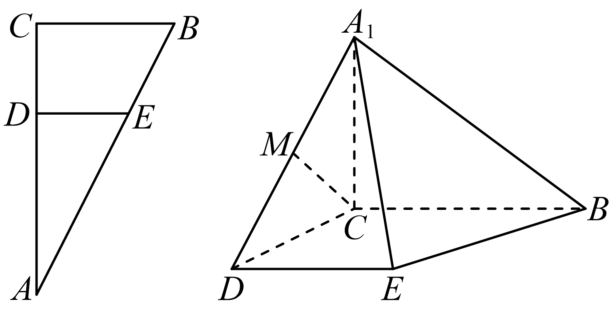

# Mathematics - 题目 3117

**ID**: aa65fd02400a4eccb70fe66a83b40d6f
**年级**: Grade 11
**难度**: Medium-Hard
**题型**: Calculation

## 题目
在 ${\rm{R}}{\rm{t}}\vartriangle ABC$ 中， $\angle C=90{}\degree $ ， $BC=3$ ， $AC=6$ ， $D,E$ 分别是 $AC,AB$ 上的点，满足 $DE//BC$ 且DE经过 $\vartriangle ABC$ 的重心，将 $\vartriangle ADE$ 沿DE折起到 $\mathrm{△}A{{}_{1}}DE$ 的位置，使 $A{{}_{1}}C\bot CD{\rm ，\mathit{M}}$ 是 $A{{}_{1}}D$ 的中点，如图所示.​​​​​​​‌（1）求证： $A{{}_{1}}C\bot $ 平面 $BCDE$ ；（2）求点M到平面 $A{{}_{1}}BE$ 的距离；（3）在线段 $A{{}_{1}}B$ 上是否存在点N（N不与端点 $A{{}_{1}},B$ 重合），使平面CMN与平面DEN垂直？若存在，求出 $\frac {A{{}_{1}}N}{A{{}_{1}}B}$ 的值；若不存在，请说明理由.

## 解答

1. （1）因为在 ${\rm{R}}{\rm{t}}\vartriangle ABC$ 中， $\angle C=90{}\degree $ ， $DE//BC$ ，所以 $DE\bot AD,DE\bot CD$ ，
2. 根据折叠关系 $DE\bot A{{}_{1}}D$ ，而 $A{{}_{1}}D\cap CD=D$ 且 $A{{}_{1}}D,CD\subset $ 平面 $A{{}_{1}}CD$ ，
3. 所以 $DE\bot $ 平面 $A{{}_{1}}CD$ ， $A{{}_{1}}C\subset $ 平面 $A{{}_{1}}CD$ ，则 $DE\bot A{{}_{1}}C$ ，又 $A{{}_{1}}C\bot CD$ ，
4. 由 $CD\cap DE=D$ ， $CD,DE\subset $ 平面 $BCDE$ ，所以 $A{{}_{1}}C\bot $ 平面 $BCDE$ ；
5. （2）因为DE经过 $\vartriangle ABC$ 的重心，故 $DE=\frac {2}{3}BC=2$ ，由（1）知 $A{{}_{1}}C\bot $ 平面 $BCDE$ ，
6. 以 $CD$ 为 $x$ 轴， $CB$ 为 $y$ 轴， $CA{{}_{1}}$ 为z轴，建立空间直角坐标系，.
7. 
8. 由几何关系知 $CD=2,AD=4,A{{}_{1}}C=2\sqrt {3}$ ，
9. 故 $C\left ({0,0,0}\right ),D\left ({2,0,0}\right ),E\left ({2,2,0}\right ),B\left ({0,3,0}\right ),A{{}_{1}}\left ({0,0,2\sqrt {3}}\right ),M\left ({1,0,\sqrt {3}}\right )$ ，
10. 所以 $\overrightarrow {{A{{}_{1}}M}}=(1,0,-\sqrt {3})$ ， $\overrightarrow {{A{{}_{1}}B}}=\left ({0,3,-2\sqrt {3}}\right ),\overrightarrow {{A{{}_{1}}E}}=\left ({2,2,-2\sqrt {3}}\right )$ ，
11. 设平面 $A{{}_{1}}BE$ 的法向量为 $\overrightarrow n=\left ({x,y,z}\right )$ ，则 $\begin{cases}\overrightarrow n\cdot \overrightarrow {{A{{}_{1}}B}}=0\\\overrightarrow n\cdot \overrightarrow {{A{{}_{1}}E}}=0\end{cases}$ ，
12. 即 $\begin{cases}3y-2\sqrt {3}z=0\\2x+2y-2\sqrt {3}z=0\end{cases}$ ，令 $y=2$ ，则 $\overrightarrow n=\left ({1,2,\sqrt {3}}\right )$ ，
13. 设M到平面 $A{{}_{1}}BE$ 的距离为 $d=\frac {\left |{\overrightarrow {{A{{}_{1}}M}}\cdot \overrightarrow n}\right |}{\left |{\overrightarrow n}\right |}=\frac {\sqrt {2}}{2}$ ；
14. （3）设 $N\left ({x{{}_{1}},y{{}_{1}},z{{}_{1}}}\right )$ ， $\overrightarrow {{BN}}=λ\overrightarrow {{BA{{}_{1}}}}$ ， $0<λ<1$ ，即 $\left ({x{{}_{1}},y{{}_{1}}-3,z{{}_{1}}}\right )=λ\left ({0,-3,2\sqrt {3}}\right )$ ，
15. 即 $x{{}_{1}}=0,y{{}_{1}}=3\left ({1-λ}\right ),z{{}_{1}}=2\sqrt {3}λ$ ， $N\left ({0,3\left ({1-λ}\right ),2\sqrt {3}λ}\right ){\rm ，}$ .
16. 设平面CMN的法向量为 $\overrightarrow {{n{{}_{2}}}}=\left ({x{{}_{2}},y{{}_{2}},z{{}_{2}}}\right )$ ，则 $\overrightarrow {{CM}}=\left ({1,0,\sqrt {3}}\right )$ ， $\overrightarrow {{CN}}=\left ({0,3\left ({1-λ}\right ),2\sqrt {3}λ}\right )$ ，
17. 所以 $\begin{cases}\overrightarrow {{n{{}_{2}}}}\cdot \overrightarrow {{CM}}=0\\\overrightarrow {{n{{}_{2}}}}\cdot \overrightarrow {{CN}}=0\end{cases}$ ，则 $\begin{cases}x{{}_{2}}+\sqrt {3}z{{}_{2}}=0\\3\left ({1-λ}\right )y{{}_{2}}+2\sqrt {3}λz{{}_{2}}=0\end{cases}$ ，令 $x{{}_{2}}=\sqrt {3}$ ，则 $\overrightarrow {{n{{}_{2}}}}=\left ({\sqrt {3},\frac {2\sqrt {3}λ}{3\left ({1-λ}\right )},-1}\right )$ ，
18. 设平面DEN的法向量为 $\overrightarrow {{n{{}_{3}}}}=\left ({x{{}_{3}},y{{}_{3}},z{{}_{3}}}\right )$ ， $\overrightarrow {{DE}}=\left ({0,2,0}\right ),\overrightarrow {{DN}}=\left ({-2,3\left ({1-λ}\right ),2\sqrt {3}λ}\right )$ ，
19. 则 $\begin{cases}\overrightarrow {{n{{}_{3}}}}\cdot \overrightarrow {{DE}}=0\\\overrightarrow {{n{{}_{3}}}}\cdot \overrightarrow {{DN}}=0\end{cases}$ ，即 $\begin{cases}2y{{}_{3}}=0\\-2x{{}_{3}}+3(1-λ)y{{}_{3}}+2\sqrt {3}λz{{}_{3}}=0\end{cases}$ ，令 $x{{}_{3}}=\sqrt {3}$ ，则 $\overrightarrow {{n{{}_{3}}}}=\left ({\sqrt {3},0,\frac {1}{λ}}\right )$ ，
20. 若平面CMN与平面DEN垂直，则满足 $\overrightarrow {{n{{}_{2}}}}\cdot \overrightarrow {{n{{}_{3}}}}=0$ ，即 $3-\frac {1}{λ}=0$ ， $λ=\frac {1}{3}$ ，
21. 故存在这样的点， $\overrightarrow {{BN}}=\frac {1}{3}\overrightarrow {{BA{{}_{1}}}}$ ，所以 $\frac {A{{}_{1}}N}{A{{}_{1}}B}=\frac {2}{3}$ .

## 知识点

**中文**:
  - 向量法求距离-点面距离
  - 直线与平面垂直的判定
  - 翻折问题
  - 用向量证明垂直问题

**English**:
  - Point-Plane Distance
  - Line-Plane Perpendicularity Determination
  - Folding Problems
  - Proving Perpendicularity

---
