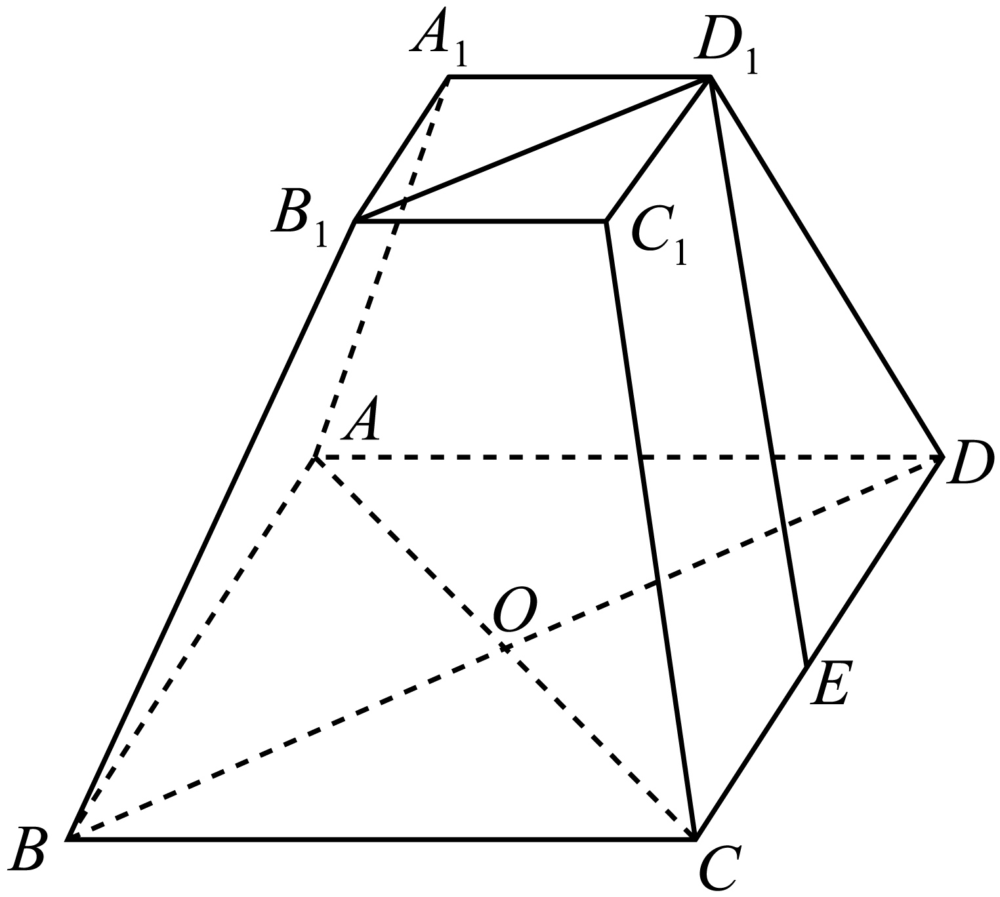

# Mathematics - 题目 3095

**ID**: b144df7da53d4ed08d09fdaa2114858f
**年级**: Grade 11
**难度**: Medium-Hard
**题型**: Calculation

## 题目
如图，在四棱台 $ABCD-A{{}_{1}}B{{}_{1}}C{{}_{1}}D{{}_{1}}$ 中，底面 $ABCD$ 是菱形， $\angle ABC=\frac {π}{3},\angle B{{}_{1}}BA=\angle B{{}_{1}}BC,\angle B{{}_{1}}BD=\frac {π}{6},AB=2A{{}_{1}}B{{}_{1}}=2$ ， $B{{}_{1}}B=2$ ， $E$ 是 $CD$ 的中点．（1）求证：直线 $AC\bot $ 平面 $BDD{{}_{1}}B{{}_{1}}$ ；​​​​​​​‌（2）求直线 $ED{{}_{1}}$ 与平面 $ABB{{}_{1}}A{{}_{1}}$ 所成角的正弦值．

## 解答

1. （1）延长 $AA{{}_{1}},BB{{}_{1}},CC{{}_{1}},DD{{}_{1}}$ 交于点 $P$ ，连结 $B{{}_{1}}C,B{{}_{1}}A,B{{}_{1}}O$ ，
2. 因为 $BC=BA,\angle B{{}_{1}}BA=\angle B{{}_{1}}BC,BB{{}_{1}}=BB{{}_{1}}$ ，
3. 故 $△\angle B{{}_{1}}BC\mathrm{≌}△B{{}_{1}}BA$ ，即 $B{{}_{1}}A=B{{}_{1}}C$ ，所以 $B{{}_{1}}O\bot AC$ ，又因为菱形 $ABCD$ ，
4. 即 $AO=OC,AC\bot BD$ ，又因为 $B{{}_{1}}O\cap BD=O$ ，所以 $AC\bot $ 平面 $BDD{{}_{1}}B{{}_{1}}$ ．
5. （2）过点 $D$ 作 $DG\bot AB$ 于 $G$ ，即 $DG=\sqrt {3}$ ，连结 $PG$ ，
6. 因为 $CD=2C{{}_{1}}D{{}_{1}}=2,CD//C{{}_{1}}D{{}_{1}}$ ，即 $C{{}_{1}}$ 是 $PC$ 的中点， $B{{}_{1}}$ 是 $PB$ 的中点，
7. 故 $D{{}_{1}}E//PC,PB=2BB{{}_{1}}=4$ ，
8. 所以直线 $D{{}_{1}}E$ 与平面 $ABB{{}_{1}}A{{}_{1}}$ 所成的角，即为 $PC$ 与平面 $PAB$ 所成的角，
9. 又因为 $BD=2\sqrt {3},\angle PBD=\frac {π}{6},PB=4$ ，所以 $PD\bot BD$ ，因为 $AC\bot $ 平面 $PBD$ ，
10. 所以面 $ABCD⊥$ 平面 $PBD$ ，所以 $PD\bot $ 平面 $ABCD$ ，
11. 故 $PC=\sqrt {PD{^{2}}+DC{^{2}}}=2\sqrt {2},PG=\sqrt {PD{^{2}}+DG{^{2}}}=\sqrt {7}$ ，
12. 所以 $S{{}_{△ABP}}=\frac {1}{2}\cdot AB\cdot PG=\sqrt {7}$ ，
13. 所以 $S{{}_{△BBC}}=\frac {1}{2}BA\cdot BC\cdot \sin \angle ABC=\sqrt {3}$ ，设点 $C$ 到平面 $PAB$ 的距离是 $h$ ，
14. 故 $h=\frac {V{{}_{P-ABC}}}{\frac {1}{3}S{{}_{△ABP}}}=\frac {\frac {1}{3}S{{}_{△ABC}}\cdot PD}{\frac {1}{3}\cdot \sqrt {7}}=\frac {2\sqrt {21}}{7}$ ，即 $\sin θ=\frac {h}{PC}=\frac {2\sqrt {21}}{7}\cdot \frac {1}{2\sqrt {2}}=\frac {\sqrt {42}}{14}$ ，
15. 所以直线 $D{{}_{1}}E$ 与平面 $ABB{{}_{1}}A{{}_{1}}$ 所成角的正弦值为 $\frac {\sqrt {42}}{14}$ ．
16. 

## 知识点

**中文**:
  - 直线与平面垂直的判定
  - 直线与平面所成的角

**English**:
  - Line-Plane Perpendicularity Determination
  - Line-Plane Angle

---
