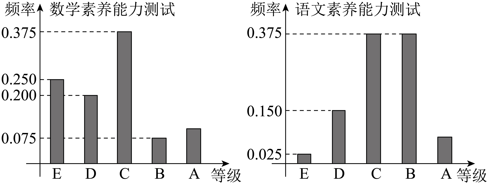

# Mathematics - 题目 2883

**ID**: bd922f4c6154487aa705eeee2b7e5cf4
**年级**: Grade 11
**难度**: Medium-Hard
**题型**: Calculation

## 题目
某中学长期坚持贯彻以人为本，因材施教的教育理念，每年都会在校文化节期间举行“数学素养能力测试”和“语文素养能力测试”两项测试，以给学生课外兴趣学习及辅导提供参考依据．成绩分为 $\mathrm{A}$ ， $B$ ， $C$ ， $D$ ， $E$ 五个等级（等级 $\mathrm{A}$ ， $B$ ， $C$ ， $D$ ， $E$ 分别对应5分，4分，3分，2分，1分）．某班学生两科的考试成绩的数据统计如图所示，其中“语文素养能力测试”科目的成绩为 $\mathrm{A}$ 的考生有3人．（1）求该班“数学素养能力测试”的科目平均分以及“数学素养能力测试”科目成绩为 $\mathrm{A}$ 的人数；​​​​​​​‌（2）若该班共有9人得分大于7分，其中有2人10分，3人9分，4人8分．从这9人中随机抽取三人，设三人的成绩之和为 $X$ ，求 $P\left ({X\geqslant EX}\right )$ ．（3）从该班得分大于7分的9人中选3人即甲，乙，丙组队参加学校内的“数学限时解题挑战赛”．规则为：每队首先派一名队员参加挑战赛，在限定的时间，若该生解决问题，即团队挑战成功，结束挑战；若解决问题失败，则派另外一名队员上去挑战，直至派完队员为止．通过训练，已知甲，乙，丙通过挑战赛的概率分别是 $\frac {1}{2}$ ， $\frac {3}{5}$ ， $\frac {2}{5}$ ，问以怎样的先后顺序派出队员，可使得派出队员数目的均值达到最小？（只需写出结果）

## 解答

1. （1）由图可知，数学素养能力测试为 $\mathrm{A}$ 的频率为0.1，故该班“数学素养能力测试”的科目平均分为 $0.1\times 5+0.075\times 4+0.375\times 3+0.2\times 2+0.25\times 1=2.575$ ，
2. 语文素养能力测试为 $\mathrm{A}$ 的频率为0.075，故而该班有 $3\div 0.075=40$ 人．“数学素养能力测试”科目成绩为 $\mathrm{A}$ 的人数 $40\times 0.1=4$ （人）．
3. （2）依题： $x$ 的取值可为29，28，27，26，25，24．
4. $P(X=29)=\frac {{\rm C}{_{3}^{1}}}{{\rm C}{_{9}^{3}}}=\frac {3}{84}$ ， $P(X=28)=\frac {{\rm C}{_{4}^{1}}+{\rm C}{_{3}^{2}}{\rm C}{_{2}^{1}}}{{\rm C}{_{9}^{3}}}=\frac {10}{84}$ ， $P(X=27)=\frac {{\rm C}{_{3}^{3}}+{\rm C}{_{3}^{1}}{\rm C}{_{2}^{1}}{\rm C}{_{4}^{1}}}{{\rm C}{_{9}^{3}}}=\frac {25}{84}$ ，
5. $P(X=26)=\frac {{\rm C}{_{4}^{2}}{\rm C}{_{2}^{1}}+{\rm C}{_{3}^{2}}{\rm C}{_{4}^{1}}}{{\rm C}{_{9}^{3}}}=\frac {24}{84}$ ， $P(X=25)=\frac {{\rm C}{_{4}^{2}}{\rm C}{_{3}^{1}}}{{\rm C}{_{9}^{3}}}=\frac {18}{84}$ ， $P(X=24)=\frac {{\rm C}{_{4}^{3}}}{{\rm C}{_{9}^{3}}}=\frac {4}{84}$ ，
6. $EX=\frac {3}{84}\times 29+\frac {10}{84}\times 28+\frac {25}{84}\times 27+\frac {24}{84}\times 26+\frac {18}{84}\times 25+\frac {4}{84}\times 24=26\frac {1}{3}$ ，
7. $P(X\geqslant EX)=P(X=29)+P(X=28)+P(X=27)$  $=\frac {3+10+25}{84}=\frac {19}{42}$ ．
8. （3）乙，甲，丙．

## 知识点

**中文**:
  - 平均数
  - 离散型随机变量的分布列
  - 频率分布直方图

**English**:
  - Mean
  - Probability Distribution Table
  - Frequency Distribution Histogram

---
