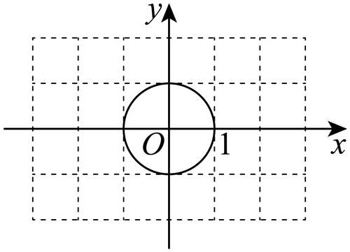

# Mathematics - 题目 1153

**ID**: c45c323ec2e44ad590d01b2ee06b6edb
**年级**: Grade 11
**难度**: Medium-Hard
**题型**: Calculation

## 题目
在平面直角坐标系 $xOy$ 中，对于点 $A$ 和 $\odot C$ 给出如下定义：若 $\odot C$ 上存在两个不同的点 $M,N$ ，对于 $\odot C$ 上任意满足 $AP=AQ$ 的两个不同的点 $P,\,Q$ ，都有 $\angle PAQ\leqslant \angle MAN$ ，则称点 $A$ 是 $\odot C$ 的关联点，称 $∠MAN$ 的大小为点 $A$ 与 $\odot C$ 的关联角度．（本定义中的角均指锐角、直角、钝角或平角）（1）如图， $\odot O$ 的半径为1．①在点 $A{{}_{1}}\left ({\frac {1}{2},\,0}\right ),\,A{{}_{2}}\left ({\frac {4}{3},\,0}\right ),\,A{{}_{3}}\left ({2,\,0}\right )$ 中，点是 $\odot O$ 的关联点且其与 $\odot O$ 的关联角度小于 $90{}\degree $ ，该点与 $\odot O$ 的关联角度为${}\degree $ ；​​​​​​​‌②点 $B\left ({1,\,m}\right )$ 在第一象限，若对于任意长度小于1的线段 $BD$ ， $BD$ 上所有的点都是 $\odot O$ 的关联点，则 $m$ 的最小值为；（2）已知点 $E\left ({1,\,3}\right ),\,F\left ({4,\,3}\right ),\,T\left ({t,\,0}\right )$ ， $\odot T$ 经过原点，线段 $EF$ 上所有的点都是 $\odot T$ 的关联点，记这些点与 $\odot T$ 的关联角度的最大值为 $α$ ．若 $90{}\degree \leqslant α\leqslant 180{}\degree $ ，直接写出 $t$ 的取值范围．

## 解答

1. （1）①根据定义可得：当 $A$ 在 $\odot O$ 上时，不存在都有 $\angle PAQ\leqslant \angle MAN$ ，当 $A$ 在 $\odot O$ 内部时过 $A$ 的直径 $MN$ 使得 $\odot O$ 的关联角度为 $180{}\degree $ ，当 $A$ 在 $\odot O$ 的外部时，且 $AM,AN$ 为 $\odot O$ 的切线时， $∠MAN$ 大；
2. 如图， $A{{}_{3}}$ 是 $\odot O$ 的关联点且其与 $\odot O$ 的关联角度小于 $90{}\degree $ ， $A{{}_{1}}$ 与 $\odot O$ 的关联角度为 $180{}\degree $ ， $A{{}_{2}}$ 与 $\odot O$ 的关联角度大于 $90{}\degree $ ，
3. 
4. ∵ $A{{}_{3}}\left ({2{\rm{,}}0}\right )$ ， $\odot O$ 的半径为 $1$ ，∴ $OM=1,OA{{}_{3}}=2$ ，且 $MA{{}_{3}}$ 是 $\odot O$ 的切线，
5. ∴ $\sin \angle MA{{}_{3}}O=\frac {OM}{OA{{}_{3}}}=\frac {1}{2}$ ，∴ $\angle MA{{}_{3}}O=30{}\degree $
6. ∴ $\angle MA{{}_{3}}N=60{}\degree $ ，即与 $\odot O$ 的关联角度为 $60{}\degree $ .
7. ②根据定义可得 $B$ 为 $\odot O$ 外一点，
8. ∵ $BD<1$ ， $\odot O$ 的半径为 $1$ ，∴ $BO\geqslant 2$ ，当 $OB=2$ 时，
9. 如图，取点 $G\left ({1,0}\right )$ ，则 $\angle OGB=90{}\degree $ ，
10. 
11. ∴ $m\geqslant BG=\sqrt {OB{^{2}}-OG{^{2}}}=\sqrt {2{^{2}}-1{^{2}}}=\sqrt {3}$ ，∴ $m$ 的最小值为 $\sqrt {3}$ ，故答案为： $\sqrt {3}$ ．
12. （2）由（1）可得，当 $A$ 在圆的外部时，且 $AM,AN$ 为圆的切线时， $∠MAN$ 最大，点 $A$ 距离圆心最近.
13. ∵ $90{}\degree \leqslant α\leqslant 180{}\degree $ ，∴当 $\angle MAN=90{}\degree $ 时，由 $\angle TMA=\angle TNA=90{}\degree $ ，如图，
14. 
15. ∴四边形 $TMAN$ 是矩形，
16. 由∵ $TM=TN$    ∴四边形 $TMAN$ 是正方形，  ∴ $TA=\sqrt {2}TM=\sqrt {2}r$
17. 当 $\angle MAN\geqslant 90{}\degree $ 时， $r<TA\leqslant \sqrt {2}r$
18. ∵点 $E\left ({1,3}\right ),F\left ({4,3}\right ),T\left ({t,0}\right )$ ， $\odot T$ 经过原点，线段 $EF$ 上所有的点都是 $\odot T$ 的关联点，则 $r=\left |{t}\right |$ ，
19. ∴ $EF$ 上距离 $T$ 最近的点在 $t<TA\leqslant \sqrt {2}t$ 的圆环内.
20. ①若线段 $EF$ 均 $\odot T$ 内，线段 $EF$ 上所有的点都是 $\odot T$ 的关联点，这些点与 $\odot T$ 的关联角度的最大值均为若 $180{}\degree $ ，如图，
21. 
22. 则 $\begin{cases}{\left({1-t}\right)^{2}}+9<t{^{2}}\\{\left({4-t}\right)^{2}}+9<t{^{2}}\end{cases}$  $\Rightarrow $  $t>5$ .
23. ②若线段 $EF$ 均在 $\odot T$ 外，则 $EF$ 上距离 $T$ 最近的点在 $t<TA\leqslant \sqrt {2}t$ 的圆环内.
24. 当 $t>0$ 时，如图：
25. 
26. 则 $\begin{cases}{\left({1-t}\right)^{2}}+9\leqslant 2t{^{2}}\\{\left({4-t}\right)^{2}}+9\leqslant 2t{^{2}}\\t<3\end{cases}$  $\Rightarrow $  $-4+\sqrt {41}\leqslant t<3$ ；
27. 当 $t<0$ 时，如图：
28. 
29. 则 $\begin{cases}{\left({1-t}\right)^{2}}+9>t{^{2}}\\{\left({4-t}\right)^{2}}+9\leqslant 2t{^{2}}\end{cases}$  $\Rightarrow $  $t\leqslant -4-\sqrt {41}$ .
30. 综上可知： $t\leqslant -4-\sqrt {41}$ 或 $-4+\sqrt {41}\leqslant t<3$ 或 $t>5$ .
31. 所以所求 $t$ 的取值范围为 $\left ({-∞,-4-\sqrt {41}}\right ]\cup \left [{-4+\sqrt {41},3}\right )\cup \left ({5,+∞}\right )$ .

## 知识点

**中文**:
  - 直线与圆的综合问题与实际应用

**English**:
  - Comprehensive Problems and Applications

---
