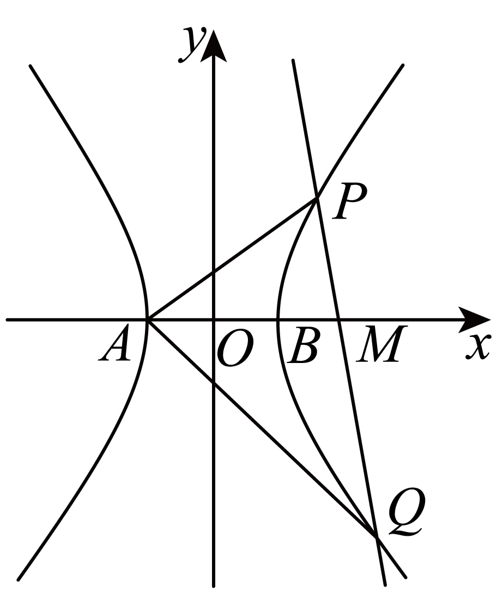

# Mathematics - 题目 3780

**ID**: d1fe60072d8446178f5987cfdac020d7
**年级**: Grade 11
**难度**: Medium-Hard
**题型**: Calculation

## 题目
如图双曲线 $C:\frac {x{^{2}}}{a{^{2}}}-\frac {y{^{2}}}{b{^{2}}}=1\left ({a>0,b>0}\right )$ 的左右顶点分别为 $A,B$ 且 $\left |{AB}\right |=2$ ，已知双曲线的离心率为2．（1）求双曲线 $C$ 的方程．（2）直线 $l$ 与双曲线交于 $P,Q$ 两点且以线段 $PQ$ 为直径的圆恰好经过点 $A$ ．①证明：直线 $PQ$ 过 $x$ 轴上一定点 $M$ ，请求出点 $M$ 的坐标；​​​​​​​‌②若 $P,Q$ 都在双曲线的右支，求 $△APQ$ 的面积的最小值．

## 解答

1. （1） $\because $ 双曲线 $C:\frac {x{^{2}}}{a{^{2}}}-\frac {y{^{2}}}{b{^{2}}}=1\left ({a>0,b>0}\right )$ 的左右顶点分别为 $A,B$ 且 $\left |{AB}\right |=2$ ，
2. $\therefore 2a=2$ ， $a=1$ ，
3. $\because e=\frac {c}{a}=\frac {c}{1}=2$ ， $\therefore c=2$ ，
4. $\therefore b{^{2}}=c{^{2}}-a{^{2}}=4-1=3$ ，
5. $\therefore $ 双曲线 $C$ ： $x{^{2}}-\frac {y{^{2}}}{3}=1$ ．
6. （2）①证明： $\because $ 直线 $l$ 与双曲线交于 $P,Q$ 两点且以线段 $PQ$ 为直径的圆恰好经过双曲线左顶点 $A\left ({-1,0}\right )$ ，
7. $\therefore \angle PAQ=90\degree $ ， $\overrightarrow {{AP}}\cdot \overrightarrow {{AQ}}=0$ ，
8. 设直线 $PQ$ 的方程为 $x=my+t$ ， $P\left ({x{{}_{1}},y{{}_{1}}}\right ),Q\left ({x{{}_{2}},y{{}_{2}}}\right )$ ，
9. 联立双曲线 $C$ 得， $\left ({m{^{2}}-\frac {1}{3}}\right )y{^{2}}+2mty+t{^{2}}-1=0$ (  $m{^{2}}-\frac {1}{3}\ne 0$ )，
10. $\therefore y{{}_{1}}+y{{}_{2}}=\frac {-2mt}{m{^{2}}-\frac {1}{3}},y{{}_{1}}y{{}_{2}}=\frac {t{^{2}}-1}{m{^{2}}-\frac {1}{3}}$ ，
11. $\because \overrightarrow {{AP}}=\left ({my{{}_{1}}+t+1,y{{}_{1}}}\right ),\overrightarrow {{AQ}}=\left ({my{{}_{2}}+t+1,y{{}_{2}}}\right )$ ， $\overrightarrow {{AP}}\cdot \overrightarrow {{AQ}}=0$ ，
12. $\therefore \overrightarrow {{AP}}\cdot \overrightarrow {{AQ}}=\left ({my{{}_{1}}+t+1}\right )\left ({my{{}_{2}}+t+1}\right )+y{{}_{1}}y{{}_{2}}=\left ({m{^{2}}+1}\right )y{{}_{1}}y{{}_{2}}+m\left ({t+1}\right )\left ({y{{}_{1}}+y{{}_{2}}}\right )+{\left({t+1}\right)^{2}}$
13. $=\left ({m{^{2}}+1}\right )\cdot \frac {t{^{2}}-1}{m{^{2}}-\frac {1}{3}}+m\left ({t+1}\right )\cdot \frac {-2mt}{m{^{2}}-\frac {1}{3}}+{\left({t+1}\right)^{2}}=\frac {m{^{2}}t{^{2}}-m{^{2}}+t{^{2}}-1-2m{^{2}}t{^{2}}-2m{^{2}}t+{\left({t+1}\right)^{2}}\cdot \left ({m{^{2}}-\frac {1}{3}}\right )}{m{^{2}}-\frac {1}{3}}$
14. $=\frac {2}{3}\frac {\left ({t{^{2}}-t-2}\right )}{m{^{2}}-\frac {1}{3}}=0$ ， $\therefore t{^{2}}-t-2=0$ ，解得 $t=2$ 或 $t=-1$ ，若 $t=-1$ ，则直线过 $A\left ({-1,0}\right )$ ，与题意矛盾舍去，故 $t=2$ ，
15. $\therefore $ 直线过 $M\left ({2,0}\right )$ ．
16. ② $\because A\left ({-1,0}\right ),M\left ({2,0}\right )$ ， $\therefore \left |{AM}\right |=3$ ，
17. $\therefore S{{}_{\vartriangle APQ}}=\frac {1}{2}\left |{AM}\right |\cdot \left |{y{{}_{1}}-y{{}_{2}}}\right |=\frac {3}{2}\left |{y{{}_{1}}-y{{}_{2}}}\right |$ ，
18. 由①知，直线 $PQ$ ： $x=my+2$ ，
19. 联立双曲线方程得 $\left ({m{^{2}}-\frac {1}{3}}\right )y{^{2}}+4my+3=0$ (  $m{^{2}}-\frac {1}{3}\ne 0$ ),
20. $\therefore y{{}_{1}}+y{{}_{2}}=\frac {-4m}{m{^{2}}-\frac {1}{3}},y{{}_{1}}y{{}_{2}}=\frac {3}{m{^{2}}-\frac {1}{3}}$ ，
21. $\because P,Q$ 都在双曲线的右支上， $\therefore y{{}_{1}}y{{}_{2}}<0$ ， $\therefore m{^{2}}-\frac {1}{3}<0$ ，
22. $\therefore \left |{y{{}_{1}}-y{{}_{2}}}\right |=\sqrt {{\left({y{{}_{1}}+y{{}_{2}}}\right)^{2}}-4y{{}_{1}}y{{}_{2}}}=\sqrt {{\left({\frac {-4m}{m{^{2}}-\frac {1}{3}}}\right)^{2}}-\frac {12}{m{^{2}}-\frac {1}{3}}}=\frac {2\sqrt {m{^{2}}+1}}{\frac {1}{3}-m{^{2}}}$ ，
23. $\therefore $  $S{{}_{\vartriangle APQ}}=\frac {3}{2}\left |{y{{}_{1}}-y{{}_{2}}}\right |=\frac {3\sqrt {m{^{2}}+1}}{\frac {1}{3}-m{^{2}}}$ ，
24. 令 $n=\sqrt {m{^{2}}+1}\left ({n\geqslant 1}\right )$ ，则 $m{^{2}}=n{^{2}}-1$ ，代入得
25. $S{{}_{\vartriangle APQ}}=\frac {3\sqrt {m{^{2}}+1}}{\frac {1}{3}-m{^{2}}}=\frac {3n}{\frac {4}{3}-n{^{2}}}=\frac {9n}{4-3n{^{2}}}$ ，
26. 令 $f\left ({n}\right )=\frac {9n}{4-3n{^{2}}}\left ({n\geqslant 1}\right )$ ， $\because 4-3n{^{2}}>0$ ，解得 $n<\frac {2\sqrt {3}}{3}$ ，
27. $\therefore 1\leqslant n<\frac {2\sqrt {3}}{3}$ ，
28. 求导得 $f^{′}{\left ({n}\right )}=\frac {9\left ({4+3n{^{2}}}\right )}{{\left({4-3n{^{2}}}\right)^{2}}}$ ， $\therefore f^{′}{\left ({n}\right )}>0$ 在 $1\leqslant n<\frac {2\sqrt {3}}{3}$ 时恒成立，
29. $\therefore f\left ({n}\right )$ 在 $1\leqslant n<\frac {2\sqrt {3}}{3}$ 单调递增，在 $n=1$ 时取最小值， $f\left ({1}\right )=9$ ，
30. $\therefore S{{}_{\vartriangle APQ}}$ 的最小值为9．

## 知识点

**中文**:
  - 双曲线标准方程及其应用
  - 直线与双曲线的位置关系
  - 弦长面积问题
  - 范围最值问题
  - 定点定值定直线问题

**English**:
  - Standard Equation and Applications
  - Line-Hyperbola Relationship
  - Chord Length and Area Problems
  - Range and Extrema Problems
  - Fixed Point, Value, Line Problems

---
