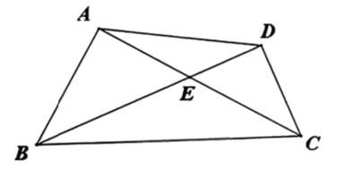

# Mathematics - 题目 3175

**ID**: df7d4fe0a84947ff84088907aded5fe3
**年级**: Grade 11
**难度**: Medium-Hard
**题型**: Calculation

## 题目
如图，平面四边形 $ABCD$ 中， $AB=1,AC=\sqrt {3},\angle ABC=\frac {{\rm{π}}}{3},\angle ADC=\frac {2{\rm{π}}}{3},AC\cap BD=E$ ，记 $\angle DBC=θ$ .​​​​​​​‌（1）用 $θ$ 表示 $AD$ ；（2）求四边形 $ABCD$ 面积的范围；（3）当 $θ$ 为何值时， $S{{}_{\vartriangle BCE}}=2S{{}_{\vartriangle ADE}}$ .

## 解答

1. （1）因为 $AB=1,AC=\sqrt {3},\angle ABC=\frac {{\rm{π}}}{3}$ ，
2. 
3. 由正弦定理 $\frac {AB}{{\rm{s}}{\rm{i}}{\rm{n}}\angle ACB}=\frac {AC}{{\rm{s}}{\rm{i}}{\rm{n}}\angle ABC}$ ，有 $\frac {1}{{\rm{s}}{\rm{i}}{\rm{n}}\angle ACB}=\frac {\sqrt {3}}{\frac {\sqrt {3}}{2}}=2$ ，
4. 即 ${\rm{s}}{\rm{i}}{\rm{n}}\angle ACB=\frac {1}{2}$ ，又 $\angle ACB\in (0,\frac{2\pi }{3})$ ，故 $\angle ACB=\frac {{\rm{π}}}{6}$ ，
5. 又因为 $\angle ABC+\angle ADC={\rm{π}}$ ，所以 $A,B,C,D$ 四点共圆，
6. 则 $\angle ADB=\angle ACB=\frac {{\rm{π}}}{6}$ ，
7. 由于 $\angle ABD=\frac {{\rm{π}}}{3}-θ$ ，所以根据正弦定理 $\frac {AB}{{\rm{s}}{\rm{i}}{\rm{n}}∠ADB}=\frac {AD}{{\rm{s}}{\rm{i}}{\rm{n}}∠ABD}$ ，
8. 有 $\frac{1}{\frac{1}{2}}=\frac{AD}{\sin (\frac{\pi }{3}-\theta )}$ ，即 $AD=2\sin (\frac{\pi }{3}-\theta )(0<\theta <\frac{\pi }{3})$ ；
9. （2）解法一： $S{{}_{ABCD}}=S{{}_{\vartriangle ABC}}+S{{}_{\vartriangle ADC}}$ ，
10. 因为 $\angle ACB=\frac {{\rm{π}}}{6},\angle ABC=\frac {{\rm{π}}}{3}$ ，所以 $\angle BAC=\frac {{\rm{π}}}{2},S{{}_{\vartriangle ABC}}=\frac {1}{2}\cdot AB\cdot AC=\frac {\sqrt {3}}{2}$ ，
11. 因同弧所对的圆周角相等， $\angle DAC=\angle DBC=θ$ ，
12. ${S}_{△ADC}=\frac{1}{2}\cdot AD\cdot AC\cdot \sin \theta =\sqrt{3}\sin (\frac{\pi }{3}-\theta )\sin \theta $
13. $=\sqrt{3}(\frac{\sqrt{3}}{2}\sin \theta \cos \theta -\frac{1}{2}{\sin }^{2}\theta )$
14. $=\sqrt{3}(\frac{\sqrt{3}}{4}\sin 2\theta -\frac{1-\cos 2\theta }{4})=\frac{\sqrt{3}}{2}\sin (2\theta +\frac{\pi }{6})-\frac{\sqrt{3}}{4}$ ，
15. 由于 $0<θ<\frac {{\rm{π}}}{3}$ ，所以 $\frac {{\rm{π}}}{6}<2θ+\frac {{\rm{π}}}{6}<\frac {5{\rm{π}}}{6},0<S{{}_{\vartriangle ADC}}\leqslant \frac {\sqrt {3}}{4}$ ，
16. 故 ${S}_{ABCD}=\frac{\sqrt{3}}{2}+{S}_{△ADC}\in (\frac{\sqrt{3}}{2},\frac{3\sqrt{3}}{4}]$ ；
17. 解法二： ${S}_{ABCD}={S}_{△ABD}+{S}_{△BCD}=\frac{1}{2}BA\cdot BD\cdot \sin (\frac{\pi }{3}-\theta )+\frac{1}{2}BD\cdot BC\cdot \sin \theta $ ，
18. 因为 $BC$ 是直径，所以 $\angle BDC=\frac {{\rm{π}}}{2}$ ，
19. 又因为 $BC=2$ ，所以 $BD=BC{\rm{c}}{\rm{o}}{\rm{s}}θ=2{\rm{c}}{\rm{o}}{\rm{s}}θ$ ，
20. ${S}_{ABCD}=\cos \theta \cdot \sin (\frac{\pi }{3}-\theta )+2\cos \theta \cdot \sin \theta =\frac{\sqrt{3}}{2}{\cos }^{2}\theta +\frac{3}{2}\sin \theta \cos \theta $  $=\frac{\sqrt{3}}{4}(1+\cos 2\theta )+\frac{3}{4}\sin 2\theta =\frac{\sqrt{3}}{2}\sin (2\theta +\frac{\pi }{6})+\frac{\sqrt{3}}{4}$ ，
21. 由于 $0<θ<\frac {{\rm{π}}}{3}$ ，所以 $\frac{\pi }{6}<2\theta +\frac{\pi }{6}<\frac{5\pi }{6},\frac{\sqrt{3}}{4}<\frac{\sqrt{3}}{2}\sin (2\theta +\frac{\pi }{6})\leqslant \frac{\sqrt{3}}{2}$ ，
22. 则 ${S}_{ABCD}\in (\frac{\sqrt{3}}{2},\frac{3\sqrt{3}}{4}]$ ；
23. （3）法一： $AE=\tan (\frac{\pi }{3}-\theta ),BE=\frac{1}{\cos (\frac{\pi }{3}-\theta )}$ ，
24. ${S}_{△BCE}=\frac{1}{2}\cdot BE\cdot BC\cdot \sin \theta =\frac{\sin \theta }{\cos (\frac{\pi }{3}-\theta )}$ ，
25. ${S}_{△ADE}=\frac{1}{2}\cdot AD\cdot AE\cdot \sin \theta =\sin (\frac{\pi }{3}-\theta )\cdot \tan (\frac{\pi }{3}-\theta )\cdot \sin \theta =\frac{{\sin }^{2}(\frac{\pi }{3}-\theta )\cdot \sin \theta }{\cos (\frac{\pi }{3}-\theta )}$ ，
26. ${S}_{△ADE}={\sin }^{2}(\frac{\pi }{3}-\theta )\cdot {S}_{△BCE}$ ，
27. 因为 $S{{}_{\vartriangle BCE}}=2S{{}_{\vartriangle ADE}}$ ，所以 ${\sin }^{2}(\frac{\pi }{3}-\theta )=\frac{1}{2},\sin (\frac{\pi }{3}-\theta )=±\frac{\sqrt{2}}{2}$ ，
28. 又因为 $0<θ<\frac {{\rm{π}}}{3}$ ，所以 $0<\frac {{\rm{π}}}{3}-θ<\frac {{\rm{π}}}{3}$ ，
29. 从而 $\frac {{\rm{π}}}{3}-θ=\frac {{\rm{π}}}{4}$ ，即 $θ=\frac {{\rm{π}}}{12}$ 时， $S{{}_{\vartriangle BCE}}=2S{{}_{\vartriangle ADE}}$ ；
30. 法二： $S{{}_{\vartriangle BCE}}=\frac {1}{2}\cdot EB\cdot EC\cdot {\rm{s}}{\rm{i}}{\rm{n}}\angle BEC,S{{}_{\vartriangle ADE}}=\frac {1}{2}\cdot ED\cdot EA\cdot {\rm{s}}{\rm{i}}{\rm{n}}\angle AED$ ，
31. 因为 $\angle BEC=\angle AED,S{{}_{\vartriangle BCE}}=2S{{}_{\vartriangle ADE}}$ ，
32. 所以 $EB\cdot EC=2ED\cdot EA$ ；根据相交弦定理， $EA\cdot EC=EB\cdot ED$ ，
33. 两式相除，得 $\frac {EB}{EA}=\frac {2EA}{EB}$ ，即 $EB=\sqrt {2}EA$ ，
34. 在 ${\rm{R}}{\rm{t}}△ABE$ 中， ${\rm{s}}{\rm{i}}{\rm{n}}\angle ABE=\frac {EA}{EB}=\frac {\sqrt {2}}{2}$ ，即 $\angle ABE=\frac {{\rm{π}}}{4}$ ，此时 $θ=\frac {{\rm{π}}}{3}-\frac {{\rm{π}}}{4}=\frac {{\rm{π}}}{12}$ .

## 知识点

**中文**:
  - 利用正弦定理解三角形
  - 周长与面积最值或范围
  - 复杂图形（多个三角形拼接、四边形）求解

**English**:
  - Solving Triangles using Law of Sines
  - Perimeter and Area: Extrema or Range
  - Solving Complex Shapes (Combined Triangles, Quadrilaterals)

---
