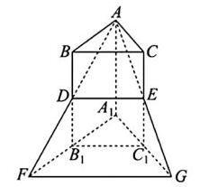

# Mathematics - 题目 1530

**ID**: e35a86dbb3344296a32099daa3b8f795
**年级**: Grade 11
**难度**: Medium-Hard
**题型**: Calculation

## 题目
定义：两个多面体 ${M}_{1},{M}_{2}$ 的重合度 $K=\frac{{V}_{21}}{{V}_{1}+{V}_{2}-{V}_{223}}$ , 其中 ${V}_{△A}$ 是多面体 ${M}_{1},{M}_{2}$ 的承合部分的体积， ${V}_{1},{V}_{2}$ 分别是多面体 ${M}_{1},{M}_{2}$ 的体积如图，在棱柱 ${ABC}-{A}_{1}{B}_{1}{C}_{1}$ 中， $D$ , $E$ 分别是棱 $B{B}_{1},C{C}_{1}$ 上的点（不包含端点），且 ${BD}={CE}$ , 延长 ${AD},{AE}$ , 分别交 ${A}_{1}{B}_{1}$ , ${A}_{1}{C}_{1}$ 的延长线于点 $F,G$ .​​​​​​​‌(1）已知 ${BD}=\frac{1}{2}B{B}_{1}$ , 且三棱柱 ${ABC}-{A}_{1}{B}_{1}{C}_{1}$ 的体积为18.①求三棱柱 ${ABC}-{A}_{1}{B}_{1}{C}_{1}$ 与三棱锥 $A-{A}_{1}{FG}$ 重合部分的体积：②求三棱柱 ${ABC}-{A}_{1}{B}_{1}{C}_{1}$ 与三棱锥 $A-{A}_{1}{FG}$ 的重合度 $K$ .（2）若二棱柱 ${ABC}-{A}_{1}{B}_{1}{C}_{1}$ 与二棱锥 $A-{A}_{1}{FG}$ 的重合度 $K=\frac{1}{3}$ , 求 $\frac{BD}{B{B}_{1}}$ 的值

## 解答

1. (1）设 $△{A}_{1}{B}_{1}{C}_{1}$ 的面积为 $S$ , 三棱柱 ${ABC}-{A}_{1}{B}_{1}{C}_{1}$ 的高为 $\text{h}$ ,
2. 则三棱柱 ${ABC}-{A}_{1}{B}_{1}{C}_{1}$ 的体积 ${V}_{1}=S\text{h}$ .
3. ①作 ${DH}{//}{AB}$ , 交 $A{A}_{1}$ 于点 $H$ , 连接 ${EH}$ ,
4. 因为 ${DH}⊄$ 平面 ${ABC},{AB}⊂$ 平面 ${ABC}$ , 因此 ${DH}{//}$ 平面 ${ABC}$ ,
5. 因为 ${BD}{//}{CE}$ , 且 ${BD}={CE}$ , 因此 ${BC}{//}{DE}$ ,
6. 又 ${DE}⊄$ 平面 ${ABC},{BC}⊂$ 平面 ${ABC}$ , 因此 ${DE}{//}$ 平面 ${ABC}$ ,
7. 又 ${DH}∩{DE}=D$ , 因此平面 ${DEH}{//}$ 平面 ${ABC}$ ,
8. 因为 ${BD}=\frac{1}{2}B{B}_{1}$ , 因此 $H$ 为棱 $A{A}_{1}$ 的中点，
9. 则三棱柱 ${HDE}-{A}_{1}{B}_{1}{C}_{1}$ 的体积 ${V}_{{HDE}-{A}_{1}{B}_{1}{C}_{1}}=\frac{1}{2}{V}_{1}{=9}$ , 三棱锥 $A-{DEH}$ 的体积 ${V}_{A-{DEH}}=\frac{1}{6}{V}_{1}{=3}$ .
10. 故三棱柱 ${ABC}-{A}_{1}{B}_{1}{C}_{1}$ 与三棱锥 $A-{A}_{1}{FG}$ 重合部分的体积
11. ${V}_{△\mathit{\pi }}={V}_{{mDE}-{A}_{1}{B}_{1}{C}_{1}}+{V}_{A-{DBH}}{=9+3=12}$ .
12. ②因为 ${DH}{//}{A}_{1}{B}_{1}$ , 因此 ${DH}{//}{A}_{1}F$ , 因此 $△{ADH}{∽△}{AF}{A}_{1}$ ,
13. 因此 $\frac{DH}{{A}_{1}F}=\frac{AH}{A{A}_{1}}=\frac{BD}{B{B}_{1}}=\frac{1}{2}$ , 因此 $\frac{{A}_{1}{B}_{1}}{{A}_{1}F}=\frac{1}{2}$ .
14. 因为 ${DE}{//}{B}_{1}{C}_{1}{, }{B}_{1}{C}_{1}⊂$ 平面 ${A}_{1}{FG}{, }{DE}∉$ 平面 ${A}_{1}{FG}$ , 因此 ${DE}{//}$ 平面 ${A}_{1}{FG}$ .
15. 因为平面 ${AFG}∩$ 平面 ${A}_{1}{FG}={FG}$ , 且 ${DE}⊂$ 平面 ${AFG}$ ,
16. 因此 ${DE}{//}{FG}$ , 因此 ${B}_{1}{C}_{1}{//}{FG}$ ,
17. 则 $△{A}_{1}{B}_{1}{C}_{1}{∽△}{A}_{1}{FG}$ , 故 ${S}_{a,A,{FG}}{=4}{S}_{A,{A}_{1}{B}_{1}{C}_{1}}{=4}S$ ,
18. 从而三棱锥 $A-{A}_{1}{FG}$ 的体积 ${V}_{2}=\frac{1}{3}{S}_{A,{AFG}}\text{⋅h=}\frac{4}{3}S\text{h=24}$ ,
19. 故三棱柱 ${ABC}-{A}_{1}{B}_{1}{C}_{1}$ 与三棱锥 $A-{A}_{1}{FG}$ 的币合度 $K=\frac{{V}_{21}}{{V}_{1}+{V}_{2}-{V}_{28}}=\frac{12}{18+24-12}=\frac{2}{5}$ .
20. 
21. (2）设 $\frac{BD}{B{B}_{1}}=\mathit{\lambda }({0<}\mathit{\lambda }{<1})$ , 则 ${BD}=\mathit{\lambda B}{B}_{1}$ , 从而 ${B}_{1}D=({1-}\mathit{\lambda })B{B}_{1}$ ,
22. 故三棱柱 ${HDE}-{A}_{1}{B}_{1}{C}_{1}$ 的体积 ${V}_{{HDB}-{A}_{1}{B}_{1}{C}_{1}}=({1-}\mathit{\lambda }){V}_{1}$ ,
23. 三棱锥 $A-{DEH}$ 的体积 ${V}_{A-{DEH}}=\frac{\mathit{\lambda }}{3}{V}_{1}$ ,
24. 故三棱柱 ${ABC}-{A}_{1}{B}_{1}{C}_{1}$ 与三棱锥 $A-{A}_{1}{FG}$ 重合部分的体积
25. ${V}_{{△}_{A}}={V}_{{mDK}-{A}_{1}{B}_{1}{C}_{1}}+{V}_{A-{DBH}}=\frac{{3-2}\mathit{\lambda }}{3}{V}_{1}$ .
26. 因为 ${DH}{//}{A}_{1}{B}_{1}$ , 因此 ${DH}{//}{A}_{i}F$ , 因此 $△{ADH}{∽△}{AF}{A}_{1}$ ,
27. 因此 $\frac{DH}{{A}_{1}F}=\frac{AH}{A{A}_{1}}=\frac{BD}{B{B}_{1}}=\mathit{\lambda }$ , 因此 $\frac{{A}_{1}{B}_{1}}{{A}_{1}F}=\mathit{\lambda }$ .
28. 因为 ${DE}{//}{B}_{1}{C}_{1}{, }{B}_{1}{C}_{1}⊂$ 平面 ${A}_{1}{FG}{, }{DE}\text{ϕ}$ 平面 ${A}_{1}{FG}$ , 因此 ${DE}{//}$ 平面 ${A}_{1}{FG}$ .
29. 因为平面 ${AFG}∩$ 平面 ${A}_{1}{FG}={FG}$ , 月 ${\rm .}{DE}⊂$ 平面 ${AFG}$ ,
30. 因此 ${DE}{//}{FG}$ , 因此 ${B}_{1}{C}_{1}{//}{FG}$ ,
31. 则 $△{A}_{1}{B}_{1}{C}_{1}{∽△}{A}_{1}{FG}$ , 故 ${S}_{A,{AFG}}=\frac{1}{{\mathit{\lambda }}^{2}}{S}_{A,{A}_{1}{C}_{1}{C}_{1}}=\frac{1}{{\mathit{\lambda }}^{2}}s$ ,
32. 从而三棱锥 $A-{A}_{1}{FG}$ 的体积 ${V}_{2}=\frac{1}{3}{S}_{A,{AFG}}\text{⋅h=}\frac{1}{3{\mathit{\lambda }}^{2}}{V}_{1}$ ,
33. 故三棱柱 ${ABC}-{A}_{1}{B}_{1}{C}_{1}$ 与三枝校锥 $A-{A}_{1}{FG}$ 的重合度 $K=\frac{\frac{{3-2}\mathit{\lambda }}{3}{V}_{1}}{{V}_{1}+\frac{1}{3{\mathit{\lambda }}^{2}}{V}_{1}-\frac{{3-2}\mathit{\lambda }}{3}{V}_{1}}=\frac{3{\mathit{\lambda }}^{2}{-2}{\mathit{\lambda }}^{3}}{2{\mathit{\lambda }}^{3}{+1}}$ .
34. 因为 $K=\frac{1}{3}$ , 因此
35. $\frac{3{\mathit{\lambda }}^{2}{-2}{\mathit{\lambda }}^{3}}{2{\mathit{\lambda }}^{3}{+1}}=\frac{1}{3}$ , 因此 $8{\mathit{\lambda }}^{3}{-9}{\mathit{\lambda }}^{2}{+1=0}$ ,
36. 因此 $(\mathit{\lambda }{-1})(8{\mathit{\lambda }}^{2}-\mathit{\lambda }{-1}){=0}，$ 解得 $\mathit{\lambda }{=1}$ 或 $\mathit{\lambda }=\frac{{1-}\sqrt{33}}{16}$ 或 $\mathit{\lambda }=\frac{{1+}\sqrt{33}}{16}$ .
37. 因为 ${0<}\mathit{\lambda }{<1}$ , 因此 $\mathit{\lambda }=\frac{{1+}\sqrt{33}}{16}$ .

## 知识点

**中文**:
  - 新定义问题
  - 棱柱、棱锥、棱台的体积

**English**:
  - New Definition Problems
  - Volume of Polyhedra

---
