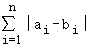
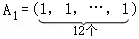
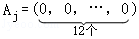

# Mathematics - 题目 3388

**ID**: ee0ab4f0837b49e6beef2008e34c8327
**年级**: Grade 11
**难度**: Medium-Hard
**题型**: 解答题（本大题共6小题，共85分）

## 题目
对于n维向量A＝（a${\rm _{1}}$ ，a${\rm _{2}}$ ，…，a${\rm \mathit{_{n}}}$ ），若对任意i∈{1，2，…，n}均有a${\rm \mathit{_{i}}}$ ＝0或a${\rm \mathit{_{i}}}$ ＝1，则称A为n维T向量．对于两个n维T向量A，B，定义d（A，B）＝．（Ⅰ）若A＝（1，0，1，0，1），B＝（0，1，1，1，0），求d（A，B）的值．（Ⅱ）现有一个5维T向量序列：A${\rm _{1}}$ ，A${\rm _{2}}$ ，A${\rm _{3}}$ ，…，若A${\rm _{1}}$ ＝（1，1，1，1，1）且满足：d（A${\rm \mathit{_{i}}}$ ，A${\rm \mathit{_{i}}}$  ${\rm _{+1}}$ ）＝2，i∈N${\rm ^{*}}$ ．求证：该序列中不存在5维T向量（0，0，0，0，0）．（Ⅲ）现有一个12维T向量序列：A${\rm _{1}}$ ，A${\rm _{2}}$ ，A${\rm _{3}}$ ，…，若且满足：d（A${\rm \mathit{_{i}}}$ ，A${\rm \mathit{_{i}}}$  ${\rm _{+1}}$ ）＝m，m∈N${\rm ^{*}}$ ，i＝1，2，3，…，若存在正整数j使得，A${\rm \mathit{_{j}}}$ 为12维T向量序列中的项，求出所有的m．​​​​​​​‌

## 解答

1. 解：（Ⅰ）由于A＝（1，0，1，0，1），B＝（0，1，1，1，0），由定义，
2. 可得d（A，B）＝4．…
3. （Ⅱ）反证法：若结论不成立，即存在一个含5维T向量序列，A${\rm _{1}}$ ，A${\rm _{2}}$ ，A${\rm _{3}}$ ，…A${\rm \mathit{_{n}}}$ ，
4. 使得A${\rm _{1}}$  ${\rm ＝（1，1，1，1，1），\mathit{A}}$  ${\rm \mathit{_{m}}}$ ＝（0，0，0，0，0）．
5. 因为向量A${\rm _{1}}$ ＝（1，1，1，1，1）的每一个分量变为0，都需要奇数次变化，
6. 不妨设A${\rm _{1}}$ 的第i（i＝1，2，3，4，5）个分量1变化了2n${\rm \mathit{_{i}}}$ ﹣1次之后变成0，
7. 所以将A${\rm _{1}}$ 中所有分量1变为0共需要（2n${\rm _{1}}$ ﹣1）+（2n${\rm _{2}}$ ﹣1）+（2n${\rm _{3}}$ ﹣1）+（2n${\rm _{4}}$ ﹣1）+（2n${\rm _{5}}$ ﹣1）＝2（n${\rm _{1}}$  ${\rm +\mathit{n}}$  ${\rm _{2}}$  ${\rm +\mathit{n}}$  ${\rm _{3}}$  ${\rm +\mathit{n}}$  ${\rm _{4}}$  ${\rm +\mathit{n}}$  ${\rm _{5}}$ ﹣2）﹣1次，此数为奇数．
8. 又因为，说明A${\rm \mathit{_{i}}}$ 中的分量有2个数值发生改变，
9. 进而变化到A${\rm \mathit{_{i}}}$  ${\rm _{+1}}$ ，所以共需要改变数值2（m﹣1）次，此数为偶数，所以矛盾．
10. 所以该序列中不存在5维T向量（0，0，0，0，0）．…（9分）
11. （Ⅲ）存在正整数j使得，A${\rm \mathit{_{j}}}$ 为12维T向量序列中的项，此时m＝1，2，3，4，5，6，7，8，9，10，11，12．…

## 知识点

**中文**:
  - 空间向量新定义问题

**English**:
  - New Definition Problems

---
