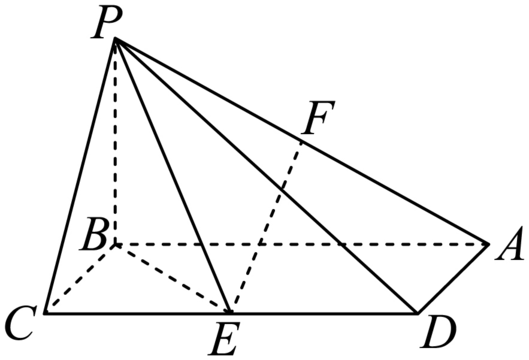

# Mathematics - 题目 1445

**ID**: f3e4efbbf24d4464a190acaa8b281323
**年级**: Grade 11
**难度**: Medium-Hard
**题型**: Calculation

## 题目
如图，四棱锥 $P-ABCD$ 的底面为矩形， $PB\bot $ 平面 $ABCD$ ， $AB=2BC$ ，点 $E$ ， $F$ 分别为棱 $CD,PA$ 的中点.​​​​​​​‌（1）证明：平面 $PEF\bot $ 平面 $PBE$ ；（2）点 $H$ 为线段 $AD$ 上的点，且满足 $PE{\rm{/}}{\rm{/}}$ 平面 $BFH$ .${\rm （i）}$ 确定点 $H$ 在 $AD$ 上的位置；${\rm （ii）}$ 若 $PB=2\sqrt {3},BC=3$ ，求直线 $PC$ 与直线 $FH$ 所成角的余弦值.

## 解答

1. （1）证明：连接 $AE$ ，如图所示.
2. 因为四棱锥 $P-ABCD$ 的底面为矩形， $AB=2BC$ ，点 $E$ 为棱 $CD$ 的中点，
3. 所以 $BC=CE$ ，且 $\angle BCE=90{^{\circ }}$ ，所以 $\angle BEC=45{^{\circ }}$ ，同理 $∠DEA=45{^{\circ }}$ ，
4. 所以 $∠AEB=180{^{\circ }}-2\times 45{^{\circ }}=90{^{\circ }}$ ，即 $AE\bot EB$ .
5. 因为 $PB\bot $ 平面 $ABCD,AE\subset $ 平面 $ABCD$ ，所以 $AE\bot PB$ .
6. 又因为 $EB\cap PB=B$ ，且 $EB,PB\subset $ 平面 $PBE$ ，所以 $AE\bot $ 平面 $PBE$ .
7. 因为 $AE\subset $ 平面 $PAE$ ，所以平面 $PAE\bot $ 平面 $PBE$ ，
8. 即平面 $PEF\bot $ 平面 $PBE$ .
9. （方法二）证明：因为四棱锥 $P-ABCD$ 的底面为矩形，且 $PB\bot $ 平面 $ABCD$ ，
10. 故以点 $B$ 为原点，分别以 $\overrightarrow {{BC}},\overrightarrow {{BA}},\overrightarrow {{BP}}$ 的方向为 $x$ 轴、 $y$ 轴、 $z$ 轴的正方向，
11. 建立如图所示的空间直角坐标系 $B-xyz$ ，设 $PB=h,BC=t$ ，
12. 因为 $AB=2BC$ ，所以 $P\left ({0,0,h}\right ),E\left ({t,t,0}\right ),F\left ({0,t,\frac {h}{2}}\right ),B\left ({0,0,0}\right )$ ，
13. 所以 $\overrightarrow {{PE}}=\left ({t,t,-h}\right ),\overrightarrow {{PF}}=\left ({0,t,-\frac {h}{2}}\right ),\overrightarrow {{PB}}=\left ({0,0,-h}\right )$ .
14. 设平面 $PEF$ 的法向量为 $\overrightarrow m=\left ({x{{}_{1}},y{{}_{1}},z{{}_{1}}}\right )$ ，
15. 则 $\begin{cases}\overrightarrow m\cdot \overrightarrow {{PE}}=0,\\\overrightarrow m\cdot \overrightarrow {{PF}}=0,\end{cases}$ 所以 $\begin{cases}tx{{}_{1}}+ty{{}_{1}}-hz{{}_{1}}=0,\\ty{{}_{1}}-\frac {h}{2}z{{}_{1}}=0,\end{cases}$
16. 令 $z{{}_{1}}=2t$ ，得 $\overrightarrow m=\left ({h,h,2t}\right )$ ；
17. 设平面 $PBE$ 的法向量为 $\overrightarrow n=\left ({x{{}_{2}},y{{}_{2}},z{{}_{2}}}\right )$ ，
18. 则 $\begin{cases}\overrightarrow n\cdot \overrightarrow {{PE}}=0,\\\overrightarrow n\cdot \overrightarrow {{PB}}=0,\end{cases}$ 所以 $\begin{cases}tx{{}_{2}}+ty{{}_{2}}-hz{{}_{2}}=0,\\-hz{{}_{2}}=0,\end{cases}$
19. 令 $x{{}_{2}}=1$ ，得 $\overrightarrow n=\left ({1,-1,0}\right )$ ；
20. 所以 $\overrightarrow m\cdot \overrightarrow n=h\times 1+h\times \left ({-1}\right )+2t\times 0=0$ ，所以 $\overrightarrow m\bot \overrightarrow n$ ，
21. 所以平面 $PEF\bot $ 平面 $PBE$ ；
22. （2）（i）如图，连接 $BH$ 交 $AE$ 于点 $G$ .
23. 因为 $PE//$ 平面 $BFH,PE\subset $ 平面 $PAE$ ，平面 $PAE\cap $ 平面 $BFH=FG$ ，所以 $PE//FG$ .
24. 因为点 $F$ 为棱 $PA$ 的中点，所以点 $G$ 为 $AE$ 的中点.
25. 设 $K$ 为 $AB$ 的中点，连接 $EK$ 交 $BH$ 于点 $N$ .
26. 又因为点 $E$ 为 $CD$ 的中点，四边形 $ABCD$ 为矩形，
27. 所以 $EK//AD$ ，且 $EK=AD$ ，
28. 所以 $\vartriangle NEG\cong \vartriangle HAG$ ，所以 $NE=HA$ ，故 $HD=KN=\frac {1}{2}AH$ ，所以 $\frac {AH}{HD}=2$ ，
29. 即点 $H$ 为 $AD$ 的一个三等分点，靠近点 $D$ 的位置.
30. ${\rm （ii）}$ 因为四棱锥 $P-ABCD$ 的底面为矩形，且 $PB\bot $ 平面 $ABCD$ ，所以 $PB,BC,BA$ 两两垂直.
31. 因此以 $\overrightarrow {{BC}},\overrightarrow {{BA}},\overrightarrow {{BP}}$ 为基底，表示 $\overrightarrow {{PC}},\overrightarrow {{FH}}$ ，
32. 则有 $\overrightarrow {{PC}}=\overrightarrow {{BC}}-\overrightarrow {{BP}}$ ， $\overrightarrow {{FH}}=\overrightarrow {{FK}}+\overrightarrow {{KA}}+\overrightarrow {{AH}}=-\frac {1}{2}\overrightarrow {{BP}}+\frac {1}{2}\overrightarrow {{BA}}+\frac {2}{3}\overrightarrow {{BC}}$
33. 因为 $PB=2\sqrt {3},BC=3$ ，所以 $AB=6$ ，
34. 所以 ${\cos}\left \langle {\overrightarrow {{PC}},\overrightarrow {{FH}}}\right \rangle =\frac {\overrightarrow {{PC}}·\overrightarrow {{FH}}}{\left |{PC}\right |\left |{FH}\right |}$  $=\frac {\left ({\overrightarrow {{BC}}-\overrightarrow {{BP}}}\right )·\left ({-\frac {1}{2}\overrightarrow {{BP}}+\frac {1}{2}\overrightarrow {{BA}}+\frac {2}{3}\overrightarrow {{BC}}}\right )}{\sqrt {{\left({\overrightarrow {{BC}}-\overrightarrow {{BP}}}\right)^{2}}}\times \sqrt {{\left({-\frac {1}{2}\overrightarrow {{BP}}+\frac {1}{2}\overrightarrow {{BA}}+\frac {2}{3}\overrightarrow {{BC}}}\right)^{2}}}}$  $=\frac {\frac {1}{2}\overrightarrow {{BP}}{^{2}}+\frac {2}{3}\overrightarrow {{BC}}{^{2}}}{\sqrt {\overrightarrow {{BC}}{^{2}}+\overrightarrow {{BP}}{^{2}}}\times \sqrt {\frac {1}{4}\overrightarrow {{BP}}{^{2}}+\frac {1}{4}\overrightarrow {{BA}}{^{2}}+\frac {4}{9}\overrightarrow {{BC}}{^{2}}}}$ ，
35. 所以 ${\cos}\left \langle {\overrightarrow {{PC}},\overrightarrow {{FH}}}\right \rangle =\frac {12}{\sqrt {21}\times 4}=\frac {\sqrt {21}}{7}.$
36. 所以直线 $PC$ 与直线 $FH$ 所成角的余弦值为 $\frac {\sqrt {21}}{7}.$
37. （方法二）（i）接（1）方法二，得 $\overrightarrow {{PE}}=\left ({t,t,-h}\right )$ ，
38. 因为点 $H$ 为线段 $AD$ 上的点，设 $AH=r\left ({0\leqslant r\leqslant t}\right )$ ，则 $H\left ({r,2t,0}\right )$ ，
39. 所以 $\overrightarrow {{BF}}=\left ({0,t,\frac {h}{2}}\right ),\overrightarrow {{BH}}=\left ({r,2t,0}\right )$ ，
40. 设平面 $BFH$ 的法向量为 $\overrightarrow u=\left ({x{{}_{3}},y{{}_{3}},z{{}_{3}}}\right )$ ，
41. 则 $\begin{cases}\overrightarrow u\cdot \overrightarrow {{BF}}=0,\\\overrightarrow u\cdot \overrightarrow {{BH}}=0,\end{cases}$ 所以 $\begin{cases}ty{{}_{3}}+\frac {h}{2}z{{}_{3}}=0,\\rx{{}_{3}}+2ty{{}_{3}}=0,\end{cases}$ 令 $x{{}_{3}}=2t$ ，
42. 得 $\overrightarrow u=\left ({2t,-r,\frac {2rt}{h}}\right )$ ；
43. 因为 $PE//$ 平面 $BFH$ ，所以 $\overrightarrow {{PE}}\cdot \overrightarrow u=0$ ，
44. 所以 $2t\times t+\left ({-r}\right )\times t+\frac {2rt}{h}\times \left ({-h}\right )=0$ ，解得 $r=\frac {2}{3}t$ ，
45. 所以 $\frac {AH}{HD}=2$ ，即点 $H$ 为 $AD$ 的一个三等分点，靠近点 $D$ 的位置.
46. ${\rm （ii）}$ 因为 $PB=2\sqrt {3},BC=3,AB=2BC$ ，所以 $P\left ({0,0,2\sqrt {3}}\right ),C\left ({3,0,0}\right ),F\left ({0,3,\sqrt {3}}\right )$ ，
47. 由 ${\rm （i）}$ 知， $AH=2HD$ ，故 $AH=2,H\left ({2,6,0}\right )$ ，
48. 所以 $\overrightarrow {{PC}}=\left ({3,0,-2\sqrt {3}}\right ),\overrightarrow {{FH}}=\left ({2,3,-\sqrt {3}}\right )$ ，
49. 所以 ${\rm{c}}{\rm{o}}{\rm{s}}\left \langle {\overrightarrow {{PC}},\overrightarrow {{FH}}}\right \rangle =\frac {\overrightarrow {{PC}}\cdot \overrightarrow {{FH}}}{\left |{\overrightarrow {{PC}}}\right |\left |{\overrightarrow {{FH}}}\right |}=\frac {6+6}{\sqrt {21}\times 4}=\frac {\sqrt {21}}{7}$ ，
50. 所以直线 $PC$ 与直线 $FH$ 所成角的余弦值为 $\frac {\sqrt {21}}{7}$ .
51. 
52. （方法三）（i）由 $PE//$ 平面 $BFH$ 可知， $H$ 唯一确定.
53. 如图，取 $AE$ 中点 $G$ ，连接 $FG,BG,BG$ 的延长线交 $AD$ 于点 $H$ ，
54. 则 $H$ 即为所求.
55. 理由如下：
56. 因为 $F,G$ 分别为 $AP,AE$ 中点，所以 $FG//PE$ ，
57. 因为 $FG\subset $ 平面 $BFH,PE\not\subset $ 平面 $BFH$ ，所以 $PE//$ 平面 $BFH$ .
58. 设 $\overrightarrow {{AD}}=λ\overrightarrow {{AH}}\left ({λ\geqslant 1}\right )$ ，由 $\overrightarrow {{AE}}=\frac {1}{2}\overrightarrow {{AB}}+\overrightarrow {{AD}}$ 得 $2\overrightarrow {{AG}}=\frac {1}{2}\overrightarrow {{AB}}+λ\overrightarrow {{AH}}$ ，
59. 因为 $G,B,H$ 三点共线，所以 $2=\frac {1}{2}+λ$ ，解得 $λ=\frac {3}{2}$ ，
60. 所以 $\overrightarrow {{AH}}=\frac {2}{3}\overrightarrow {{AD}}$ ，点 $H$ 为 $AD$ 的一个三等分点，靠近点 $D$ 位置.
61. ${\rm （ii）}$ 在 ${\rm Rt}\mathrm{△}PBC$ 中， $PC=\sqrt {PB{^{2}}+BC{^{2}}}=\sqrt {{\left({2\sqrt {3}}\right)^{2}}+3{^{2}}}=\sqrt {21}$ ，
62. 连接 $AC$ ，取 $AC$ 中点 $O$ ，连接 $OF$ ，
63. 因为点 $F$ 为 $PA$ 中点，所以 $OF=\frac {1}{2}PC=\frac {\sqrt {21}}{2},OF//PC$ .
64. 所以 $\angle OFH$ 为直线 $PC$ 与直线 $FH$ 所成角或其补角.
65. 取 $AB$ 中点 $M$ ，连接 $FM,MH$ ，则 $FM=\frac {1}{2}PB=\sqrt {3}$ ， $FM//PB$ ，
66. 因为 $PB\bot $ 平面 $ABCD$ ，所以 $FM\bot $ 平面 $ABCD$ .
67. 在 ${\rm Rt}△AHM$ 中， $AM=\frac {1}{2}AB=3,AH=\frac {2}{3}AD=2$ ，
68. 所以 $MH=\sqrt {AM{^{2}}+AH{^{2}}}=\sqrt {3{^{2}}+2{^{2}}}=\sqrt {13}$ .
69. 在 ${\rm Rt}\vartriangle FMH$ 中， $FH=\sqrt {FM{^{2}}+MH{^{2}}}=\sqrt {3+13}=4$ .
70. 取 $AD$ 中点 $N$ ，连接 $ON$ ，则 $ON\bot AD$ ，
71. 所以 $OH=\sqrt {ON{^{2}}+HN{^{2}}}=\sqrt {3{^{2}}+{\left({2-\frac {3}{2}}\right)^{2}}}=\frac {\sqrt {37}}{2}$ .
72. 在 $\vartriangle OFH$ 中，由余弦定理得 ${\rm{c}}{\rm{o}}{\rm{s}}∠OFH=\frac {OF{^{2}}+FH{^{2}}-OH{^{2}}}{2OF\cdot FH}=\frac {\frac {21}{4}+16-\frac {37}{4}}{2\times \frac {\sqrt {21}}{2}\times 4}=\frac {\sqrt {21}}{7}.$
73. 所以直线 $PC$ 与直线 $FH$ 所成角的余弦值为 $\frac {\sqrt {21}}{7}$ .
74. 

## 知识点

**中文**:
  - 向量法求异面直线所成角
  - 直线与平面平行的性质
  - 平面与平面垂直的判定

**English**:
  - Angle between Skew Lines
  - Properties of Line-Plane Parallelism
  - Plane-Plane Perpendicularity Determination

---
