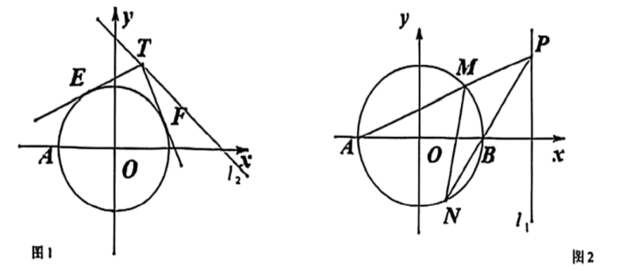

# Mathematics - 题目 956

**ID**: f5ce561fa0544fd09ff599e55fc60bde
**年级**: Grade 11
**难度**: Medium-Hard
**题型**: Calculation

## 题目
已知 $A$ ， $B$ 是圆 $C:x{^{2}}+y{^{2}}=9$ 与 $x$ 轴的交点， $P$ 为直线 $l{{}_{1}}:x=6$ 上的动点， $T$ 为 $l{{}_{2}}:x+y-6=0$ 上的动点.​​​​​​​‌（1）判断圆 $C$ 与圆 $D:x{^{2}}+y{^{2}}-8x+15=0$ 的公切线条数，并说明理由；（2）如图1：过点 $T$ 作圆 $C$ 的切线，切点为 $E$ ， $F$ ，当 $\left |{TO}\right |\cdot \left |{EF}\right |$ 最小时，求直线 $EF$ 的方程；（3）如图2： $PA$ ， $PB$ 与圆 $C$ 的另一个交点分别为 $M$ ， $N$ .直线 $MN$ 是否过定点，若过定点则求出定点坐标，若不过定点，请说明理由.

## 解答

1. （1）3条公切线；
2. 圆 ${\rm{C}}$ 的圆心为 $O\left ({0,0}\right )$ 半径为 $r{{}_{1}}=3$ ，圆 $D:{\left({x-4}\right)^{2}}+y{^{2}}=1$ 圆心 $O{{}_{1}}\left ({4,0}\right )$ ，半径为 $r{{}_{2}}=1$ ，
3. 圆心距为 $\left |{OO{{}_{1}}}\right |=4$ ，半径和半径为 $r{{}_{1}}+r{{}_{2}}=3+1=4$ ，
4. $\left |{OO{{}_{1}}}\right |=r{{}_{1}}+r{{}_{2}}$ ，两圆外切，故两圆有3条公切线.
5. （2）因为直线 $TE$ ， $TF$ 为圆 $C$ 的切线，所以 $OT\bot EF$ ，则 $\left |{EF}\right |\cdot \left |{OT}\right |=2\left |{OE}\right |\cdot \left |{TE}\right |$ ，
6. 又 $\left |{TE}\right |=\sqrt {\left |{OT}\right |{^{2}}-\left |{OE}\right |{^{2}}}=\sqrt {\left |{OT}\right |{^{2}}-9}$ ，所以 $\left |{EF}\right |\cdot \left |{OT}\right |=2\left |{OE}\right |\cdot \left |{TE}\right |=6\sqrt {\left |{OT}\right |{^{2}}-9}$ ，
7. 则当 $\left |{OT}\right |$ 取最小值时， $\left |{TO}\right |\cdot \left |{EF}\right |$ 最小，即 $OT\bot $ 直线 $l{{}_{2}}$ 时， $\left |{OT}\right |$ 取得最小值，即 $T\left ({3,3}\right )$ ，
8. 此时切线 $TF$ 的斜率不存在，切线 $TF$ 的方程为 $x=3$ ，
9. 
10. 此时切线 $TE$ 的斜率存在，切线 $TE$ 的方程为 $y=3$ ，
11. 一个切点坐标为 $\left ({0,3}\right )$ ，同理另一切点坐标为 $\left ({3,0}\right )$ ，
12. 所以直线 $EF$ 的方程为 $x+y-3=0$ ，即当 $\left |{TO}\right |\cdot \left |{EF}\right |$ 最小时，
13. 直线 $EF$ 的方程为 $x+y-3=0$ ；
14. （3）证明：如图 $A\left ({-3,0}\right )$ ， $B\left ({3,0}\right )$ ，设 $P\left ({6,t}\right )$ ，
15. ${\rm （i）}$ 当 $t\ne 0$ 时，则直线 $AP$ 的方程为 $y=\frac {t}{9}\left ({x+3}\right )$ ，
16. 直线 $BP$ 的方程为 $y=\frac {t}{3}\left ({x-3}\right )$ ，
17. 联立 $\begin{cases}x=\frac {9y}{t}-3\\x{^{2}}+y{^{2}}=9\end{cases}$ ，
18. 得 $\left ({\frac {81}{t{^{2}}}+1}\right )y{^{2}}-\frac {54}{t}y=0$ ， $y{{}_{M}}=\frac {54t}{t{^{2}}+81}$ 则 $x{{}_{M}}=\frac {3\left ({81-t{^{2}}}\right )}{t{^{2}}+81}$ ，则 $M\left ({\frac {3\left ({81-t{^{2}}}\right )}{t{^{2}}+81},\frac {54t}{t{^{2}}+81}}\right )$ ，
19. 同理 $N\left ({\frac {3\left ({t{^{2}}-9}\right )}{t{^{2}}+9},\frac {-18t}{t{^{2}}+9}}\right )$ ，
20. 所以直线 $MN$ 的斜率 $k{{}_{MN}}=\frac {\frac {54t}{t{^{2}}+81}-\frac {-18t}{t{^{2}}+9}}{\frac {3\left ({81-t{^{2}}}\right )}{t{^{2}}+81}-\frac {3\left ({t{^{2}}-9}\right )}{t{^{2}}+9}}=\frac {12t}{27-t{^{2}}}$ ，
21. 则直线 $MN$ 的方程为 $y=\frac {12t}{27-t{^{2}}}\left ({x-\frac {3\left ({t{^{2}}-9}\right )}{t{^{2}}+9}}\right )-\frac {18t}{t{^{2}}+9}$ ，
22. 即 $y=\frac {12t}{27-t{^{2}}}\left ({x-\frac {3}{2}}\right )$ ，所以直线恒过定点 $\left ({\frac {3}{2},0}\right )$ .
23. 
24. ${\rm （ii）}$ 当 $t=0$ 时， $M$ 与 $B$ 点重合， $N$ 与 $A$ 点重合，此时 $MN$ 的直线方程 $y=0$ ，直线过 $\left ({\frac {3}{2},0}\right )$ .
25. 综上所述：直线 $MN$ 恒过定点 $\left ({\frac {3}{2},0}\right )$ .

## 知识点

**中文**:
  - 圆的公切线
  - 直线与圆的位置关系的判断

**English**:
  - Common Tangents
  - Determining Line-Circle Relationship

---
