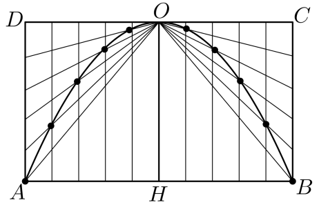

# Mathematics - 题目 997

**ID**: 0a57dae9d90e4911bf05cbcd6d9cef47
**年级**: Grade 11
**难度**: Medium-Hard
**题型**: 习题3.3（2）

## 题目
（阅读题）在工程中，画拱宽为 $2a$ ，拱高为h的抛物线，常用下面的画法：（1）作矩形ABCD，使 $AB=2a$ ， $DA=h$ ；​​​​​​​‌（2）分别取CD，AB的中点O，H，把线段DA，OD，HA各n等分；（3）如图连线得到各交点，将交点连成光滑曲线，就得到抛物线的一半；（4）用同样方法画出抛物线的另一半．你能说明上述画法的正确性吗？

## 解答

1. 以 $O$  为原点， $OC$ 所在直线为 $x$ 轴， $HO$ 所在直线为 $y$ 轴，建立如图所示的坐标系.
2. 则 $O\left ({0,0}\right ),C\left ({a,0}\right ),H\left ({0,-h}\right ),B\left ({a,-h}\right )$
3. 设满足条件的抛物线为 $x{^{2}}=-2py\left ({p>0}\right )$ ，由点 $B\left ({a,-h}\right )$ 在抛物线上.
4. 则 $a{^{2}}=2ph$ ，即 $2p=\frac {a{^{2}}}{h}$ ，所以抛物线的方程为 $x{^{2}}=-\frac {a{^{2}}}{h}y$
5. 把线段 $OC,BC,HB$ 各n等分；
6. 设线段 $OC$ 上的 $n$ 等分点分别为 $C{{}_{1}},C{{}_{2}},C{{}_{3}},\cdots C{{}_{n-1}}$ ，线段 $HB$ 上的 $n$ 等分点分别为 $H{{}_{1}},H{{}_{2}},H{{}_{3}},\cdots H{{}_{n-1}}$ ，线段 $BC$ 上的 $n$ 等分点分别为 $B{{}_{1}},B{{}_{2}},B{{}_{3}},\cdots B{{}_{n-1}}$ ，
7. 设 $C{{}_{m}}H{{}_{m}}$ 与 $OB{{}_{m}}$ 的交点为 $P{{}_{m}}\left ({x,y}\right )$ ，则 $\left |{OC{{}_{m}}}\right |=\frac {am}{n}$ ， $\left |{CB{{}_{m}}}\right |=\frac {hm}{n}$
8. 由 $\vartriangle OC{{}_{m}}P{{}_{m}}$ 与 $\vartriangle OCB{{}_{m}}$ 相似，可得 $\frac {\left |{C{{}_{m}}P{{}_{m}}}\right |}{\left |{CB{{}_{m}}}\right |}=\frac {\left |{OC{{}_{m}}}\right |}{\left |{OC}\right |}$
9. 即 $\left |{C{{}_{m}}P{{}_{m}}}\right |=\frac {\left |{OC{{}_{m}}}\right |}{\left |{OC}\right |}\times \left |{CB{{}_{m}}}\right |=\frac {\frac {am}{n}}{a}\times \frac {hm}{n}=\frac {m{^{2}}h}{n{^{2}}}$
10. 所以点 $P{{}_{m}}\left ({\frac {am}{n},-\frac {m{^{2}}h}{n{^{2}}}}\right )$
11. 由 ${\left({\frac {am}{n}}\right)^{2}}=-\frac {a{^{2}}}{h}\times \left ({-\frac {m{^{2}}h}{n{^{2}}}}\right )=\frac {m{^{2}}a{^{2}}}{n{^{2}}}$
12. 即点 $P{{}_{m}}\left ({x,y}\right )$ 满足方程 $x{^{2}}=-\frac {a{^{2}}}{h}y$ ，即点 $P{{}_{m}}\left ({x,y}\right )$ 在满足条件的抛物线上，
13. 故这种画法是正确的.
14. 

## 知识点

**中文**:
  - 抛物线的实际应用

**English**:
  - Real-world Applications

---
