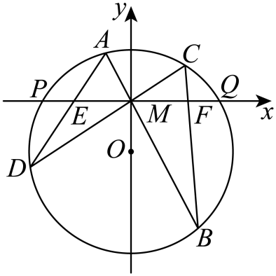

# Mathematics - 题目 3371

**ID**: 2973fb016e1c47b59d29b61919519e87
**年级**: Grade 11
**难度**: Medium-Hard
**题型**: 上下而求索

## 题目
设圆O的弦 $PQ$ 的中点为M，过点M任作两弦 $AB,CD$ ，弦 $AD$ 与 $BC$ 分别交 $PQ$ 于点E，F.​​​​​​​‌(1)试用解析几何的方法证明：M为 $EF$ 的中点；(2)如果将圆分别变为椭圆、双曲线或抛物线，你能得到类似的结论吗？

## 解答

1. （1）由题图所示：
2. 
3. 一方面：由题意设圆O的方程为 $x{^{2}}+{\left({y+a}\right)^{2}}=r{^{2}}$ ，直线 $AB,CD$ 的方程分别为 $y=k{{}_{1}}x,y=k{{}_{2}}x$ ;
4. 点A，B，C，D的坐标为 $\left ({x{{}_{i}},y{{}_{i}}}\right ),i=1,2,3,4$ ，所以直线 $AD$ 的方程为 $y-y{{}_{1}}=\frac {y{{}_{1}}-y{{}_{4}}}{x{{}_{1}}-x{{}_{4}}}\left ({x-x{{}_{1}}}\right )$ ，
5. 令 $y=0$ ，可得点E的横坐标为 $x{{}_{E}}=-y{{}_{1}}\cdot \frac {x{{}_{1}}-x{{}_{4}}}{y{{}_{1}}-y{{}_{4}}}+x{{}_{1}}$ ，结合 $y{{}_{1}}=k{{}_{1}}x{{}_{1}},y{{}_{4}}=k{{}_{2}}x{{}_{4}}$ 可知 $x{{}_{E}}=-y{{}_{1}}\cdot \frac {x{{}_{1}}-x{{}_{4}}}{y{{}_{1}}-y{{}_{4}}}+x{{}_{1}}=-k{{}_{1}}x{{}_{1}}\cdot \frac {x{{}_{1}}-x{{}_{4}}}{k{{}_{1}}x{{}_{1}}-k{{}_{2}}x{{}_{4}}}+x{{}_{1}}=\frac {\left ({k{{}_{1}}-k{{}_{2}}}\right )x{{}_{1}}x{{}_{4}}}{k{{}_{1}}x{{}_{1}}-k{{}_{2}}x{{}_{4}}}$ ，
6. 同理可得点F的横坐标为 $x{{}_{F}}=\frac {\left ({k{{}_{1}}-k{{}_{2}}}\right )x{{}_{2}}x{{}_{3}}}{k{{}_{1}}x{{}_{2}}-k{{}_{2}}x{{}_{3}}}$ ，
7. 由题意若要M为 $EF$ 的中点，只需 $EM=FM$ 即 $x{{}_{E}}=\frac {\left ({k{{}_{1}}-k{{}_{2}}}\right )x{{}_{1}}x{{}_{4}}}{k{{}_{1}}x{{}_{1}}-k{{}_{2}}x{{}_{4}}}=-\frac {\left ({k{{}_{1}}-k{{}_{2}}}\right )x{{}_{2}}x{{}_{3}}}{k{{}_{1}}x{{}_{2}}-k{{}_{2}}x{{}_{3}}}=-x{{}_{F}}$ ，
8. 所以只需 $\frac {x{{}_{1}}x{{}_{4}}}{k{{}_{1}}x{{}_{1}}-k{{}_{2}}x{{}_{4}}}=-\frac {x{{}_{2}}x{{}_{3}}}{k{{}_{1}}x{{}_{2}}-k{{}_{2}}x{{}_{3}}}$ ，交叉相乘得并整理得 $k{{}_{1}}x{{}_{1}}x{{}_{2}}\left ({x{{}_{3}}+x{{}_{4}}}\right )=k{{}_{2}}x{{}_{3}}x{{}_{4}}\left ({x{{}_{1}}+x{{}_{2}}}\right )$ .
9. 另一方面：联立圆O的方程 $x{^{2}}+{\left({y+a}\right)^{2}}=r{^{2}}$ 与直线 $AB$ 的方程 $y=k{{}_{1}}x$ 得 $x{^{2}}+{\left({k{{}_{1}}x+a}\right)^{2}}=r{^{2}}$ ，
10. 整理得 $\left ({1+k{{}_{1}^{2}}}\right )x{^{2}}+2k{{}_{1}}ax+a{^{2}}-r{^{2}}=0$ ，由韦达定理可得 $x{{}_{1}}+x{{}_{2}}=\frac {-2ak{{}_{1}}}{k{{}_{1}^{2}}+1},x{{}_{1}}\cdot x{{}_{2}}=\frac {a{^{2}}-r{^{2}}}{k{{}_{1}^{2}}+1}$ ，
11. 同理可得 $x{{}_{3}}+x{{}_{4}}=\frac {-2ak{{}_{2}}}{k{{}_{2}^{2}}+1},x{{}_{3}}\cdot x{{}_{4}}=\frac {a{^{2}}-r{^{2}}}{k{{}_{2}^{2}}+1}$ .
12. 结合以上两方面有 $k{{}_{1}}x{{}_{1}}x{{}_{2}}\left ({x{{}_{3}}+x{{}_{4}}}\right )=k{{}_{2}}x{{}_{3}}x{{}_{4}}\left ({x{{}_{1}}+x{{}_{2}}}\right )$ 成立，故命题得证.
13. （2）当圆变为椭圆时的情形（情形一）：
14. 如下图所示：
15. 
16. 一方面：由以上分析可知，设椭圆方程为 $\frac {x{^{2}}}{a{^{2}}}+\frac {{\left({y+m}\right)^{2}}}{b{^{2}}}=1$ ，将其与直线 $AB$ 的方程 $y=k{{}_{1}}x$ 联立得 $b{^{2}}x{^{2}}+a{^{2}}{\left({k{{}_{1}}x+m}\right)^{2}}=a{^{2}}b{^{2}}$ ，化简并整理得 $\left ({b{^{2}}+a{^{2}}k{{}_{1}^{2}}}\right )x{^{2}}+2a{^{2}}mk{{}_{1}}x+a{^{2}}\left ({m{^{2}}-b{^{2}}}\right )=0$ ，
17. 由韦达定理可得 $x{{}_{1}}+x{{}_{2}}=\frac {-2a{^{2}}mk{{}_{1}}}{b{^{2}}+a{^{2}}k{{}_{1}^{2}}},x{{}_{1}}\cdot x{{}_{2}}=\frac {a{^{2}}\left ({m{^{2}}-b{^{2}}}\right )}{b{^{2}}+a{^{2}}k{{}_{1}^{2}}}$ ，同理可得 $x{{}_{3}}+x{{}_{4}}=\frac {-2a{^{2}}mk{{}_{2}}}{b{^{2}}+a{^{2}}k{{}_{2}^{2}}},x{{}_{3}}\cdot x{{}_{4}}=\frac {a{^{2}}\left ({m{^{2}}-b{^{2}}}\right )}{b{^{2}}+a{^{2}}k{{}_{2}^{2}}}$ .
18. 另一方面：由（1）中分析可知，若要M为 $EF$ 的中点，则只需 $k{{}_{1}}x{{}_{1}}x{{}_{2}}\left ({x{{}_{3}}+x{{}_{4}}}\right )=k{{}_{2}}x{{}_{3}}x{{}_{4}}\left ({x{{}_{1}}+x{{}_{2}}}\right )$ 成立.
19. 结合以上两方面有 $k{{}_{1}}x{{}_{1}}x{{}_{2}}\left ({x{{}_{3}}+x{{}_{4}}}\right )=k{{}_{2}}x{{}_{3}}x{{}_{4}}\left ({x{{}_{1}}+x{{}_{2}}}\right )$ 成立,故命题得证.
20. 当圆变为双曲线时的情形（情形二）：
21. 如下图所示：
22. 
23. 一方面：同理设双曲线方程为 $\frac {x{^{2}}}{a{^{2}}}-\frac {{\left({y+m}\right)^{2}}}{b{^{2}}}=1$ ，将其与直线 $AB$ 的方程 $y=k{{}_{1}}x$ 联立得 $b{^{2}}x{^{2}}-a{^{2}}{\left({k{{}_{1}}x+m}\right)^{2}}=a{^{2}}b{^{2}}$ ，
24. 化简并整理得 $\left ({b{^{2}}-a{^{2}}k{{}_{1}^{2}}}\right )x{^{2}}-2a{^{2}}mk{{}_{1}}x-a{^{2}}\left ({m{^{2}}+b{^{2}}}\right )=0$ ，由韦达定理可得 $x{{}_{1}}+x{{}_{2}}=\frac {2a{^{2}}mk{{}_{1}}}{b{^{2}}-a{^{2}}k{{}_{1}^{2}}},x{{}_{1}}\cdot x{{}_{2}}=\frac {a{^{2}}\left ({m{^{2}}+b{^{2}}}\right )}{b{^{2}}-a{^{2}}k{{}_{1}^{2}}}$ ，
25. 同理可得 $x{{}_{3}}+x{{}_{4}}=\frac {2a{^{2}}mk{{}_{2}}}{b{^{2}}-a{^{2}}k{{}_{2}^{2}}},x{{}_{3}}\cdot x{{}_{4}}=\frac {a{^{2}}\left ({m{^{2}}+b{^{2}}}\right )}{b{^{2}}-a{^{2}}k{{}_{2}^{2}}}$ .
26. 另一方面：由（1）中分析可知，若要M为 $EF$ 的中点，则只需 $k{{}_{1}}x{{}_{1}}x{{}_{2}}\left ({x{{}_{3}}+x{{}_{4}}}\right )=k{{}_{2}}x{{}_{3}}x{{}_{4}}\left ({x{{}_{1}}+x{{}_{2}}}\right )$ 成立.
27. 结合以上两方面有 $k{{}_{1}}x{{}_{1}}x{{}_{2}}\left ({x{{}_{3}}+x{{}_{4}}}\right )=k{{}_{2}}x{{}_{3}}x{{}_{4}}\left ({x{{}_{1}}+x{{}_{2}}}\right )$ 成立,故命题得证.
28. 当圆变为抛物线时的情形（情形三）：
29. 如图所示：
30. 
31. 一方面：同理设抛物线方程为 $x{^{2}}=2p\left ({y+n}\right )$ ，将其与直线 $AB$ 的方程 $y=k{{}_{1}}x$ 联立得 $x{^{2}}=2p\left ({k{{}_{1}}x+n}\right )$ ，
32. 化简并整理得 $x{^{2}}-2pk{{}_{1}}x-2pn=0$ ，由韦达定理可得 $x{{}_{1}}+x{{}_{2}}=2pk{{}_{1}},x{{}_{1}}\cdot x{{}_{2}}=-2pn$ ，
33. 同理可得 $x{{}_{3}}+x{{}_{4}}=2pk{{}_{2}},x{{}_{3}}\cdot x{{}_{4}}=-2pn$ .
34. 另一方面：由（1）中分析可知，若要M为 $EF$ 的中点，则只需 $k{{}_{1}}x{{}_{1}}x{{}_{2}}\left ({x{{}_{3}}+x{{}_{4}}}\right )=k{{}_{2}}x{{}_{3}}x{{}_{4}}\left ({x{{}_{1}}+x{{}_{2}}}\right )$ 成立.
35. 而 $k{{}_{1}}x{{}_{1}}x{{}_{2}}\left ({x{{}_{3}}+x{{}_{4}}}\right )=k{{}_{2}}x{{}_{3}}x{{}_{4}}\left ({x{{}_{1}}+x{{}_{2}}}\right )$ 显然成立.
36. 结合以上两方面有 $k{{}_{1}}x{{}_{1}}x{{}_{2}}\left ({x{{}_{3}}+x{{}_{4}}}\right )=k{{}_{2}}x{{}_{3}}x{{}_{4}}\left ({x{{}_{1}}+x{{}_{2}}}\right )$ 成立,故命题得证.
37. 综上所述：如果将圆分别变为椭圆、双曲线或抛物线，（1）中结论依然成立.

## 知识点

**中文**:
  - 直线与圆的位置关系的判断
  - 直线与椭圆的位置关系

**English**:
  - Determining Line-Circle Relationship
  - Line-Ellipse Relationship

---
