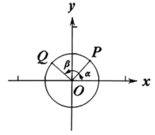

# Mathematics - 题目 2817

**ID**: 33b314185d064bff9f76e5f898e9b57f
**年级**: Grade 11
**难度**: Medium-Hard
**题型**: Fill-in-the-blank

## 题目
已知平面向量 $\overrightarrow {{OP}},\angle POx=α$ ，将 $\overrightarrow {{OP}}$ 绕点 $O$ 逆时针方向旋转 $β$ 得到向量 $\overrightarrow {{OQ}}$ ，在复平面内，向量 $\overrightarrow {{OP}}$ 对应的复数为 $Z{{}_{1}}={\rm{c}}{\rm{o}}{\rm{s}}α+{\rm{i}}{\rm{s}}{\rm{i}}{\rm{n}}α$ ，记复数 $Z{{}_{2}}={\rm{c}}{\rm{o}}{\rm{s}}β+{\rm{i}}{\rm{s}}{\rm{i}}{\rm{n}}β$ ，向量 $\overrightarrow {{OQ}}$ 对应的复数为 $ω$ ，下列说法正确的是.​​​​​​​‌（填正确说法的序号）.①点 $Q\left ({{\rm{c}}{\rm{o}}{\rm{s}}α{\rm{c}}{\rm{o}}{\rm{s}}β+{\rm{s}}{\rm{i}}{\rm{n}}α{\rm{s}}{\rm{i}}{\rm{n}}β,{\rm{s}}{\rm{i}}{\rm{n}}α{\rm{c}}{\rm{o}}{\rm{s}}β+{\rm{c}}{\rm{o}}{\rm{s}}β{\rm{s}}{\rm{i}}{\rm{n}}α}\right )$② $\left |{ω}\right |=\left |{Z{{}_{1}}}\right |\cdot \left |{Z{{}_{2}}}\right |$③ $ω=Z{{}_{1}}\cdot Z{{}_{2}}$④若 $α=0,β=\frac {2{\rm{π}}}{3}$ ，则 $Z{{}_{1}}\cdot Z{{}_{2}}\cdot {\overline{Z{{}_{2}}}}=1$

## 解答

1. 因为 $Z{{}_{1}}={\rm{c}}{\rm{o}}{\rm{s}}α+{\rm{i}}{\rm{s}}{\rm{i}}{\rm{n}}α$ ，所以 $\left |{Z{{}_{1}}}\right |=\sqrt {{\rm{c}}{\rm{o}}{\rm{s}}{^{2}}α+{\rm{s}}{\rm{i}}{\rm{n}}{^{2}}α}=1$ ，
2. 所以 $P,Q$ 在单位圆上，所以 $P\left ({{\rm{c}}{\rm{o}}{\rm{s}}α,{\rm{s}}{\rm{i}}{\rm{n}}α}\right )$ ，
3. 设 $\mathbf{Q}\left ({x,y}\right )$ ，由三角函数的定义，可得 ${\cos}\left ({α+β}\right )=x,\sin \left ({α+β}\right )=y$ ，
4. 所以 $Q\left ({{\cos}\left ({α+β}\right ),\sin \left ({α+β}\right )}\right )$ ，即 $Q\left ({{\rm{c}}{\rm{o}}{\rm{s}}α{\rm{c}}{\rm{o}}{\rm{s}}β-{\rm{s}}{\rm{i}}{\rm{n}}α{\rm{s}}{\rm{i}}{\rm{n}}β,{\rm{s}}{\rm{i}}{\rm{n}}α{\rm{c}}{\rm{o}}{\rm{s}}β+{\rm{c}}{\rm{o}}{\rm{s}}α{\rm{s}}{\rm{i}}{\rm{n}}β}\right )$ ，故①错误；
5. 所以 $ω={\cos}\left ({α+β}\right )+{\rm{i}}\sin \left ({α+β}\right )$ ，
6. $\left |{ω}\right |=\sqrt {{\left({{\rm{c}}{\rm{o}}{\rm{s}}α{\rm{c}}{\rm{o}}{\rm{s}}β-{\rm{s}}{\rm{i}}{\rm{n}}α{\rm{s}}{\rm{i}}{\rm{n}}β}\right)^{2}}+{\left({{\rm{s}}{\rm{i}}{\rm{n}}α{\rm{c}}{\rm{o}}{\rm{s}}β+{\rm{c}}{\rm{o}}{\rm{s}}α{\rm{s}}{\rm{i}}{\rm{n}}β}\right)^{2}}}$
7. $=\sqrt {{\cos}{^{2}}\left ({α+β}\right )+\sin {^{2}}\left ({α+β}\right )}=1$ ，
8. 又 $\left |{Z{{}_{1}}}\right |\times \left |{Z{{}_{2}}}\right |=\sqrt {{\rm{c}}{\rm{o}}{\rm{s}}{^{2}}α+{\rm{s}}{\rm{i}}{\rm{n}}{^{2}}α}\times \sqrt {{\rm{c}}{\rm{o}}{\rm{s}}{^{2}}β+{\rm{s}}{\rm{i}}{\rm{n}}{^{2}}β}=1$ ，
9. 所以 $\left |{ω}\right |=\left |{Z{{}_{1}}}\right |\cdot \left |{Z{{}_{2}}}\right |$ ，故②正确；
10. $Z{{}_{1}}\times Z{{}_{2}}=\left ({{\rm{c}}{\rm{o}}{\rm{s}}α+{\rm{i}}{\rm{s}}{\rm{i}}{\rm{n}}α}\right )\times \left ({{\rm{c}}{\rm{o}}{\rm{s}}β+{\rm{i}}{\rm{s}}{\rm{i}}{\rm{n}}β}\right )$
11. $={\rm{c}}{\rm{o}}{\rm{s}}α{\rm{c}}{\rm{o}}{\rm{s}}β+{\rm{i}}{\rm{c}}{\rm{o}}{\rm{s}}α{\rm{s}}{\rm{i}}{\rm{n}}β+{\rm{i}}{\rm{s}}{\rm{i}}{\rm{n}}α{\rm{c}}{\rm{o}}{\rm{s}}β+{\rm{i}}{^{2}}{\rm{s}}{\rm{i}}{\rm{n}}α{\rm{s}}{\rm{i}}{\rm{n}}β$
12. $=\left ({{\rm{c}}{\rm{o}}{\rm{s}}α{\rm{c}}{\rm{o}}{\rm{s}}β-{\rm{s}}{\rm{i}}{\rm{n}}α{\rm{s}}{\rm{i}}{\rm{n}}β}\right )+{\rm{i}}\left ({{\rm{c}}{\rm{o}}{\rm{s}}α{\rm{s}}{\rm{i}}{\rm{n}}β+{\rm{s}}{\rm{i}}{\rm{n}}α{\rm{c}}{\rm{o}}{\rm{s}}β}\right )$
13. $={\cos}\left ({α+β}\right )+{\rm{i}}\sin \left ({α+β}\right )=ω$ ，故③正确；
14. 当 $α=0,β=\frac {2{\rm{π}}}{3}$ 时， $Z{{}_{1}}={\rm{c}}{\rm{o}}{\rm{s}}0+{\rm{i}}{\rm{s}}{\rm{i}}{\rm{n}}0=1$ ，
15. $Z{{}_{2}}={\rm{c}}{\rm{o}}{\rm{s}}\frac {2{\rm{π}}}{3}+{\rm{i}}{\rm{s}}{\rm{i}}{\rm{n}}\frac {2{\rm{π}}}{3}=-\frac {1}{2}+\frac {\sqrt {3}}{2}{\rm{i}}$ ， ${\overline{Z{{}_{2}}}}={\rm{c}}{\rm{o}}{\rm{s}}\frac {2{\rm{π}}}{3}-{\rm{i}}{\rm{s}}{\rm{i}}{\rm{n}}\frac {2{\rm{π}}}{3}=-\frac {1}{2}-\frac {\sqrt {3}}{2}{\rm{i}}$ ，
16. 所以 $Z{{}_{1}}\cdot Z{{}_{2}}\cdot {\overline{Z{{}_{2}}}}=1\times \left ({-\frac {1}{2}+\frac {\sqrt {3}}{2}{\rm{i}}}\right )\left ({-\frac {1}{2}-\frac {\sqrt {3}}{2}{\rm{i}}}\right )=\frac {1}{4}+\frac {3}{4}=1$ ，故④正确.

## 知识点

**中文**:
  - 复数三角表示的乘除法*
  - 复数的模

**English**:
  - Multiplication and Division in Trigonometric Form
  - Modulus of a Complex Number

---
