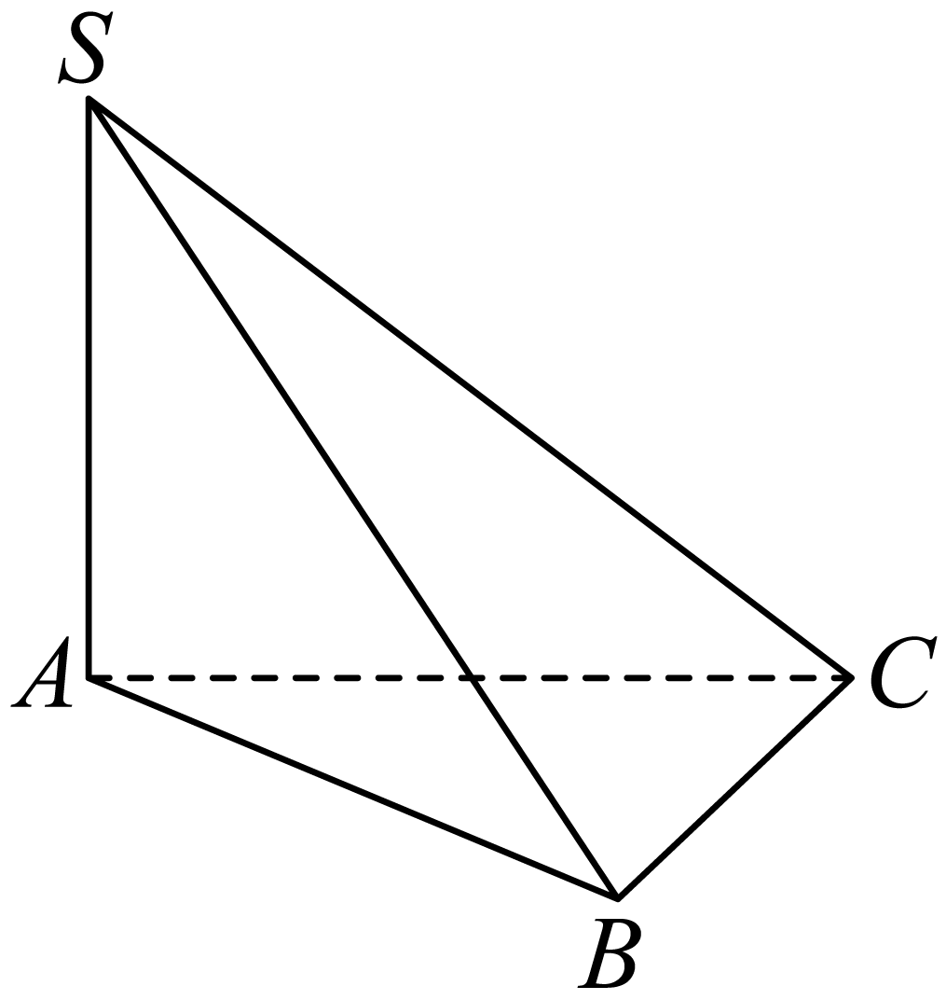

# Mathematics - 题目 520

**ID**: 72aa57abd6844e7bbfd7830347e3f5bb
**年级**: Grade 11
**难度**: Medium-Hard
**题型**: Fill-in-the-blank

## 题目
如图，在三棱锥 $S-ABC$ 中， $\vartriangle ABC$ 为等边三角形， $SA\bot AB$ ， $SB=SC$ ，若 $SA+AB=1$ ，则三棱锥 $S-ABC$ 外接球体积的最小值为．​​​​​​​‌

## 解答

1. 如图，取 $BC$ 中点 $E$ ，连接 $SE,AE$ ，则 $BC\bot SE$ ， $BC\bot AE$ ，
2. 
3. 又 $SE\cap AE=E$ ， $SE$ ， $AE\subset $ 平面 $ASE$ ，则 $BC\bot $ 平面 $ASE$ ，
4. 因为 $SA\subset $ 平面 $ASE$ ，则 $BC\bot SA$ ，
5. 又 $SA\bot AB$ ， $AB\cap BC=B$ ， $AB$ ， $BC\subset $ 平面 $ABC$ ，
6. 所以 $SA\bot $ 平面 $ABC$ ，
7. 所以三棱锥 $S-ABC$ 的外接球球心必在过 $\vartriangle ABC$ 的中心 $O{{}_{1}}$ 且平行于 $SA$ 的直线上，
8. 且 $OO{{}_{1}}=\frac {1}{2}SA$ ，
9. 设 $AB=x\left ({0<x<1}\right )$ ，则 $SA=1-x$ ， $AO{{}_{1}}=\frac {\sqrt {3}}{3}x$ ，
10. 设三棱锥 $S-ABC$ 的外接球半径为 $R$ ，则有 $R{^{2}}=AO{{}_{1}^{2}}+OO{{}_{1}^{2}}=\frac {7}{12}x{^{2}}-\frac {1}{2}x+\frac {1}{4}$ ，
11. 当 $x=\frac {3}{7}$ 时， $R{{}_{{\rm{m}}{\rm{i}}{\rm{n}}}^{2}}=\frac {1}{7}$ ，
12. 故三棱锥 $S-ABC$ 外接球体积的最小值为 $\frac {4{\rm{π}}}{3}R{{}_{{\rm{m}}{\rm{i}}{\rm{n}}}^{3}}=\frac {4\sqrt {7}{\rm{π}}}{147}$ ．

## 知识点

**中文**:
  - 球的体积
  - 球的切接问题

**English**:
  - Volume of a Sphere
  - Tangency and Inscribed/Circumscribed Spheres

---
