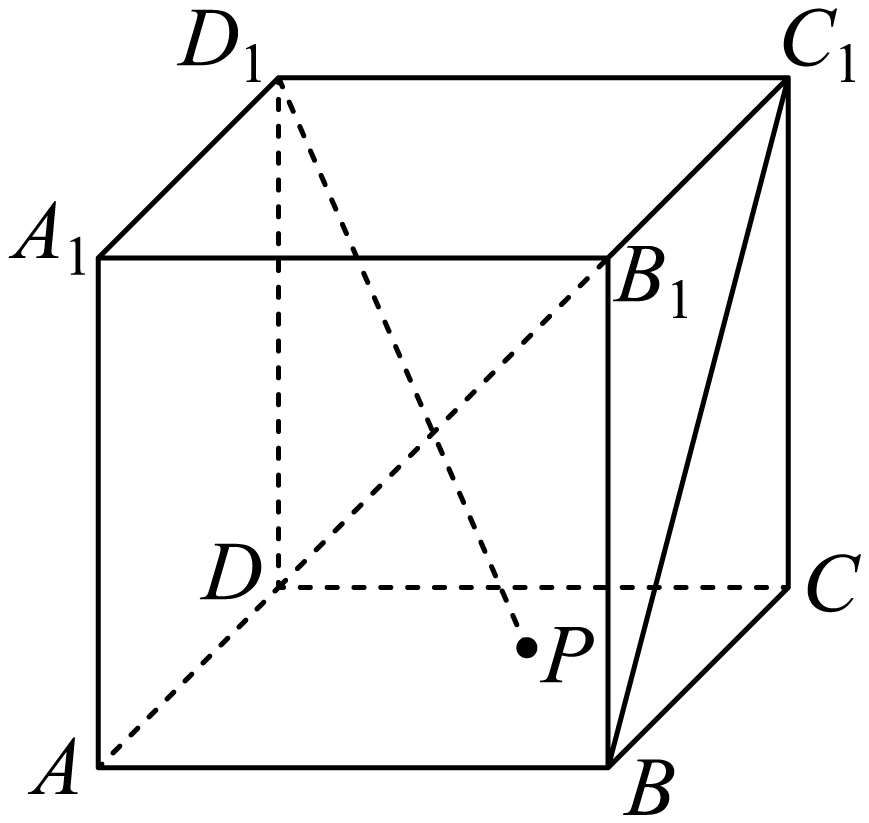

# Mathematics - 题目 3594

**ID**: 8766420d22334d41b10fe806a4bec0a4
**年级**: Grade 11
**难度**: Medium-Hard
**题型**: Fill-in-the-blank

## 题目
对于两个空间向量 $\overrightarrow a=\left ({x{{}_{1}}{\rm{,}}y{{}_{1}}{\rm{,}}z{{}_{1}}}\right )$ 与 $\overrightarrow b=\left ({x{{}_{2}}{\rm{,}}y{{}_{2}}{\rm{,}}z{{}_{2}}}\right )$ ，我们定义 $d\left ({\overrightarrow a,\overrightarrow b}\right )=\sqrt {{\left({x{{}_{1}}-x{{}_{2}}}\right)^{2}}+{\left({y{{}_{1}}-y{{}_{2}}}\right)^{2}}+{\left({z{{}_{1}}-z{{}_{2}}}\right)^{2}}}$ 为两点之间的直线距离；又定义它们之间的曼哈顿距离为 $D\left ({\overrightarrow a{\rm{,}}\overrightarrow b}\right )=∣x{{}_{1}}-x{{}_{2}}∣+∣y{{}_{1}}-y{{}_{2}}∣+\left |{z{{}_{1}}-z{{}_{2}}}\right |$ .​​​​​​​‌如图，在棱长为1的正方体 $ABCD-A{{}_{1}}B{{}_{1}}C{{}_{1}}D{{}_{1}}$ 中， $d\left ({\overrightarrow {{DB{{}_{1}}}}{\rm{,}}\overrightarrow {{BC{{}_{1}}}}}\right )=$；若点P在底面 $ABCD$ 内（含边界）运动，且 $\left |{\overrightarrow {{D{{}_{1}}P}}}\right |=\sqrt {2}$ ，则 $D\left ({\overrightarrow {{AB}}{\rm{,}}\overrightarrow {{D{{}_{1}}P}}}\right )$ 的取值范围是.

## 解答

1. 由题可建立如图所示空间直角坐标系 $D-xyz$ ，
2. 则 $D\left ({0,0,0}\right ),B{{}_{1}}\left ({1,1,1}\right ),B\left ({1,1,0}\right ),C{{}_{1}}\left ({0,1,1}\right ),A\left ({1,0,0}\right ),D{{}_{1}}\left ({0,0,1}\right )$ ，设 $P\left ({x,y,0}\right ),0\leqslant x\leqslant 1,0\leqslant y\leqslant 1$ ，
3. 则 $\overrightarrow {{DB{{}_{1}}}}=\left ({1,1,1}\right ),\overrightarrow {{BC{{}_{1}}}}=\left ({-1,0,1}\right ),\overrightarrow {{AB}}=\left ({0,1,0}\right ),\overrightarrow {{D{{}_{1}}P}}=\left ({x,y,-1}\right )$ ，
4. 所以 $\left |{\overrightarrow {{D{{}_{1}}P}}}\right |=\sqrt {x{^{2}}+y{^{2}}+1}=\sqrt {2}$ ，即 $x{^{2}}+y{^{2}}=1$ ，
5. 所以 $d\left ({\overrightarrow {{DB{{}_{1}}}},\overrightarrow {{BC{{}_{1}}}}}\right )=\sqrt {\left [1-\left ({-1}\right )\right ]{^{2}}+{\left({1-0}\right)^{2}}+{\left({1-1}\right)^{2}}}=\sqrt {5}$ ；
6. $D\left ({\overrightarrow {{AB}},\overrightarrow {{D{{}_{1}}P}}}\right )=\left |{0-x}\right |+\left |{1-y}\right |+\left |{0-\left ({-1}\right )}\right |=x+1-y+1=x-y+2$ ，
7. 令 $x={\cos}θ,y=\sin θ,θ\in \left [0,\frac {{\rm{π}}}{2}\right ]$ ，
8. 则 $D\left ({\overrightarrow {{AB}},\overrightarrow {{D{{}_{1}}P}}}\right )=x-y+2={\cos}θ-\sin θ+2=\sqrt {2}{\cos}\left ({θ+\frac {{\rm{π}}}{4}}\right )+2$ ，
9. 因为 $θ\in \left [0,\frac {{\rm{π}}}{2}\right ]$ ，所以 $θ+\frac {{\rm{π}}}{4}\in \left [\frac {{\rm{π}}}{4},\frac {{{3}}{\rm{π}}}{4}\right ]$ ，
10. 所以 ${\cos}\left ({θ+\frac {{\rm{π}}}{4}}\right )\in \left [-\frac {\sqrt {2}}{2},\frac {\sqrt {2}}{2}\right ]$ ，所以 $\sqrt {2}{\cos}\left ({θ+\frac {{\rm{π}}}{4}}\right )+2\in \left [1,,3\right ]$ ，
11. 所以 $D\left ({\overrightarrow {{AB}}{\rm{,}}\overrightarrow {{D{{}_{1}}P}}}\right )$ 的取值范围是 $\left [1,3\right ]$ .
12. 

## 知识点

**中文**:
  - 空间向量新定义问题

**English**:
  - New Definition Problems

---
