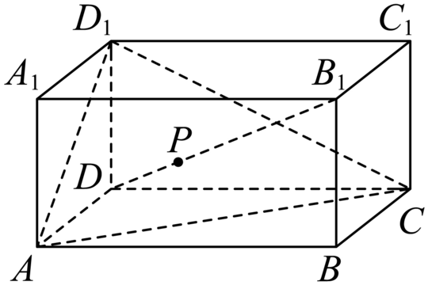

# Mathematics - 题目 1569

**ID**: 8785b6eeface4e6a8f3e580868aa1588
**年级**: Grade 11
**难度**: Medium-Hard
**题型**: Fill-in-the-blank

## 题目
如图所示，在长方体 $ABCD-A{{}_{1}}B{{}_{1}}C{{}_{1}}D{{}_{1}}$ 中 ${\rm \mathit{，}}AD=AA{{}_{1}}=2$ ， $AB=4$ ， $B{{}_{1}}D$ 与平面 $ACD{{}_{1}}$ 交于点 $P$ ，则点 $P$ 到直线 $BC$ 的距离为．​​​​​​​‌

## 解答

1. 以点 $D$ 为原点， $DA,DC,DD{{}_{1}}$ 所在直线为 $x,y,z$ 轴建立空间直角坐标系，如图所示，
2. 则 $A\left ({2,0,0}\right ),B\left ({2,4,0}\right ),C\left ({0,4,0}\right ),B{{}_{1}}\left ({2,4,2}\right ),D{{}_{1}}\left ({0,0,2}\right )$ ，
3. $\overrightarrow {{AD{{}_{1}}}}=\left ({-2,0,2}\right ),\overrightarrow {{AC}}=\left ({-2,4,0}\right ),\overrightarrow {{DB{{}_{1}}}}=\left ({2,4,2}\right ),\overrightarrow {{CB}}=\left ({2,0,0}\right )$ ，
4. 由 $B{{}_{1}}D\cap $ 平面 $ACD{{}_{1}}=$  $P$ ，设 $\overrightarrow {{AP}}=λ\overrightarrow {{AD{{}_{1}}}}+μ\overrightarrow {{AC}}=λ\left ({-2,0,2}\right )+μ\left ({-2,4,0}\right )=\left ({-2λ-2μ,4μ,2λ}\right )$ ，
5. 所以 $\overrightarrow {{DP}}=\overrightarrow {{DA}}+\overrightarrow {{AP}}=\left ({-2λ-2μ+2,4μ,2λ}\right )$ ，
6. 设 $\overrightarrow {{DP}}=k\overrightarrow {{DB{{}_{1}}}}=\left ({2k,4k,2k}\right )$ ，
7. 所以 $\left ({-2λ-2μ+2,4μ,2λ}\right )=\left ({2k,4k,2k}\right )$ ，即 $\begin{cases}-2λ-2μ+2=2k\\4μ=4k\\2λ=2k\end{cases}$ ，解得 $λ=μ=k=\frac {1}{3}$ ，
8. 所以 $P\left ({\frac {2}{3},\frac {4}{3},\frac {2}{3}}\right )$ ，则 $\overrightarrow {{PB}}=\left ({\frac {4}{3},\frac {8}{3}，-\frac {2}{3}}\right )$ ，
9. 设直线 $PB,BC$ 的夹角为 $θ\in [0,\frac {{\rm{π}}}{2}]$ ，
10. 则 ${\cos}θ=\left |{{\cos}\left \langle {\overrightarrow {{PB}},\overrightarrow {{CB}}}\right \rangle }\right |=\frac {\frac {8}{3}}{\sqrt {\frac {16}{9}+\frac {64}{9}+\frac {4}{9}}}=\frac {2}{\sqrt {21}}$ ，
11. 所以 $\sin θ=\sqrt {1-{\cos}{^{2}}θ}=\frac {\sqrt {17}}{\sqrt {21}}$ ，
12. 所以点 $P$ 到直线 $BC$ 的距离为 $\sin θ\cdot \left |{\overrightarrow {{PB}}}\right |=\frac {\sqrt {17}}{\sqrt {21}}\times \frac {2\sqrt {21}}{3}=\frac {2\sqrt {17}}{3}$ .
13. 

## 知识点

**中文**:
  - 向量法求距离-点线距离

**English**:
  - Point-Line Distance

---
