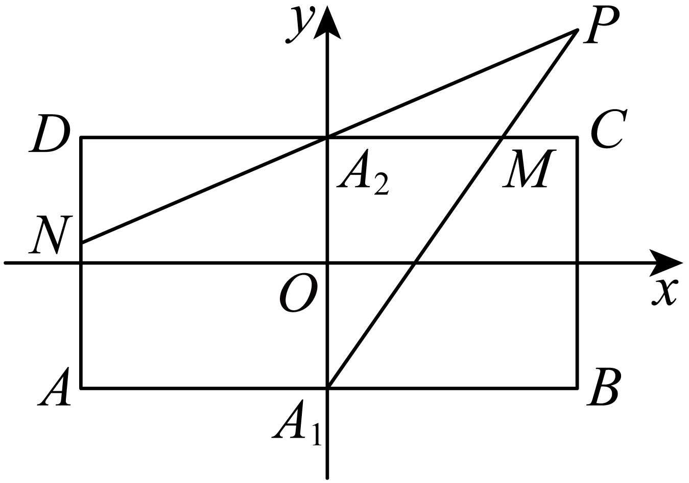

# Mathematics - 题目 754

**ID**: b07b9d777c2a48f4b982870666a6716b
**年级**: Grade 11
**难度**: Medium-Hard
**题型**: Fill-in-the-blank

## 题目
在矩形 $ABCD$ 中， $\left |{AB}\right |=2\left |{AD}\right |$ ， $A{{}_{1}}$ ， $A{{}_{2}}$ 分别为边 $AB$ ， $CD$ 的中点， $M$ ， $N$ 分别为线段 $A{{}_{2}}C$ （不含端点）和 $AD$ 上的动点，满足 $\frac {\left |{MA{{}_{2}}}\right |}{\left |{CD}\right |}=\frac {\left |{DN}\right |}{\left |{AD}\right |}$ ，直线 $A{{}_{1}}M$ ， $A{{}_{2}}N$ 的交点为 $P$ ，已知点 $P$ 的轨迹为双曲线的一部分，以 $A{{}_{1}}A{{}_{2}}$ 所在的直线为 $y$ 轴，线段 $A{{}_{1}}A{{}_{2}}$ 的中垂线所在的直线为 $x$ 轴，建立如图所示的直角坐标系，则该双曲线的渐近线方程为.​​​​​​​‌

## 解答

1. 设 $\left |{AD}\right |=\left |{BC}\right |=m\left ({m>0}\right )$ ，则 $\left |{AB}\right |=\left |{CD}\right |=2m$ ，
2. 则有 $A(-m,-\frac {m}{2})$ ， $B(m,-\frac {m}{2})$ ， $A{{}_{1}}\left ({0,-\frac {m}{2}}\right )$ ， $A{{}_{2}}(0,\frac {m}{2})$ ， $C(m,\frac {m}{2})$ ， $D(-m,\frac {m}{2})$ ， $A(-m,-\frac {m}{2})$ ，
3. 设 $M\left ({x{{}_{0}},\frac {m}{2}}\right )\left ({0<x{{}_{0}}<m}\right )$ ， $N\left ({-m,y{{}_{0}}}\right )\left ({-\frac {m}{2}\leqslant y{{}_{0}}\leqslant \frac {m}{2}}\right )$ ，
4. 所以 $\left |{MA{{}_{2}}}\right |=x{{}_{0}}$ ， $\left |{DN}\right |=\frac {m}{2}-y{{}_{0}}$ ，
5. 又因为 $\frac {\left |{MA{{}_{2}}}\right |}{\left |{CD}\right |}=\frac {\left |{DN}\right |}{\left |{AD}\right |}$ ，所以 $\frac {x{{}_{0}}}{2m}=\frac {\frac {m}{2}-y{{}_{0}}}{m}$ ，
6. 所以 $x{{}_{0}}=m-2y{{}_{0}}$ ，即 $y{{}_{0}}=\frac {m-x{{}_{0}}}{2}$ ，
7. 又因为 $k{{}_{A{{}_{1}}M}}=\frac {\frac {m}{2}-\left ({-\frac {m}{2}}\right )}{x{{}_{0}}-0}=\frac {m}{x{{}_{0}}}$ ，
8. 所以直线 $A{{}_{1}}M$ 的方程为： $y-\left ({-\frac {m}{2}}\right )=\frac {m}{x{{}_{0}}}\left ({x-0}\right )$ ，即 $y=\frac {m}{x{{}_{0}}}x-\frac {m}{2}$ ，
9. 同理可得直线 $A{{}_{2}}N$ 的方程为： $y-\frac {m}{2}=-\frac {y{{}_{0}}-\frac {m}{2}}{m}\left ({x-0}\right )$ ，即 $y=\frac {m}{2}-\frac {y{{}_{0}}-\frac {m}{2}}{m}x=\frac {m}{2}-\frac {\frac {m-x{{}_{0}}}{2}-\frac {m}{2}}{m}x=\frac {m}{2}+\frac {x{{}_{0}}}{2m}x$ ，
10. 由 $\begin{cases}y=\frac {m}{2}+\frac {x{{}_{0}}}{2m}x\\y=\frac {m}{x{{}_{0}}}x-\frac {m}{2}\end{cases}$ ，可得 $\begin{cases}x=\frac {2x{{}_{0}}m{^{2}}}{2m{^{2}}-x{{}_{0}^{2}}}\\y=\frac {2m{^{3}}+mx{{}_{0}^{2}}}{2\left ({2m{^{2}}-x{{}_{0}^{2}}}\right )}\end{cases}$ ，
11. 即 $P(\frac {2x{{}_{0}}m{^{2}}}{2m{^{2}}-x{{}_{0}^{2}}},\frac {2m{^{3}}+mx{{}_{0}^{2}}}{2(2m{^{2}}-x{{}_{0}^{2}})})$ ，
12. 因为 $x{{}_{p}}=\frac {2x{{}_{0}}m{^{2}}}{2m{^{2}}-x{{}_{0}^{2}}}$ ， $y{{}_{p}}=\frac {2m{^{3}}+mx{{}_{0}^{2}}}{2\left ({2m{^{2}}-x{{}_{0}^{2}}}\right )}$
13. $y{{}_{p}}=\frac {2m{^{3}}+mx{{}_{0}^{2}}}{2\left ({2m{^{2}}-x{{}_{0}^{2}}}\right )}=\frac {m\left ({2m{^{2}}+x{{}_{0}^{2}}}\right )}{2\left ({2m{^{2}}-x{{}_{0}^{2}}}\right )}$ ， $y{{}_{p}^{2}}=\left ({\frac {m\left ({2m{^{2}}+x{{}_{0}^{2}}}\right )}{2\left ({2m{^{2}}-x{{}_{0}^{2}}}\right )}}\right ){^{2}}=\frac {m{^{2}}}{4}·\frac {{\left({2m{^{2}}-x{{}_{0}^{2}}}\right)^{2}}+8m{^{2}}x{{}_{0}^{2}}}{{\left({2m{^{2}}-x{{}_{0}^{2}}}\right)^{2}}}=\frac {m{^{2}}}{4}·\left ({1+\frac {8m{^{2}}x{{}_{0}^{2}}}{{\left({2m{^{2}}-x{{}_{0}^{2}}}\right)^{2}}}}\right )=\frac {m{^{2}}}{4}+\frac {x{{}_{p}^{2}}}{2}$ ，
14. 即有 $y{{}_{p}^{2}}-\frac {x{{}_{p}^{2}}}{2}=\frac {m{^{2}}}{4}$ ，得 $\frac {y{{}_{p}^{2}}}{\frac {m{^{2}}}{4}}-\frac {x{{}_{p}^{2}}}{\frac {m{^{2}}}{2}}=1$ ,
15. 所以点 $P$ 所在双曲线方程为： $\frac {y{{}_{p}^{2}}}{\frac {m{^{2}}}{4}}-\frac {x{{}_{p}^{2}}}{\frac {m{^{2}}}{2}}=1$ ，
16. 所以， $a{^{2}}=\frac {m{^{2}}}{4},b{^{2}}=\frac {m{^{2}}}{2}$ ，
17. 所以渐近线方程为 $y=\pm \frac {\sqrt {2}}{2}x$ .

## 知识点

**中文**:
  - 渐近线

**English**:
  - Asymptotes

---
