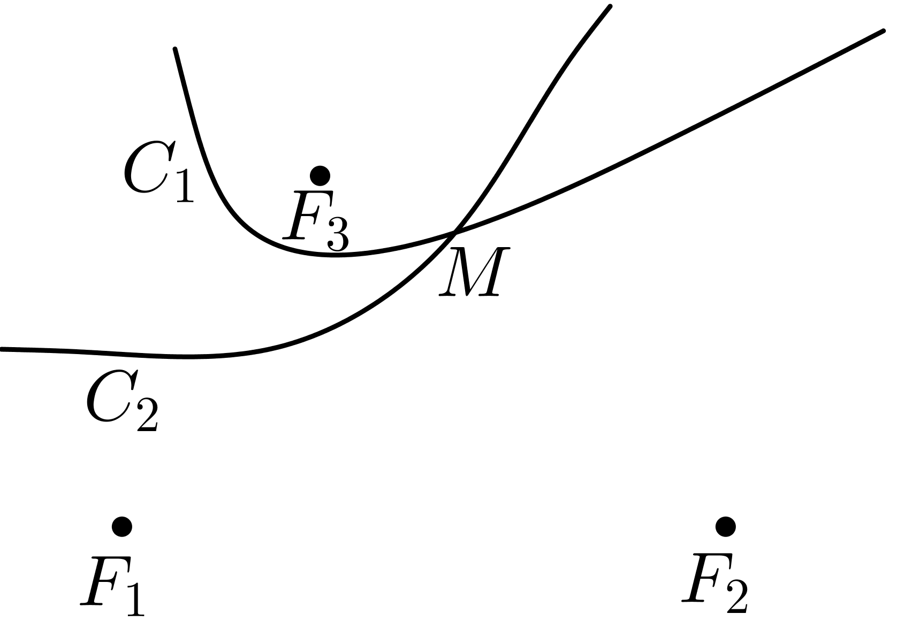

# Mathematics - 题目 2065

**ID**: e3f9226f9d3340b5839051988a55cd56
**年级**: Grade 11
**难度**: Medium-Hard
**题型**: Fill-in-the-blank

## 题目
双曲线定位是通过测定待定点到至少三个已知点的两个距离差所进行的一种无线电定位．定位参数是距离差，位置线是双曲线，定位时需由至少三个已知点的组合，在待定点到三个已知点的三个距离中，取其中两个距离差，此时形成两条位置双曲线，两者相交便可确定待定点的位置．例如图所示， $F{{}_{1}}$ ， $F{{}_{2}}$ ， $F{{}_{3}}$ 为三个已知点，点M即为两条位置双曲线 $C{{}_{1}}$ ， $C{{}_{2}}$ 确定的待定点．现海上有三个两两相距180公里的岸台A，B，C三个岸台同时发射电磁波，远离岸台A，B，C的船只S同时接收到了来自岸台A，B的电磁波信号，而接收到岸台 $C$ 的信号比接收到岸台A，B的信号早了 $200\sqrt {3}$ 微秒（已知1微秒等于 $10{^{-6}}$ 秒，且电磁波在空气中1微秒传播距离为300米），则船只S与岸台C的距离为公里．​​​​​​​‌

## 解答

1. 以CA所在直线为x轴，以线段CA的垂直平分线为y轴，建立平面直角坐标系如图，
2. $\left |{AB}\right |=\left |{BC}\right |=\left |{CA}\right |=180$ , $A(90,0),C(-90,0)$ ，
3. 船只S距离岸台C比岸台A，B近 $200\sqrt {3}\times 300=60000\sqrt {3}$ 米，即 $60\sqrt {3}$ 公里，
4. 即船只S到岸台C比到岸台A的距离近 $60\sqrt {3}$ 公里，即 $\left |{SA}\right |-\left |{SC}\right |=60\sqrt {3}$ ，
5. 则船只S在以C，A为焦点的双曲线的左支上，设双曲线的方程为 $\frac {x{^{2}}}{a{^{2}}}-\frac {y{^{2}}}{b{^{2}}}=1\left ({a>0,b>0}\right )$ ，则 $2a=60\sqrt {3},2c=180$ ，故 $b{^{2}}=c{^{2}}-a{^{2}}=5400$ ，
6. 则船只S的位置双曲线的方程为 $\frac {x{^{2}}}{2700}-\frac {y{^{2}}}{5400}=1\left ({x<0}\right )$ ，
7. 又因为船只S到岸台A，B距离相等，所以船只S也在线段AB的垂直平分线上，
8. 设线段AB的中点D，则 $\angle DCA=30{}\degree $ ， $k{{}_{CD}}={\tan}30{}\degree =\frac {\sqrt {3}}{3}$ ，
9. 则线段AB的垂直分线CD的方程为 $y=\frac {\sqrt {3}}{3}(x+90)$ ，即 $x=\sqrt {3}y-90$ ，
10. 联立 $\begin{cases}\frac {x{^{2}}}{2700}-\frac {y{^{2}}}{5400}=1\\x=\sqrt {3}y-90\end{cases}$ ，解得 $\begin{cases}x=-54\\y=12\sqrt {3}\end{cases}$ 或 $\begin{cases}x=90\\y=60\sqrt {3}\end{cases}$ （舍），故 $S(-54,12\sqrt {3})$ ，
11. 所以船只S到岸台C的距离为 $\left |{CS}\right |=\sqrt {{\left({-54+90}\right)^{2}}+{\left({12\sqrt {3}}\right)^{2}}}=24\sqrt {3}$ 公里．

## 知识点

**中文**:
  - 直线与双曲线的位置关系

**English**:
  - Line-Hyperbola Relationship

---
