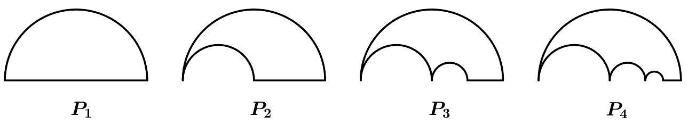

# Mathematics - 题目 3895

**ID**: e65c1edf253b46dca4394b89b8f244e0
**年级**: Grade 11
**难度**: Medium-Hard
**题型**: Fill-in-the-blank

## 题目
如图，P_{1}是一块半径为2a的半圆形纸板，在P_{1}的左下端剪去一个半径为a的半圆后得到图形P_{2}，然后依次剪去一个更小的半圆（其直径为前一个被剪掉半圆的半径）得图形P_{3}、P_{4}、…、P_{n}、…，记第n块纸板P_{n}的面积为S_{n}，则（1）S_{3}＝，（2）如果对 $\forall n\in {\mathbf{N}^{*}},S{{}_{n}}>\frac {2020π}{3}$ 恒成立，那么a的取值范围是．​​​​​​​‌

## 解答

1. 第一块纸板面积为 $S{{}_{1}}=\frac {1}{2}π{\left({2a}\right)^{2}}=2πa{^{2}}$
2. 第二块纸板面积为 $S{{}_{2}}=2πa{^{2}}-\frac {1}{2}πa{^{2}}=\frac {3}{2}πa{^{2}}$
3. 第三块纸板面积为 $S{{}_{3}}=\frac {3}{2}a{^{2}}-\frac {1}{2}π{\left({\frac {a}{2}}\right)^{2}}=\frac {11}{8}πa{^{2}}$
4. $\cdots $
5. 由此归纳总结，第 $n$ 块纸板面积为
6. $S{{}_{n}}=2πa{^{2}}\left [1-\frac {1}{4}-{\left({\frac {1}{4}}\right)^{2}}-{\left({\frac {1}{4}}\right)^{3}}-\cdots -{\left({\frac {1}{4}}\right)^{n-1}}\right ]=2πa{^{2}}-2πa{^{2}}\left [\frac {1}{4}+{\left({\frac {1}{4}}\right)^{2}}+\cdots +{\left({\frac {1}{4}}\right)^{n-1}}\right ]$
7. $=2πa{^{2}}-2πa{^{2}}\times \frac {\frac {1}{4}\left [1-{\left({\frac {1}{4}}\right)^{n-1}}\right ]}{1-\frac {1}{4}}=2πa{^{2}}\left [\frac {2}{3}+\frac {1}{3}\times {\left({\frac {1}{4}}\right)^{n-1}}\right ]$
8. 因为 $S{{}_{n}}>\frac {4πa{^{2}}}{3}$ ，故要使得 $\forall n\in {\mathbf{N}^{*}}$ ， $S{{}_{n}}>\frac {2020π}{3}$ 恒成立
9. 只需 $\frac {4πa{^{2}}}{3}\geqslant \frac {2020π}{3}$ ，可解的 $a{^{2}}\geqslant 505$ ，
10. 故 $a\in \left [{\sqrt {505},+\infty }\right )$ .

## 知识点

**中文**:
  - 数学归纳法

**English**:
  - Mathematical Induction

---
