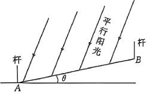

# Mathematics - 题目 407

**ID**: ecda307f33fa48488e033de91a09d100
**年级**: Grade 11
**难度**: Medium-Hard
**题型**: Fill-in-the-blank

## 题目
某斜面上有两根长为3米的垂直于水平面放置的杆子，杆子与斜面的接触点分别为 $A,B$ ，某时刻它们在阳光的照射下呈现出影子，阳光可视为平行光，其中一根杆子的影子在水平面上，长度为1.​​​​​​​‌5米，另一根杆子的影子完全在斜面上，长度为 $\sqrt {5}$ 米，斜面的底角为 $θ$ ，则 ${\tan}θ=$．

## 解答

1. 如图， $AD$ 、 $BG$ 分别为杆， $CD$ 、 $EG$ 为平行的阳光， $AC$ 、 $BF$ 分别为杆的影子，
2. 设阳光与水平面所成角为 $α$ ，则 ${\tan}α=\frac {AD}{AC}=2$ ，
3. $\angle ADC=\angle BGF=\frac {π}{2}-α{\rm \mathit{，}}$  $\angle BFG=\angle AFE=α-θ$ ，
4. 在 $\vartriangle BFG$ 中，由正弦定理可得 $\frac {BF}{\sin \angle BGF}=\frac {BG}{\sin \angle BFG}$
5. 即 $\frac {\sqrt {5}}{\sin \left ({\frac {π}{2}-α}\right )}=\frac {3}{\sin \left ({α-θ}\right )}$ ，
6. 由 ${\tan}α=2$ 可得 $\sin α=\frac {2\sqrt {5}}{5}$ ， ${\cos}α=\frac {\sqrt {5}}{5}$ ，
7. 代入可得 $\sin \left ({α-θ}\right )=\frac {3}{5}$ ， ${\cos}\left ({α-θ}\right )=\frac {4}{5}$ ， ${\tan}\left ({α-θ}\right )=\frac {3}{4}$ ，
8. 则 ${\tan}θ={\tan}\left [α-\left ({α-θ}\right )\right ]=\frac {{\tan}α-{\tan}\left ({α-θ}\right )}{1+{\tan}α{\tan}\left ({α-θ}\right )}=\frac {1}{2}$ .
9. 

## 知识点

**中文**:
  - 正、余弦定理的实际应用-测量角度问题

**English**:
  - Measuring Angles

---
