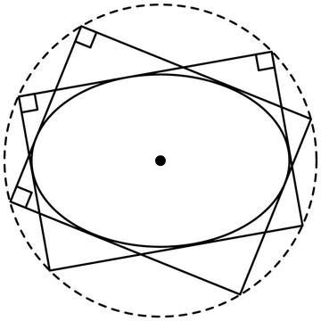

# Mathematics - 题目 1649

**ID**: ed1c90475b014193939a851ac35a6aeb
**年级**: Grade 11
**难度**: Medium-Hard
**题型**: Fill-in-the-blank

## 题目
“蒙日圆”涉及几何学中的一个著名定理，该定理的内容为：椭圆上任意两条互相垂直的切线的交点，必在一个与椭圆同心的圆上，称此圆为该椭圆的“蒙日圆”，该圆由法国数学家加斯帕尔·蒙日（1746−1818）最先发现，若椭圆 $C:\frac {x{^{2}}}{4}+\frac {y{^{2}}}{3}=1$ 的左、右焦点分别为 $F{{}_{1}}$ 、 $F{{}_{2}}{\rm ，\mathit{P}}$ 为椭圆C上一动点，过P和原点作直线l与圆C的蒙日圆相交于M，N，则 $\frac {\overrightarrow {{PM}}\cdot \overrightarrow {{PN}}}{\overrightarrow {{PF{{}_{1}}}}\cdot \overrightarrow {{PF{{}_{2}}}}}$ 的最小值为．​​​​​​​‌

## 解答

1. 因为椭圆 $C:\frac {x{^{2}}}{4}+\frac {y{^{2}}}{3}=1$ ，所以 $a{^{2}}=4$ ， $b{^{2}}=3$ ，故 $a=2$ ， $b=\sqrt {3}$ ， $c{^{2}}=a{^{2}}-b{^{2}}=1$ ，
2. 如图，令 $\left |{PF{{}_{1}}}\right |\cdot \left |{PF{{}_{2}}}\right |=m$ ，因为 $\left |{PF{{}_{1}}}\right |+\left |{PF{{}_{2}}}\right |=2a=4$ ，所以 $\left |{PF{{}_{1}}}\right |{^{2}}+\left |{PF{{}_{2}}}\right |{^{2}}+2\left |{PF{{}_{1}}}\right |\cdot \left |{PF{{}_{2}}}\right |=16$ ，
3. 即 $\left |{PF{{}_{1}}}\right |{^{2}}+\left |{PF{{}_{2}}}\right |{^{2}}=16-2m$ ，结合图象，由平面向量的知识可得 $\begin{cases}\overrightarrow {{PF{{}_{1}}}}+\overrightarrow {{PF{{}_{2}}}}=2\overrightarrow {{PO}}\\\overrightarrow {{PF{{}_{1}}}}-\overrightarrow {{PF{{}_{2}}}}=\overrightarrow {{F{{}_{2}}F{{}_{1}}}}\end{cases}$ ，
4. 故 $\begin{cases}\overrightarrow {{PF{{}_{1}}}}{^{2}}+\overrightarrow {{PF{{}_{2}}}}{^{2}}+2\overrightarrow {{PF{{}_{1}}}}\cdot \overrightarrow {{PF{{}_{2}}}}=4\overrightarrow {{PO}}{^{2}}\\\overrightarrow {{PF{{}_{1}}}}{^{2}}+\overrightarrow {{PF{{}_{2}}}}{^{2}}-2\overrightarrow {{PF{{}_{1}}}}\cdot \overrightarrow {{PF{{}_{2}}}}=\overrightarrow {{F{{}_{2}}F{{}_{1}}}}{^{2}}=4c{^{2}}=4\end{cases}$ ，两式相加得 $2\left ({\overrightarrow {{PF}}{{}_{1}^{2}}+\overrightarrow {{PF}}{{}_{2}^{2}}}\right )=4\overrightarrow {{PO}}{^{2}}+4$ ，
5. 即 $2\left ({16-2m}\right )=4\overrightarrow {{PO}}{^{2}}+4$ ，即 $\overrightarrow {{PO}}{^{2}}=7-m$ ，由“蒙日圆”的定义，当我们过椭圆上下左右四个顶点作椭圆的切线时，
6. 易知椭圆的“蒙日圆”的直径为这四条切线所围成的矩形的对角线，故由勾股定理得， $r{^{2}}=a{^{2}}+b{^{2}}=7$ ，
7. 所以 $\left |{PM}\right |\cdot \left |{PN}\right |=\left ({r-\left |{PO}\right |}\right )\left ({r+\left |{PO}\right |}\right )=r{^{2}}-\left |{PO}\right |{^{2}}=7-\left ({7-m}\right )=m$ ，故 $\frac {\left |{PM}\right |\cdot \left |{PN}\right |}{\left |{PF{{}_{1}}}\right |\cdot \left |{PF{{}_{2}}}\right |}=\frac {m}{m}=1$ ．
8. 令 $θ=\overrightarrow {{PF{{}_{1}}}},\overrightarrow {{PF{{}_{2}}}}$ ， $\left |{\overrightarrow {{PF{{}_{1}}}}}\right |=x$ ，则 $\left |{\overrightarrow {{PF{{}_{2}}}}}\right |=4-x$ ，
9. 所以 ${\cos}θ=\frac {x{^{2}}+{\left({4-x}\right)^{2}}-4}{2x\left ({4-x}\right )}=-1+\frac {6}{-x{^{2}}+4x},x\in \left [1,3\right ]$ ，由二次函数易知 $-x{^{2}}+4x\in \left [3,4\right ]$ ，所以 ${\cos}θ\in \left [\frac {1}{2},1\right ]$ ，
10. $\frac {\overrightarrow {{PM}}\cdot \overrightarrow {{PN}}}{\overrightarrow {{PF{{}_{1}}}}\cdot \overrightarrow {{PF{{}_{2}}}}}=\frac {-\left |{PM}\right |\cdot \left |{PN}\right |}{\left |{PF{{}_{1}}}\right |\cdot \left |{PF{{}_{2}}}\right |{\cos}θ}=-\frac {1}{{\cos}θ}\in \left [-2,-1\right ]$ ，所以最小值为 $-2$ ．
11. 

## 知识点

**中文**:
  - 向量线性综合运算
  - 数量积的计算
  - 椭圆的标准方程及应用

**English**:
  - Comprehensive Linear Operations
  - Calculation of Scalar Product
  - Standard Equation and Applications

---
