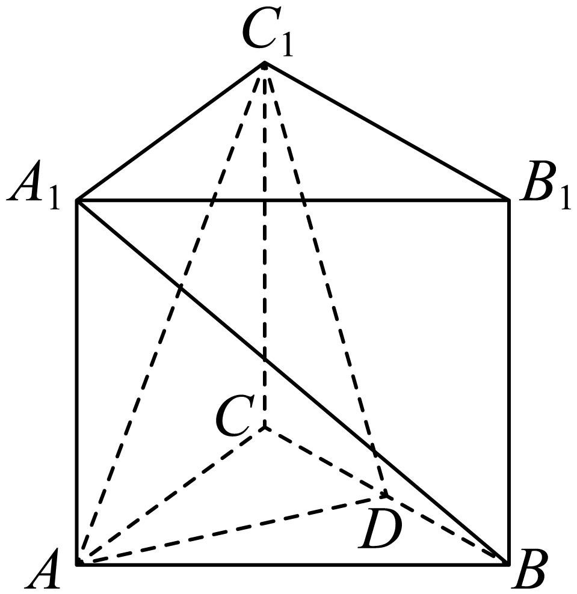

# Mathematics - 题目 243

**ID**: ed60b9f75b2d4cf694d975f230bded92
**年级**: Grade 11
**难度**: Medium-Hard
**题型**: Fill-in-the-blank

## 题目
如图，正三棱柱 $ABC-A{{}_{1}}B{{}_{1}}C{{}_{1}}$ 的底面边长为2，侧棱长为 $3,D$ 为 $BC$ 的中点，若 $\overrightarrow {{A{{}_{1}}P}}=λ\overrightarrow {{A{{}_{1}}B{{}_{1}}}},\overrightarrow {{DQ}}=λ\overrightarrow {{DC{{}_{1}}}}\left ({0\leqslant λ\leqslant 1}\right )$ ，则 $\left |{\overrightarrow {{PQ}}}\right |$ 的取值范围是．​​​​​​​‌

## 解答

1. 因为正三棱柱 $ABC-A{{}_{1}}B{{}_{1}}C{{}_{1}}$ 的底面边长为 ${\rm 2，}D$ 为 $BC$ 的中点，
2. 所以 $AD\bot BC,\left |{AD}\right |=\sqrt {3}$ ，过点 $D$ 作 $z$ 轴 $//BB{{}_{1}}$ ，建立如图所示的空间直角坐标系，
3. 所以 $A\left ({\sqrt {3},0,0}\right ),D\left ({0,0,0}\right ),B\left ({0,1,0}\right ),C\left ({0,-1,0}\right )$ ， $A{{}_{1}}\left ({\sqrt {3},0,3}\right ),B{{}_{1}}\left ({0,1,3}\right ),C{{}_{1}}\left ({0,-1,3}\right )$ ，
4. 因为 $\overrightarrow {{A{{}_{1}}B{{}_{1}}}}=\left ({-\sqrt {3},1,0}\right ),\overrightarrow {{DC{{}_{1}}}}=\left ({0,-1,3}\right )$ ，设 $P\left ({x{{}_{0}},y{{}_{0}},z{{}_{0}}}\right )$ ， $Q\left ({x{{}_{1}},y{{}_{1}},z{{}_{1}}}\right )$ ，
5. $\overrightarrow {{A{{}_{1}}P}}=\left ({x{{}_{0}}-\sqrt {3},y{{}_{0}},z{{}_{0}}-3}\right ),\overrightarrow {{DQ}}=\left ({x{{}_{1}},y{{}_{1}},z{{}_{1}}}\right )$ ，
6. 所以 $\left ({x{{}_{0}}-\sqrt {3},y{{}_{0}},z{{}_{0}}-3}\right )=λ\left ({-\sqrt {3},1,0}\right ),\left ({x{{}_{1}},y{{}_{1}},z{{}_{1}}}\right )=λ\left ({0,-1,3}\right )\left ({0\leqslant λ\leqslant 1}\right )$ ，
7. 所以 $x{{}_{0}}{\rm{=}}\sqrt {3}-\sqrt {3}λ,y{{}_{0}}=λ,z{{}_{0}}=3,x{{}_{1}}=0,y{{}_{1}}=-λ,z{{}_{1}}=3λ$ ，
8. 所以 $P\left ({\sqrt {3}-\sqrt {3}λ,λ,3}\right )$ ， $Q\left ({0,-λ,3λ}\right )$ ，
9. 所以 $\left |{\overrightarrow {{PQ}}}\right |{\rm{=}}\sqrt {{\left({\sqrt {3}-\sqrt {3}λ}\right)^{2}}{{+}}4λ{^{2}}+{\left({3-3λ}\right)^{2}}}=\sqrt {16λ{^{2}}-24λ+12}=2\sqrt {4{\left({λ-\frac {3}{4}}\right)^{2}}+\frac {3}{4}}$ ，
10. 当 $λ=\frac {3}{4}$ 时， $\left |{\overrightarrow {{PQ}}}\right |$ 有最小值 $\sqrt {3}$ ，当 $λ=0$ 时， $\left |{\overrightarrow {{PQ}}}\right |$ 有最大值 $2\sqrt {3}$ ，
11. 所以 $\left |{\overrightarrow {{PQ}}}\right |$ 的取值范围是 $\left [\sqrt {3},2\sqrt {3}\right ]$ .
12. 

## 知识点

**中文**:
  - 空间向量模的坐标计算公式

**English**:
  - Modulus Calculation

---
