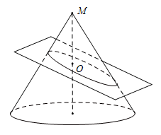

# Mathematics - 题目 3675

**ID**: f5269593216c4cc9ad451ba4f0c1a5db
**年级**: Grade 11
**难度**: Medium-Hard
**题型**: Fill-in-the-blank

## 题目
历史上，许多人研究过圆锥的截口曲线.​​​​​​​‌如图，在圆锥中，母线与旋转轴夹角为30°，现有一截面与圆锥的一条母线垂直，与旋转轴的交点O到圆锥顶点M的距离为1，对于所得截口曲线给出如下命题：①曲线形状为椭圆；②点O为该曲线上任意两点最长距离的三等分点；③该曲线上任意两点间的最长距离为 $\frac {3}{2}$ ，最短距离为 $\frac {2\sqrt {3}}{3}$ .其中正确命题的序号为.

## 解答

1. 在圆锥中，母线与旋转轴夹角为 $30{}^\circ $ ，现有一截面与圆锥的一条母线垂直，与旋转轴的交点O到圆锥顶点M的距离为1,曲线形状为椭圆，故①正确，即曲线形状为椭圆.
2. 对于②，画出圆锥的椭圆长轴所在的轴截面的图形如图所示，
3. 
4. 由于 $\angle AMO=\angle BMO=30^\circ ,MA\bot AB,|MO|=1$ ，
5. 所以 $|AO|=\frac {1}{2}|MO|=\frac {1}{2},\angle OMB=\angle OBM=30{}^\circ $ ，即 $|BO|=|MO|=1$ ，
6. 所以 $\frac {|AO|}{|BO|}=\frac {1}{2}$ .而曲线上任意两点间的最长距离为椭圆长轴 $AB$ ，故点O为该曲线上任意两点最长距离的三等分点，即②正确.
7. 对于③，由于曲线是连续不断的，故任意两点间没有最短距离，故③错误；
8. 综上所述，正确命题的序号为①②.
9. 故答案为：①②

## 知识点

**中文**:
  - 范围最值问题

**English**:
  - Range and Extrema Problems

---
