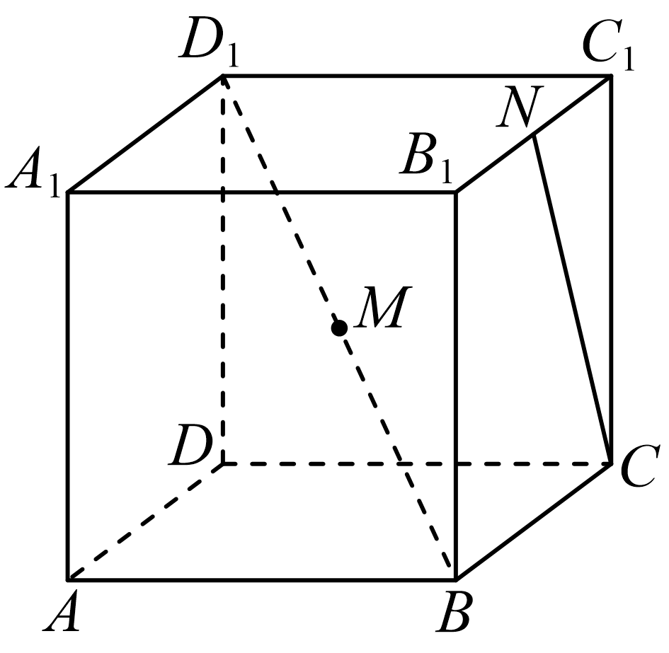

# Mathematics - 题目 2614

**ID**: 43e29b5dc9af4f86857ef49ea3215ab5
**年级**: Grade 11
**难度**: Medium-Hard
**题型**: Multiple-choice

## 题目
如图，在棱长为1的正方体 $ABCD-A{{}_{1}}B{{}_{1}}C{{}_{1}}D{{}_{1}}$ 中，M，N分别为 $BD{{}_{1}}$ ， $B{{}_{1}}C{{}_{1}}$ 的中点，点P为正方体 $ABCD-A{{}_{1}}B{{}_{1}}C{{}_{1}}D{{}_{1}}$ 表面上的动点．给出下列三个结论：①当点P为棱 $A{{}_{1}}B{{}_{1}}$ 中点时， $CN{\rm{/}}{\rm{/}}$ 平面 $BMP$ ；​​​​​​​‌②当点P在棱 $BB{{}_{1}}$ 上运动时，点P到平面 $CNM$ 的距离的最小值为 $\frac {\sqrt {6}}{6}$ ；③当点 $P\notin NC$ 时，满足 $MP\bot $ 平面 $NCP$ 的点P恰有2个．其中正确结论的个数为（      ）

## 解答

1. 对于①，如图所示，
2. 
3. 由立方体性质，以 $D$ 为坐标原点，以 $DA,DC,DD{{}_{1}}$ 分别为 $x,y,z$ 轴建立空间直角坐标系，
4. 因为正方体棱长为1，所以 $A{{}_{1}}\left ({1,0,1}\right ),B\left ({1,1,0}\right ),C\left ({0,1,0}\right ),C{{}_{1}}\left ({0,1,1}\right ),B{{}_{1}}\left ({1,1,1}\right ),D{{}_{1}}\left ({0,0,1}\right )$ ，
5. 因为M，N分别为 $BD{{}_{1}}$ ， $B{{}_{1}}C{{}_{1}}$ 的中点，点P为棱 $A{{}_{1}}B{{}_{1}}$ 中点时， $M\left ({\frac {1}{2},\frac {1}{2},\frac {1}{2}}\right ),N\left ({\frac {1}{2},1,1}\right ),P\left ({1,\frac {1}{2},1}\right )$ ，
6. 可得 $\overrightarrow {{BP}}=\left ({0,-\frac {1}{2},1}\right ),\overrightarrow {{BM}}=\left ({-\frac {1}{2},-\frac {1}{2},\frac {1}{2}}\right ),\overrightarrow {{CN}}=\left ({\frac {1}{2},0,1}\right )$ ，
7. 设平面 $BPM$ 的法向量 $\overrightarrow m=\left ({a,b,c}\right )$ ，
8. 则 $\begin{cases}\overrightarrow m\cdot \overrightarrow {{BP}}=0\\\overrightarrow m\cdot \overrightarrow {{BM}}=0\end{cases}$ ,即 $\begin{cases}-\frac {1}{2}b+c=0\\-\frac {1}{2}a-\frac {1}{2}b+\frac {1}{2}c=0\end{cases}$ ，
9. 当 $b=2$ 时，解得 $c=1,a=-1$ ，即平面 $BPM$ 的一个法向量 $\overrightarrow m=\left ({-1,2,1}\right )$ ，
10. 此时 $\overrightarrow {{CN}}\cdot \overrightarrow {{m}}=-\frac {1}{2}+1=\frac {1}{2}\ne 0$ ，可知①错误；
11. 对于②，如下图所示，
12. 
13. 当点P在棱 $BB{{}_{1}}$ 上运动时，设点 $P\left ({1,1,z}\right )$ ，
14. 可得 $\overrightarrow {{CN}}=\left ({\frac {1}{2},0,1}\right ),\overrightarrow {{CM}}=\left ({\frac {1}{2},-\frac {1}{2},\frac {1}{2}}\right ),\overrightarrow {{CP}}=\left ({1,0,z}\right ),\left ({0\leqslant z\leqslant 1}\right )$ ，
15. 设平面 $CMN$ 的法向量 $\overrightarrow n=\left ({d,e,f}\right )$ ，
16. 则 $\begin{cases}\overrightarrow n\cdot \overrightarrow {{CN}}=0\\\overrightarrow n\cdot \overrightarrow {{CM}}=0\end{cases}$ ,即 $\begin{cases}\frac {1}{2}d+f=0\\\frac {1}{2}d-\frac {1}{2}e+\frac {1}{2}f=0\end{cases}$ ，
17. 当 $d=2$ 时，解得 $f=-1,e=1$ ，即平面 $CMN$ 的一个法向量 $\overrightarrow n=\left ({2,1,-1}\right )$ ，
18. 此时点P到平面 $CNM$ 的距离为 $\frac {\left |{\overrightarrow n\cdot \overrightarrow {{CP}}}\right |}{\left |{\overrightarrow n}\right |}=\frac {\left |{2-z}\right |}{\sqrt {6}}$ ，
19. 因为 $0\leqslant z\leqslant 1$ ，当 $z=1$ 时，点P到平面 $CNM$ 的距离最小，此时距离为 $\frac {\sqrt {6}}{6}$ ，所以②正确；
20. 对于③，如图所示，
21. 
22. 设点 $P\left ({x,y,z}\right )$ ，
23. 则 $\overrightarrow {{CN}}=\left ({\frac {1}{2},0,1}\right ),\overrightarrow {{CP}}=\left ({x,y-1,z}\right ),\overrightarrow {{MP}}=\left ({x-\frac {1}{2},y-\frac {1}{2},z-\frac {1}{2}}\right )$ ，
24. 当 $P$ 满足 $MP\bot $ 平面 $NCP$ 时， $\overrightarrow {{CN}}\bot \overrightarrow {{MP}},\overrightarrow {{CP}}\bot \overrightarrow {{MP}}$ ，
25. 即 $\begin{cases}\frac {1}{2}\left ({x-\frac {1}{2}}\right )+\left ({z-\frac {1}{2}}\right )=0\\x\left ({x-\frac {1}{2}}\right )+\left ({y-1}\right )\left ({y-\frac {1}{2}}\right )+z\left ({z-\frac {1}{2}}\right )=0\end{cases}$ ，
26. 当点 $P$ 在平面 $ADD{{}_{1}}A{{}_{1}}$ 上时，即 $0\leqslant x\leqslant 1,y=0,0\leqslant z\leqslant 1$ ，
27. 化简得 $\begin{cases}x+2z=\frac {3}{2}\\x\left ({x-\frac {1}{2}}\right )+\frac {1}{2}+z\left ({z-\frac {1}{2}}\right )=0\end{cases}$ ，消去 $x$ 得 $10z{^{2}}-11z+4=0$ ，可知 $Δ=121-4\times 10\times 4=-39<0$ ，所以此时无解；
28. 当点 $P$ 在平面 $BCC{{}_{1}}B{{}_{1}}$ 上时，即 $0\leqslant x\leqslant 1,y=1,0\leqslant z\leqslant 1$ ，
29. 化简得 $\begin{cases}x+2z=\frac {3}{2}\\x\left ({x-\frac {1}{2}}\right )+z\left ({z-\frac {1}{2}}\right )=0\end{cases}$ ，消去 $x$ 得 $10z{^{2}}-11z+3=0$ ,解得 $z=\frac {1}{2}$ 或 $z=\frac {3}{5}$ ，
30. 当 $z=\frac {1}{2}$ 时， $x=\frac {1}{2}$ ，点 $P\left ({\frac {1}{2},1,\frac {1}{2}}\right )$ ，符合条件；
31. 当 $z=\frac {3}{5}$ 时， $x=\frac {3}{10}$ ，点 $P\left ({\frac {3}{10},1,\frac {3}{5}}\right )$ ， $\overrightarrow {{CP}}=\left ({\frac {3}{10},0,\frac {3}{5}}\right ),\overrightarrow {{CN}}=\left ({\frac {1}{2},0,1}\right )$ ，
32. 可知 $\overrightarrow {{CP}}=\frac {3}{5}\overrightarrow {{CN}}$ ，不符合条件；
33. 当点 $P$ 在平面 $ABCD$ 上时，即 $0\leqslant x\leqslant 1,0\leqslant y\leqslant 1,z=0$ ，
34. 化简得 $\begin{cases}x+2z=\frac {3}{2}\\x\left ({x-\frac {1}{2}}\right )+\frac {1}{2}+z\left ({z-\frac {1}{2}}\right )=0\end{cases}$ ，
35. 当 $z=0$ 时， $x=\frac {3}{2}>1$ ，不符合题意；
36. 当点 $P$ 在平面 $A{{}_{1}}B{{}_{1}}C{{}_{1}}D{{}_{1}}$ 上时，即 $0\leqslant x\leqslant 1,0\leqslant y\leqslant 1,z=1$ ，
37. 当 $z=1$ 时， $x=-\frac {1}{2}<0$ ，不符合题意；
38. 当点 $P$ 在平面 $ABB{{}_{1}}A{{}_{1}}$ 上时，即 $x=1,0\leqslant y\leqslant 1,0\leqslant z\leqslant 1$ ，
39. 化简得 $\begin{cases}x+2z=\frac {3}{2}\\x\left ({x-\frac {1}{2}}\right )+\frac {1}{2}+z\left ({z-\frac {1}{2}}\right )=0\end{cases}$ ，
40. 当 $x=1$ 时， $z=\frac {1}{4}$ ，代入得 $16y{^{2}}-24y+15=0$ ，可知 $Δ=576-4\times 16\times 15=-384<0$ ，所以此时无解；
41. 当点 $P$ 在平面 $DCC{{}_{1}}D{{}_{1}}$ 上时，即 $x=0,0\leqslant y\leqslant 1,0\leqslant z\leqslant 1$ ，
42. 化简得 $\begin{cases}x+2z=\frac {3}{2}\\x\left ({x-\frac {1}{2}}\right )+\frac {1}{2}+z\left ({z-\frac {1}{2}}\right )=0\end{cases}$ ，
43. 当 $x=0$ 时， $z=\frac {3}{4}$ ，代入得 $16y{^{2}}-24y+11=0$ ，可知 $Δ=576-4\times 16\times 11=-128<0$ ，所以此时无解；
44. 综上所述，当点 $P\notin NC$ 时，满足 $MP\bot $ 平面 $NCP$ 的点P仅有1个，所以③错误.
45. 故选B.

## 知识点

**中文**:
  - 向量法求距离-点面距离
  - 用向量证明平行问题
  - 用向量证明垂直问题

**English**:
  - Point-Plane Distance
  - Proving Parallelism
  - Proving Perpendicularity

---
