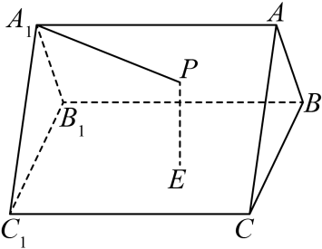

# Mathematics - 题目 2386

**ID**: 64fa7a8fb15e4da49263338256314feb
**年级**: Grade 11
**难度**: Medium-Hard
**题型**: Multiple-choice

## 题目
如图，直三棱柱 $ABC-A{{}_{1}}B{{}_{1}}C{{}_{1}}$ 的所有棱长均相等，P是侧面 $AA{{}_{1}}C{{}_{1}}C$ 内一点，若点P到平面 $BB{{}_{1}}C{{}_{1}}C$ 的距离 $\left |{PE}\right |=\frac {\sqrt {3}}{2}\left |{PA{{}_{1}}}\right |$ ，则点P的轨迹是（      ）​​​​​​​‌

## 解答

1. 如图，作 $ED\bot C{{}_{1}}C$ ，做 $A{{}_{1}}F\bot B{{}_{1}}C{{}_{1}}$ ，连接 $PD$ .
2. 因几何体为直三棱柱，则 $CC{{}_{1}}\bot $ 平面 $A{{}_{1}}B{{}_{1}}C{{}_{1}}$ ，又 $A{{}_{1}}F\subset $ 平面 $A{{}_{1}}B{{}_{1}}C{{}_{1}}$ ，
3. 则 $CC{{}_{1}}\bot A{{}_{1}}F$ ，又 $CC{{}_{1}}\subset $ 平面 $C{{}_{1}}CBB{{}_{1}}$ ， $B{{}_{1}}C{{}_{1}}\subset $ 平面 $C{{}_{1}}CBB{{}_{1}}$ ，
4. $B{{}_{1}}C{{}_{1}}{\rm{∩}}CC{{}_{1}}=C{{}_{1}}$ ，则 $A{{}_{1}}F\bot $ 平面 $C{{}_{1}}CBB{{}_{1}}$ .
5. 又由题可得 $PE\bot $ 平面 $C{{}_{1}}CBB{{}_{1}}$ ，则 $PE\parallel A{{}_{1}}F$ .
6. 因 $ED\bot C{{}_{1}}C$ ， $C{{}_{1}}B{{}_{1}}\bot C{{}_{1}}C$ ，则 $ED\parallel C{{}_{1}}B{{}_{1}}$ .
7. 又 $ED\subset $ 平面 ${\rm \mathit{EPD}，}EP\mathrm{⊂}$ 平面 ${\rm \mathit{EPD}，}EP{\rm{∩}}ED=E$ ，
8. $A{{}_{1}}F\subset $ 平面 $A{{}_{1}}B{{}_{1}}C{{}_{1}}$ ， $FC{{}_{1}}\subset $ 平面 $A{{}_{1}}B{{}_{1}}C{{}_{1}}$ ， $A{{}_{1}}F{\rm{∩}}FC{{}_{1}}=F$ ，
9. 则平面 ${\rm \mathit{EPD}}\mathrm{/\mskip-4mu/}$ 平面 $A{{}_{1}}B{{}_{1}}C{{}_{1}}$ .
10. 因平面 $A{{}_{1}}C{{}_{1}}CA{\rm{∩}}$ 平面 ${\rm \mathit{EPD}}=PD$ ，平面 $A{{}_{1}}C{{}_{1}}CA{\rm{∩}}$ 平面 $A{{}_{1}}B{{}_{1}}C{{}_{1}}$  $=A{{}_{1}}C{{}_{1}}$ ，则 $PD\parallel A{{}_{1}}C{{}_{1}}$ .
11. 故 $\angle PDE=\angle A{{}_{1}}C{{}_{1}}B{{}_{1}}=\frac {{\rm{π}}}{3}$ ，结合 $PE\bot $ 平面 $C{{}_{1}}CBB{{}_{1}}$ ， $ED\subset $ 平面 $C{{}_{1}}CBB{{}_{1}}$ ，可得
12. $PE\bot ED$ ，则 $\left |{PE}\right |=\left |{PD}\right |\sin \frac {{\rm{π}}}{3}=\frac {\sqrt {3}}{2}\left |{PD}\right |$ .又 $\left |{PE}\right |=\frac {\sqrt {3}}{2}\left |{PA{{}_{1}}}\right |$ ，则 $\left |{PD}\right |=\left |{PA{{}_{1}}}\right |$ .
13. 由题又有 $CC{{}_{1}}\bot A{{}_{1}}C{{}_{1}}$ ，结合 $PD\parallel A{{}_{1}}C{{}_{1}}$ ，则 $CC{{}_{1}}\bot PD$ ，即 $\left |{PD}\right |$ 为点P到直线 $CC{{}_{1}}$ 距离.故点P到定点 $A{{}_{1}}$ 距离等于点P到直线 $BB{{}_{1}}$ 距离，则点P轨迹为抛物线的一部分.
14. 故选D.
15. 

## 知识点

**中文**:
  - 动点问题

**English**:
  - Moving Point Problems

---
