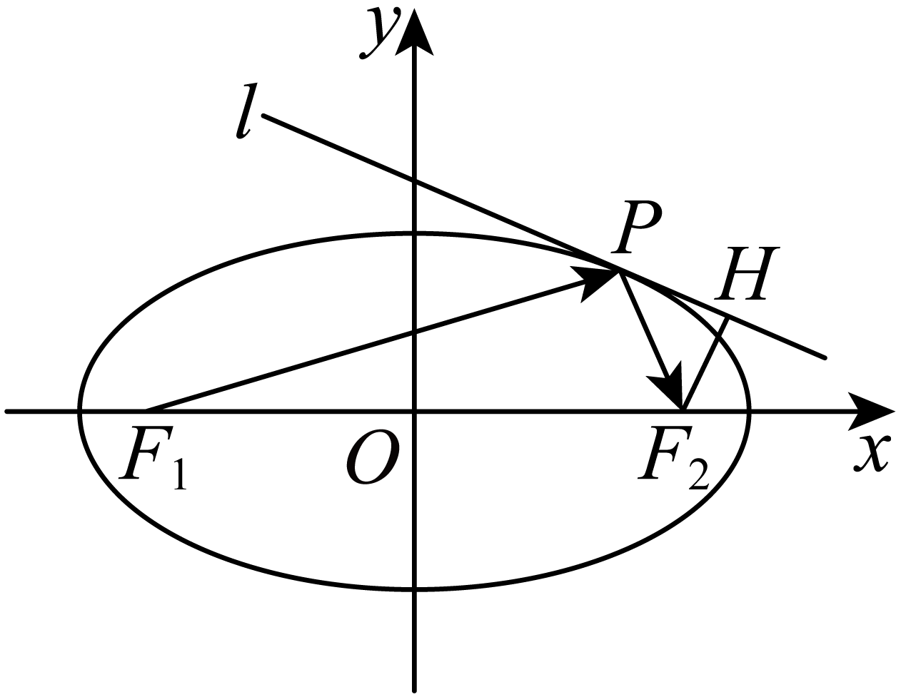

# Mathematics - 题目 2505

**ID**: 950f206793374e35820e808b8be8d994
**年级**: Grade 11
**难度**: Medium-Hard
**题型**: Multiple-choice

## 题目
根据椭圆的光学性质可以得到如下结论：如图， $F{{}_{1}}$ ， $F{{}_{2}}$ 是椭圆 $C$ ： $\frac {x{^{2}}}{20}+\frac {y{^{2}}}{15}=1$ 的两个焦点，P为椭圆C上任意一点， $l$ 为椭圆 $C$ 在点P处的切线，光线 $F{{}_{1}}P$ 经过直线 $l$ 反射后一定经过另一个焦点 $F{{}_{2}}$ .​​​​​​​‌过 $F{{}_{2}}$ 作 $l$ 的垂线，垂足为H，则点H的轨迹方程为（      ）

## 解答

1. 延长 $F{{}_{1}}P$ 、 $F{{}_{2}}H$ 使其交于点 $A$ ，连接 $OH$ ，
2. 由光线 $F{{}_{1}}P$ 经过直线 $l$ 反射后为直线 $PF{{}_{2}}$ ，且 $F{{}_{2}}H\bot l$ ，
3. 则点 $A$ 与 $F{{}_{2}}$ 关于 $l$ 对称，则 $\left |{PA}\right |=\left |{PF{{}_{2}}}\right |$ ， $\left |{HA}\right |=\left |{HF{{}_{2}}}\right |$ ，
4. 故 $\left |{F{{}_{1}}A}\right |=\left |{F{{}_{1}}P}\right |+\left |{PA}\right |=\left |{F{{}_{1}}P}\right |+\left |{PF{{}_{2}}}\right |=2\times \sqrt {20}=4\sqrt {5}$ ，
5. $OH$ 为 $\mathrm{△}AF{{}_{1}}F{{}_{2}}$ 中位线，则 $\left |{OH}\right |=\frac {1}{2}\left |{F{{}_{1}}A}\right |=2\sqrt {5}$ ，
6. 即点 $H$ 在圆 $x{^{2}}+y{^{2}}=20$ 上.
7. 故选D.
8. 

## 知识点

**中文**:
  - 与圆有关的轨迹问题

**English**:
  - Locus Problems involving Circles

---
