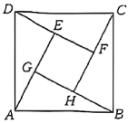

# Mathematics - 题目 2373

**ID**: 98ae6a03a2e94ac28166a17070de9c21
**年级**: Grade 11
**难度**: Medium-Hard
**题型**: Multiple-choice

## 题目
我国古代数学家赵爽为了证明勾股定理，创制了一幅“勾股圆方图”，该图被后人称为“赵爽弦图”．如图，大正方形 $ABCD$ 由四个全等的直角三角形与一个小正方形拼成，其中小正方形 $EFHG$ 的边长为 ${\rm 1，}E$ 为 $DF$ 的中点，点 $P$ 在正方形 $EFHG$ 内（不含边界），则 $\overrightarrow {{AP}}\cdot \overrightarrow {{AB}}$ 的取值范围为（      ）​​​​​​​‌

## 解答

1. $\because E$ 为 $DF$ 的中点，设 $EF=1$ ， $\therefore DF=2$ ， $\therefore GB=2$ ， $AG=1$ ， $\therefore EA=DF=2$ ，
2. $\because \angle DEA=90{}\degree $ ， $\therefore AD=\sqrt {AE{^{2}}+ED{^{2}}}=\sqrt {1{^{2}}+2{^{2}}}=\sqrt {5}$ ， $\therefore AB=\sqrt {5}$ ，
3. 过 $G$ 作 $GM\bot $  $AB$ 于 $M$ ，过 $F$ 作 $FN\bot AB$ 于 $N$ ，过 $F$ 作 $FK\bot DC$ 于 $K$ ，
4. $S{{}_{\vartriangle AGB}}=\frac {1}{2}AB\cdot MG=\frac {1}{2}AG\cdot GB$ ， $\because AB=\sqrt {5}$ ， $AG=1$ ， $GB=2$ ， $\therefore MG=\frac {2\sqrt {5}}{5}$ ，
5. $\because \vartriangle AGB\cong \vartriangle DFC$ ， $\therefore FK=GM=\frac {2\sqrt {5}}{5}$ ， $AM=\sqrt {AG{^{2}}-GM{^{2}}}=\sqrt {1-(\frac {2\sqrt {5}}{5}){^{2}}}=\frac {\sqrt {5}}{5}$ ，
6. $\because AM=BN$ ， $\therefore BN=\frac {\sqrt {5}}{5}$ ， $\therefore FN=NK-FK=\sqrt {5}-\frac {2\sqrt {5}}{5}=\frac {3\sqrt {5}}{5}$ ，过 $P$ 作 $PP{{}_{1}}\bot AB$ 于 $P{{}_{{{1}}}}$ ， $\therefore \frac {\left |{\overrightarrow {{AP{{}_{1}}}}}\right |}{\left |{\overrightarrow {{AP}}}\right |}={\cos}\angle PAB$ ， $\therefore \left |{\overrightarrow {{AP{{}_{1}}}}}\right |=\left |{\overrightarrow {{AP}}}\right |{\cos}\angle PAB$ ， $\therefore \overrightarrow {{AP}}\cdot \overrightarrow {{AB}}=\left |{\overrightarrow {{AP}}}\right |\cdot \left |{\overrightarrow {{AB}}}\right |\cdot {\cos}\angle PAB=\sqrt {5}\left |{\overrightarrow {{AP}}}\right |\cdot {\cos}\angle PAB=\sqrt {5}\left |{\overrightarrow {{AP{{}_{1}}}}}\right |$ ，
7. 又 $\because \left |{\overrightarrow {{AM}}}\right |<\left |{\overrightarrow {{AP{{}_{1}}}}}\right |<\left |{\overrightarrow {{AN}}}\right |$ ， $\frac {\sqrt {5}}{5}<\left |{\overrightarrow {{AP{{}_{1}}}}}\right |<\frac {4\sqrt {5}}{5}$ ， $\therefore 1<\overrightarrow {{AP}}\cdot \overrightarrow {{AB}}<4$ .
8. 故选D

## 知识点

**中文**:
  - 数量积的计算

**English**:
  - Calculation of Scalar Product

---
