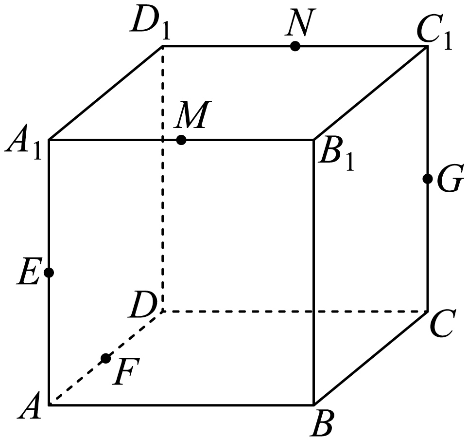

# Mathematics - 题目 308

**ID**: ecb7146503b844e6b94f376bf369444a
**年级**: Grade 11
**难度**: Medium-Hard
**题型**: Multiple-choice

## 题目
如图，正方体透明容器 $ABCD-A{{}_{1}}B{{}_{1}}C{{}_{1}}D{{}_{1}}$ 的棱长为 $8,E,F,G,M$ 分别为 $AA{{}_{1}},AD,CC{{}_{1}},A{{}_{1}}B{{}_{1}}$ 的中点，点 $N$ 是棱 $C{{}_{1}}D{{}_{1}}$ 上任意一点，下列说法正确的是（      ）​​​​​​​‌

## 解答

1. 对A：由正方体性质知： $B{{}_{1}}C\bot BC{{}_{1}},B{{}_{1}}C\bot D{{}_{1}}C{{}_{1}}$ ， $BC{{}_{1}}\mathrm{∩}D{{}_{1}}C{{}_{1}}=C{{}_{1}}$ ，
2. 且 $BC{{}_{1}}$ 、 $D{{}_{1}}C{{}_{1}}\subset $ 面 $ABC{{}_{1}}D{{}_{1}}$ ，
3. 所以 $B{{}_{1}}C\bot $ 面 $ABC{{}_{1}}D{{}_{1}}$ ，又 $BN\subset $ 面 $ABC{{}_{1}}D{{}_{1}}$ ，则 $B{{}_{1}}C\bot BN$ ，
4. 由 $B{{}_{1}}C\cap B{{}_{1}}G=B{{}_{1}}$ ，故 $B{{}_{1}}G$ 与 $BN$ 不垂直，故A错误；
5. 
6. 对B：由题意 $EM//AB{{}_{1}}$ 且 $EM=\frac {1}{2}AB{{}_{1}}$ ，若 $O$ 是 $B{{}_{1}}C,BC{{}_{1}}$ 交点，连接 $OG$ ，
7. 所以 $OG//BC//AF,OG=\frac {1}{2}BC=AF$ ，
8. 故 $AFGO$ 为平行四边形，则 $AO//FG$ ， $AO=FG$ ，
9. 所以 $EM,FG$ 所成角，即为 $AB{{}_{1}},AO$ 所成角，
10. 由题设，易知 $AB{{}_{1}}=8\sqrt {2},AO=4\sqrt {6},OB{{}_{1}}=4\sqrt {2}$ ，
11. 在 $\vartriangle AOB{{}_{1}}$ 中 $\left |{{\cos}\angle OAB{{}_{1}}}\right |=\left |{\frac {AO{^{2}}+AB{{}_{1}^{2}}-OB{{}_{1}^{2}}}{2AO\cdot AB{{}_{1}}}}\right |=\frac {\sqrt {3}}{2}$ ，
12. 即 $AB{{}_{1}},AO$ 夹角为 $\frac {{\rm{π}}}{6}$ ，所以 $EM,FG$ 夹角为 $\frac {{\rm{π}}}{6}$ ，
13. 故向量 $\overrightarrow {{EM}}$ 在向量 $\overrightarrow {{FG}}$ 上的投影向量为：
14. $\left |{\overrightarrow {{EM}}}\right |{\cos}\frac {{\rm{π}}}{6}\cdot \frac {\overrightarrow {{FG}}}{\left |{\overrightarrow {{FG}}}\right |}=4\sqrt {2}\times \frac {\sqrt {3}}{2}\times \frac {1}{4\sqrt {6}}\cdot \overrightarrow {{FG}}=\frac {1}{2}\overrightarrow {{FG}}$ ，故B错误；
15. 对C：令放在桌面上的顶点为 $A$ ，
16. 若 $AC{{}_{1}}\bot $ 桌面时正方体的各棱所在的直线与桌面所成的角都相等，
17. 此时要使容器内水的面积最大，即垂直于 $AC{{}_{1}}$ 的平面截正方体的截面积最大，
18. 
19. 根据正方体的对称性，仅当截面过 $A{{}_{1}}B{{}_{1}},BB{{}_{1}},BC,CD,DD{{}_{1}},A{{}_{1}}D{{}_{1}}$ 中点时截面积最大，
20. 此时，截面是边长为 $4\sqrt {2}$ 的正六边形，
21. 故最大面积为 $6\times \frac {1}{2}\times (4\sqrt {2}){^{2}}\times \sin 60{}\degree =48\sqrt {3}$ ，故C正确；
22. 对D：由题意，第一层小球为 $8\times 8=64$ 个，第二层小球为 $7\times 7=49$ ，
23. 且奇数层均为 $64$ 个，偶数层均为 $49$ ，
24. 而第一层与第二层中任意四个相邻球的球心构成一个棱长为1的正四棱锥，故高为 $\frac {\sqrt {2}}{2}$ ，
25. 假设共有n层小球，则总高度为 $\frac {\sqrt {2}}{2}\left ({n-1}\right )+1$ ，且 $n$ 为正整数，
26. 令 $\frac {\sqrt {2}}{2}\left ({n-1}\right )+1\leqslant 8$ ，则 $n\leqslant 7\sqrt {2}+1$ ，而 $10<7\sqrt {2}+1<11$ ，故小球总共有10层，
27. 由上，相邻的两层小球共有 $113$ 个，
28. 所以正方体一共可以放 $113\times 5=565$ 个小球，故D错误.
29. 故选C.

## 知识点

**中文**:
  - 直线与平面垂直的判定
  - 直线与平面垂直的性质

**English**:
  - Line-Plane Perpendicularity Determination
  - Properties of Line-Plane Perpendicularity

---
