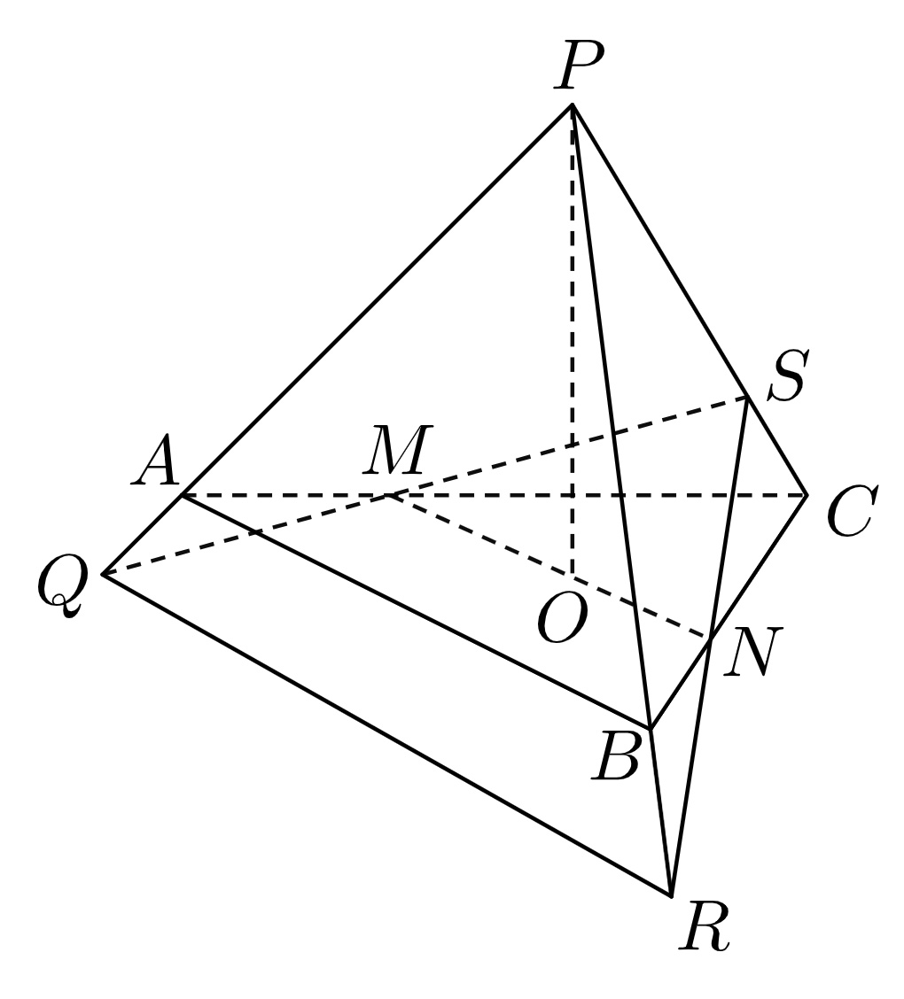

# Mathematics - 题目 3008

**ID**: 0e2a0d1189234960b5d886618e9ba089
**年级**: Grade 11
**难度**: Medium-Hard
**题型**: Multiple-select

## 题目
如图，点 $O$ 是正四面体 $PABC$ 底面 $ABC$ 的中心，过点 $O$ 且平行于平面 $PAB$ 的直线分别交 $AC$ ， $BC$ 于点 $M$ ， $N$ ， $S$ 是棱 $PC$ 上的点，平面 $SMN$ 与棱 $PA$ 的延长线相交于点 $Q$ ，与棱 $PB$ 的延长线相交于点 $R$ ，则（      ）​​​​​​​‌

## 解答

1. 对于 ${\rm A，}\because MN//$ 平面 $PAB$ ，平面 $SMN$ 与棱 $PA$ 的延长线相交于点 $Q$ ，与棱 $PB$ 的延长线相交于点 $R$ ，
2. $\therefore $ 平面 $SMN$  $\cap $ 平面 $PAB=RQ$ ，
3. 又 $MN\subset $ 平面 $SMN$ ， $MN{\rm{/}}{\rm{/}}$ 平面 $PAB$ ， $\therefore $  $MN//RQ$ ，
4. $\because $ 点 $O$ 在面 $ABC$ 上，过点 $O$ 的直线交 $AC$ ， $BC$ 于点 $M$ ， $N$ ， $\therefore $  $MN\subset $ 平面 $ABC$ ，
5. 又 $MN{\rm{/}}{\rm{/}}$ 平面 $PAB$ ，平面 $ABC$  $\cap $ 平面 $PAB$  ${\rm{=}}AB$ ， $\therefore $  $MN{\rm{/}}{\rm{/}}AB$ ，
6. $\therefore $  $AB{\rm{/}}{\rm{/}}RQ$ ，故A正确；
7. 对于B，设正四面体 $P-ABC$ 的棱长为 $a$ ， $\therefore \overrightarrow {{PS}}\cdot (\overrightarrow {{PQ}}+\overrightarrow {{PR}})=\overrightarrow {{PS}}\cdot \overrightarrow {{PQ}}+\overrightarrow {{PS}}\cdot \overrightarrow {{PR}}$
8. $=\left |{\overrightarrow {{PS}}}\right |\cdot \left |{\overrightarrow {{PQ}}}\right |{\cos}60{}\degree +\left |{\overrightarrow {{PS}}}\right |\cdot \left |{\overrightarrow {{PR}}}\right |{\cos}60{}\degree =a{^{2}}>0$ ，故B错误；
9. 对于C，当直线 $MN$ 平行于直线 $AB$ ， $S$ 为线段 $PC$ 上靠近 $C$ 的三等分点，即 $SC=\frac {1}{3}PC$ ，此时 $PC\bot $ 平面 $SRQ$ ，
10. 以下给出证明：在正四面体 $P-ABC$ 中，设各棱长为 $a$ ，
11. $\therefore $  $\vartriangle ABC$ ， $\mathrm{△}PBC$ ， $\mathrm{△}PAC$ ， $△PAB$ 均为正三角形，
12. $\because $ 点 $O$ 为 $\vartriangle ABC$ 的中心， $MN{\rm{/}}{\rm{/}}AB$ ，
13. $\therefore $ 由正三角形中的性质，易得 $CN=CM=\frac {2}{3}a$ ，
14. 在 $\vartriangle CNS$ 中， $\because $  $CN=\frac {2}{3}a$ ， $SC=\frac {1}{3}a$ ， $\angle SCN=\frac {\mathrm{π}}{3}$ ，
15. $\therefore $ 由余弦定理得， $SN=\sqrt {{\left({\frac {a}{3}}\right)^{2}}+{\left({\frac {2a}{3}}\right)^{2}}-2\cdot \frac {a}{3}\cdot \frac {2a}{3}{\cos}\frac {\mathrm{π}}{3}}=\frac {\sqrt {3}}{3}a$ ，
16. $\therefore $  $SC{^{2}}+SN{^{2}}=\frac {4}{9}a{^{2}}=CN{^{2}}$ ，则 $SN\bot PC$ ，
17. 同理， $SM\bot PC$ ，又 $SM\cap SN=S$ ， $SM$  $\subset $ 平面 $SRQ$ ， $SN$  $\subset $ 平面 $SRQ$ ，
18. $\therefore $  $PC\bot $ 平面 $SRQ$ ， $\therefore $ 存在点S与直线MN，使 $PC\bot $ 平面 $SRQ$ ，故C正确；
19. 对于D，设 $D$ 为 $BC$ 的中点，则 $\overrightarrow {{PO}}=\overrightarrow {{PA}}+\overrightarrow {{AO}}=\overrightarrow {{PA}}+\frac {2}{3}\overrightarrow {{AD}}=\overrightarrow {{PA}}+\frac {2}{3}(\overrightarrow {{PD}}-\overrightarrow {{PA}})$  $=\frac {1}{3}(\overrightarrow {{PA}}+\overrightarrow {{PB}}+\overrightarrow {{PC}})$ ，
20. 又∵ $P$ ， $A$ ， $Q$ 三点共线，∴ $\overrightarrow {{PA}}=\frac {\left |{\overrightarrow {{PA}}}\right |}{\left |{\overrightarrow {{PQ}}}\right |}\overrightarrow {{PQ}}$ ，
21. ∵ $P$ ， $B$ ， $R$ 三点共线，∴ $\overrightarrow {{PB}}=\frac {\left |{\overrightarrow {{PB}}}\right |}{\left |{\overrightarrow {{PR}}}\right |}\overrightarrow {{PR}}$ ，
22. ∵ $P$ ， $S$ ， $C$ 三点共线，∴ $\overrightarrow {{PC}}=\frac {\left |{\overrightarrow {{PC}}}\right |}{\left |{\overrightarrow {{PS}}}\right |}\overrightarrow {{PS}}$ ，
23. 设 $\left |{\overrightarrow {{PQ}}}\right |=x$ ， $\left |{\overrightarrow {{PR}}}\right |=y$ ， $\left |{\overrightarrow {{PS}}}\right |=z$ ，则 $\overrightarrow {{PO}}=\frac {\left |{\overrightarrow {{PA}}}\right |}{3x}\overrightarrow {{PQ}}+\frac {\left |{\overrightarrow {{PB}}}\right |}{3y}\overrightarrow {{PR}}+\frac {\left |{\overrightarrow {{PC}}}\right |}{3z}\overrightarrow {{PS}}$ ，
24. ∵ $O$ ， $Q$ ， $R$ ， $S$ 四点共面，∴ $\frac {\left |{\overrightarrow {{PA}}}\right |}{3x}+\frac {\left |{\overrightarrow {{PB}}}\right |}{3y}+\frac {\left |{\overrightarrow {{PC}}}\right |}{3z}=1$ ，
25. 又∵ $\left |{\overrightarrow {{PA}}}\right |=\left |{\overrightarrow {{PB}}}\right |=\left |{\overrightarrow {{PC}}}\right |$ ，∴ $\frac {1}{3x}+\frac {1}{3y}+\frac {1}{3z}=\frac {1}{\left |{\overrightarrow {{PA}}}\right |}$ ，∴ $\frac {1}{x}+\frac {1}{y}+\frac {1}{z}=\frac {3}{\left |{\overrightarrow {{PA}}}\right |}$ ，
26. 即 $\frac {1}{\left |{\overrightarrow {{PQ}}}\right |}+\frac {1}{\left |{\overrightarrow {{PR}}}\right |}+\frac {1}{\left |{\overrightarrow {{PS}}}\right |}=\frac {3}{\left |{\overrightarrow {{PA}}}\right |}$ ，故D正确.
27. 故选ACD.

## 知识点

**中文**:
  - 用向量证明垂直问题
  - 空间向量的数量积
  - 用向量证明平行问题

**English**:
  - Proving Perpendicularity
  - Scalar Product of Spatial Vectors
  - Proving Parallelism

---
