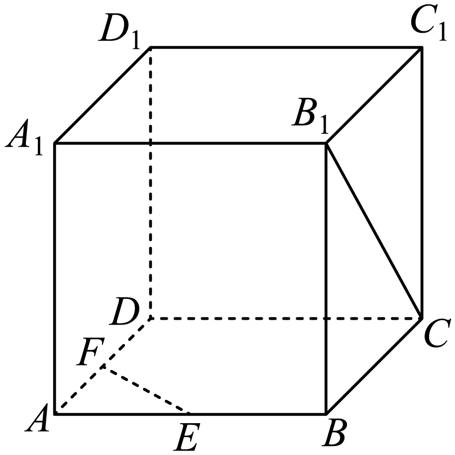

# Mathematics - 题目 2161

**ID**: 10117168fd354db99a40fb2d631c656a
**年级**: Grade 11
**难度**: Medium-Hard
**题型**: Multiple-select

## 题目
已知在正方体 $ABCD-A{{}_{1}}B{{}_{1}}C{{}_{1}}D{{}_{1}}$ 中，点 ${\rm{E}}$ 为线段 $AB$ 的中点，点F在正方体棱 $AD$ 上移动，则下列结论成立是（      ）​​​​​​​‌

## 解答

1. 以 $D$ 为原点，  $DA$ 所在直线为 $x$ 轴， $DC$ 所在直线为 $y$ 轴， $DD{{}_{1}}$ 所在直线为 $z$ 轴，建立空间直角坐标系，如图所示，在正方体 $ABCD-A{{}_{1}}B{{}_{1}}C{{}_{1}}D{{}_{1}}$ 中，设其棱长为2，
2. 
3. 则 $D(0,0,0),E(2,1,0),B{{}_{1}}(2,2,2),C(0,2,0)$ , $\overrightarrow {{B{{}_{1}}C}}=(-2,0,-2)$ ，
4. 对于 ${\rm{A}}$ ，若 $F$ 是线段 $AD$ 中点，则 $F(1,0,0),\overrightarrow {{EF}}=(-1,-1,0)$ ，
5. ${\cos}<\overrightarrow {{B{{}_{1}}C}},\overrightarrow {{EF}}>=\frac {\overrightarrow {{B{{}_{1}}C}}\cdot \overrightarrow {{EF}}}{\left |{\overrightarrow {{B{{}_{1}}C}}}\right |\left |{\overrightarrow {{EF}}}\right |}=\frac {2}{\sqrt {4+0+4}\sqrt {1+1+0}}=\frac {1}{2}$ ，所以直线 $B{{}_{1}}C$ 与 $EF$ 所成角为60°，故选项 ${\rm{A}}$ 正确；
6. 对于 ${\rm{B}}$ ，设 $F(m,0,0)(0\leqslant m\leqslant 2),\overrightarrow {{EF}}=(m-2,-1,0)$ ，要使直线 $B{{}_{1}}C$ 与 $EF$ 垂直，
7. 则有 $\overrightarrow {{EF}}\cdot \overrightarrow {{B{{}_{1}}C}}=4-2m=0$ ，解得： $m=2$ ，当 $F$ 与 $A$ 点重合时，直线 $B{{}_{1}}C$ 与 $EF$ 垂直，故选项 ${\rm{B}}$ 正确；
8. 对于 ${\rm{C}}$ ，设 $F(m,0,0)(0\leqslant m\leqslant 2),\overrightarrow {{EF}}=(m-2,-1,0)$ ，要使直线 $B{{}_{1}}C$ 与 $EF$ 平行，
9. 则有 $\overrightarrow {{EF}}=λ\overrightarrow {{B{{}_{1}}C}}$ ，这样的 $λ$ 不存在，所以直线 $B{{}_{1}}C$ 与 $EF$ 不可能平行，故选项 ${\rm{C}}$ 错误；
10. 对于 ${\rm{D}}$ ，设 $F(m,0,0)(0\leqslant m\leqslant 2),\overrightarrow {{EF}}=(m-2,-1,0)$ ，
11. 设异面直线 $B{{}_{1}}C$ 与EF所成的夹角为 $θ$ ，
12. 则 ${\cos}θ=\left |{{\cos}<\overrightarrow {{EF}},\overrightarrow {{B{{}_{1}}C}}>}\right |=\frac {\left |{\overrightarrow {{EF}}\cdot \overrightarrow {{B{{}_{1}}C}}}\right |}{\left |{\overrightarrow {{EF}}}\right |\left |{\overrightarrow {{B{{}_{1}}C}}}\right |}=\frac {\left |{4-2m}\right |}{2\sqrt {2}\sqrt {(m-2){^{2}}+1}}=\frac {1}{\sqrt {2}\sqrt {\frac {1}{(m-2){^{2}}}+1}}$ ，（ $m\ne 2$ ），当 $m=2$ 时， $θ=\frac {{\rm{\mathrm{π}}}}{2}$ ，
13. 当异面直线 $B{{}_{1}}C$ 与 $EF$ 所成角最小时，则 ${\cos}θ$ 最大，即 $m=0$ 时，
14. ${\cos}θ=\frac {1}{\sqrt {2}\sqrt {\frac {1}{4}+1}}=\frac {\sqrt {10}}{5}$ ，故选项 ${\rm{D}}$ 正确．
15. 故选 ${\rm{A}}{\rm{B}}{\rm{D}}$ .

## 知识点

**中文**:
  - 向量法求异面直线所成角
  - 用向量证明平行问题
  - 用向量证明垂直问题

**English**:
  - Angle between Skew Lines
  - Proving Parallelism
  - Proving Perpendicularity

---
