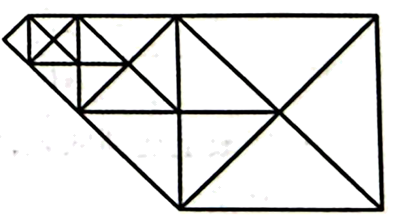

# Mathematics - 题目 512

**ID**: 12c62b44c31b47cd9c7f872f450301cd
**年级**: Grade 11
**难度**: Medium-Hard
**题型**: Multiple-select

## 题目
如图，有边长为1的正方形，取其对角线的一半，构成新的正方形，再取新正方形对角线的一半，构成正方形……如此形成一个边长不断缩小的正方形系列，设原正方形的面积为 $a{{}_{1}}$ ，其后新的正方形面积依次为 $a{{}_{2}},a{{}_{3}},\cdots ,a{{}_{n}}$ ，则下列表述正确的是（      ）​​​​​​​‌

## 解答

1. 已知原正方形边长为 $1$ ，根据正方形面积公式可得 $a{{}_{1}}=1\times 1=1$ .
2. 因为新正方形是由前一个正方形对角线的一半构成，设原正方形边长为 $x$ ，则其对角线长为 $\sqrt {x{^{2}}+x{^{2}}}=\sqrt {2}x$ ，那么新正方形边长为 $\frac {\sqrt {2}x}{2}$ ，新正方形面积 $S={\left({\frac {\sqrt {2}x}{2}}\right)^{2}}=\frac {1}{2}x{^{2}}$ .
3. 即后一个正方形面积是前一个正方形面积的 $\frac {1}{2}$ ，所以 $\frac {a{{}_{n+1}}}{a{{}_{n}}}=\frac {1}{2}$ （ $n\in {\rm{N}}{^{*}}$ ）.
4. 可知数列 $\{a{{}_{n}}\}$ 是以 $a{{}_{1}}=1$ 为首项， $q=\frac {1}{2}$ 为公比的等比数列，A选项正确.
5. 等比数列的通项公式为 $a{{}_{n}}=a{{}_{1}}q{^{n-1}}$ （ $a{{}_{1}}$ 为首项， $q$ 为公比）.
6. 则 $a{{}_{10}}=1\times (\frac {1}{2}){^{10-1}}=(\frac {1}{2}){^{9}}=\frac {1}{512}{\rm ，B}$ 选项错误.
7. 等比数列的前 $n$ 项和公式为 $S{{}_{n}}=\frac {a{{}_{1}}(1-q{^{n}})}{1-q}$ （ $q\ne 1$ ）.
8. 这里 $a{{}_{1}}=1$ ， $q=\frac {1}{2}$ ， $n=10$ ，则 $S{{}_{10}}=\frac {1\times \left [1-{\left({\frac {1}{2}}\right)^{10}}\right ]}{1-\frac {1}{2}}=\frac {1-\frac {1}{1024}}{\frac {1}{2}}=\frac {1023}{512}{\rm ，C}$ 选项正确.
9. 对于首项为 $a{{}_{1}}$ ，公比为 $q$ （ $|q|{\rm{<}}1$ ）的无穷等比数列，其各项和的极限公式为 $S={\mathop {{\rm \lim }}\limits_{n\to +\infty }^{}}S{{}_{n}}=\frac {a{{}_{1}}}{1-q}$ .
10. 因为 $a{{}_{1}}=1$ ， $q=\frac {1}{2}$ ，所以 $S=\frac {1}{1-\frac {1}{2}}=\frac {1}{\frac {1}{2}}=2{\rm ，D}$ 选项正确.
11. 故选ACD.

## 知识点

**中文**:
  - 等比数列前n项和公式
  - 等比数列的概念与通项公式

**English**:
  - Sum Formula
  - Concept and Formula

---
