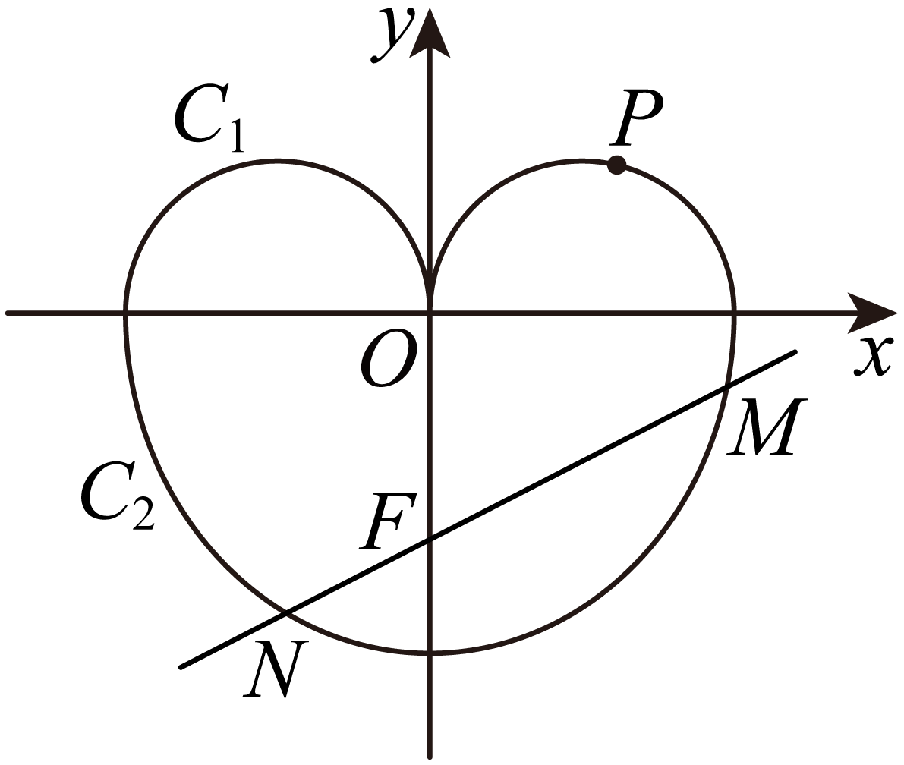

# Mathematics - 题目 667

**ID**: 209f35a028994d60b66830dae00a55fa
**年级**: Grade 11
**难度**: Medium-Hard
**题型**: Multiple-select

## 题目
如图，类似“心形”的曲线 $E$ ，可以看成由上部分曲线 $C{{}_{1}}$ ： $y=\sqrt {-x{^{2}}+2\left |{x}\right |}$ ，下部分曲线 $C{{}_{2}}$ ： $\frac {y{^{2}}}{a{^{2}}}+\frac {x{^{2}}}{b{^{2}}}=1\left ({y\leqslant 0}\right )$ 构成，过曲线 $C{{}_{2}}$ 的焦点 $F\left ({0,-1}\right )$ 的直线 $l$ 与曲线 $C{{}_{2}}$ 交于M，N两点， $P\left ({x,y}\right )$ 是“心形”曲线E上的动点，下列说法正确的是（      ）​​​​​​​‌

## 解答

1. 由 $C{{}_{1}}:y=\sqrt {-x{^{2}}+2\left |{x}\right |}$ 可变形为 ${\left({x\pm 1}\right)^{2}}+y{^{2}}=1\left ({y\geqslant 0}\right )$ ，
2. 则上半部分表示以 $\left ({\pm 1,0}\right )$ 为圆心，1为半径的2个半圆.
3. 曲线 $C{{}_{2}}:\frac {y{^{2}}}{a{^{2}}}+\frac {x{^{2}}}{b{^{2}}}=1\left ({y\leqslant 0}\right )$ 的焦点为 $F\left ({0,-1}\right )$ ，解得 $c=1$ ， $b=2$ ， $a=\sqrt {5}$ ，
4. 则曲线 $C{{}_{2}}$ 的方程为 $\frac {y{^{2}}}{5}+\frac {x{^{2}}}{4}=1\left ({y\leqslant 0}\right )$ ，故A正确；
5. 另椭圆的上焦点 $F{{}_{1}}\left ({0,1}\right )$ ，所以 $x{^{2}}+{\left({y-1}\right)^{2}}$ 可以看成 $\left |{PF{{}_{1}}}\right |{^{2}}$ ，
6. 当点 $P$ 位于 $C{{}_{2}}$ 的下顶点时， $\left |{PF{{}_{1}}}\right |{^{2}}$ 最大，所以 $\left ({\left |{PF{{}_{1}}}\right |{^{2}}}\right )\leqslant {\left({\sqrt {5}+1}\right)^{2}}=6+2\sqrt {5}$ ，故B错误；
7. 当直线 $y=x+m$ 与第一象限半圆相切时， $\frac {\left |{1+m}\right |}{\sqrt {2}}=1$ ，则 $m=\sqrt {2}-1$ ，
8. 由图，可得 $m$ 的取值范围为 $\left ({0,\sqrt {2}-1}\right )$ ，故C正确；
9. 
10. 根据对称性，不妨设 $l:y=kx-1$ ，联立 $\begin{cases}y=kx-1\\\frac {y{^{2}}}{5}+\frac {x{^{2}}}{4}=1\end{cases}$ ，消去 $y$ 并整理得 $\left ({5+4k{^{2}}}\right )x{^{2}}-8kx-16=0$ ，
11. 且 $-\frac {1}{2}\leqslant k\leqslant \frac {1}{2},Δ=320\left ({k{^{2}}+1}\right )>0$ ，则 $x{{}_{M}}+x{{}_{N}}=\frac {8k}{5+4k{^{2}}}$ ， $x{{}_{M}}\cdot x{{}_{N}}=\frac {-16}{5+4k{^{2}}}$ ，
12. 则 $\left |{MN}\right |=$  $\sqrt {1+k{^{2}}}\cdot \sqrt {{\left({x{{}_{M}}+x{{}_{N}}}\right)^{2}}-4x{{}_{M}}x{{}_{N}}}=\frac {8\sqrt {5}\left ({k{^{2}}+1}\right )}{5+4k{^{2}}},d{{}_{O-l}}=\frac {1}{\sqrt {k{^{2}}+1}}$ ，
13. 所以 $S{{}_{\vartriangle OMN}}=\frac {1}{2}\left |{MN}\right |\times d{{}_{O-l}}=$  $\frac {1}{2}\times \frac {8\sqrt {5}\left ({k{^{2}}+1}\right )}{5+4k{^{2}}}\times \frac {1}{\sqrt {k{^{2}}+1}}=\frac {4\sqrt {5\left ({k{^{2}}+1}\right )}}{5+4k{^{2}}}$ ，
14. 设 $t=\sqrt {k{^{2}}+1}\in \left [1,\frac {\sqrt {5}}{2}\right ]$ ，易得 $S{{}_{\vartriangle OMN}}=\frac {4\sqrt {5}t}{4t{^{2}}+1}=\frac {4\sqrt {5}}{4t+\frac {1}{t}}$ ，
15. 函数 $y=4t+\frac {1}{t}$ 在 $\left [1,\frac {\sqrt {5}}{2}\right ]$ 上单调递增， $\left ({4t+\frac {1}{t}}\right ){{}_{{\rm \min }}}=5$ ，
16. 所以 $S{{}_{△OMN}}$ 的最大值为 $\frac {4\sqrt {5}}{5}$ ，故D错误.
17. 故选AC.

## 知识点

**中文**:
  - 曲线与方程

**English**:
  - Curves and Equations

---
