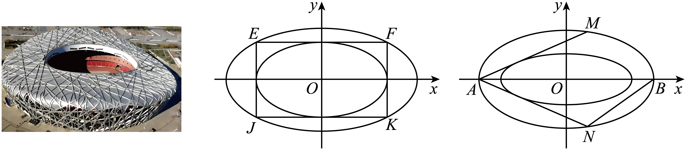

# Mathematics - 题目 3822

**ID**: 232e050ad6be4ec8baf4070a30089c78
**年级**: Grade 11
**难度**: Medium-Hard
**题型**: Multiple-select

## 题目
第24届冬季奥林匹克运动会圆满结束.​​​​​​​‌根据规划，国家体育场（鸟巢）成为北京冬奥会开、闭幕式的场馆.国家体育场“鸟巢”的钢结构鸟瞰图如图所示，内外两圈的钢骨架是离心率相同的椭圆，若椭圆 $C{{}_{1}}$ ： $\frac {x{^{2}}}{a{{}_{1}^{2}}}+\frac {y{^{2}}}{b{{}_{1}^{2}}}=1\left ({a{{}_{1}}>b{{}_{1}}>0}\right )$ 和椭圆 $C{{}_{2}}$ ： $\frac {x{^{2}}}{a{{}_{2}^{2}}}+\frac {y{^{2}}}{b{{}_{2}^{2}}}=1\left ({a{{}_{2}}>b{{}_{2}}>0}\right )$ 的离心率相同，且 $a{{}_{1}}>a{{}_{2}}$ .则下列正确的是（      ）

## 解答

1. A：由 $\frac {a{{}_{1}^{2}}-b{{}_{1}^{2}}}{a{{}_{1}^{2}}}=\frac {a{{}_{2}^{2}}-b{{}_{2}^{2}}}{a{{}_{2}^{2}}}$ 且 $a{{}_{1}}>a{{}_{2}}$ ，则 $a{{}_{1}^{2}}-b{{}_{1}^{2}}>a{{}_{2}^{2}}-b{{}_{2}^{2}}$ ，即 $a{{}_{1}^{2}}-a{{}_{2}^{2}}>b{{}_{1}^{2}}-b{{}_{2}^{2}}$ ，故错误；
2. B：由 $\frac {a{{}_{1}^{2}}-b{{}_{1}^{2}}}{a{{}_{1}^{2}}}=\frac {a{{}_{2}^{2}}-b{{}_{2}^{2}}}{a{{}_{2}^{2}}}$ ，得 $1-\frac {b{{}_{1}^{2}}}{a{{}_{1}^{2}}}=1-\frac {b{{}_{2}^{2}}}{a{{}_{2}^{2}}}$ ，则 $a{{}_{2}}=\frac {a{{}_{1}}b{{}_{2}}}{b{{}_{1}}}$ ，所以 $a{{}_{1}}-a{{}_{2}}=a{{}_{1}}-\frac {a{{}_{1}}b{{}_{2}}}{b{{}_{1}}}=\frac {a{{}_{1}}}{b{{}_{1}}}\left ({b{{}_{1}}-b{{}_{2}}}\right )>b{{}_{1}}-b{{}_{2}}$ ，故正确；
3. C： $F\left ({a{{}_{2}},b{{}_{2}}}\right )$ 满足椭圆 $C{{}_{1}}$ 方程 $\frac {a{{}_{2}^{2}}}{a{{}_{1}^{2}}}+\frac {b{{}_{2}^{2}}}{b{{}_{1}^{2}}}=1$ ，又 $\frac {a{{}_{1}}}{b{{}_{1}}}=\frac {a{{}_{2}}}{b{{}_{2}}}$ ，则 $\frac {a{{}_{2}}}{a{{}_{1}}}=\frac {b{{}_{2}}}{b{{}_{1}}}$ ，所以 $2{\left({\frac {a{{}_{2}}}{a{{}_{1}}}}\right)^{2}}=1$ ， $\frac {a{{}_{1}}}{a{{}_{2}}}=\sqrt {2}$ ，故正确；
4. D：由对称性知： $M$ 、 $N$ 关于 $x$ 轴对称， $A\left ({-a{{}_{1}},0}\right )$ ， $M\left ({x{{}_{0}},y{{}_{0}}}\right )$ ， $N\left ({x{{}_{0}},-y{{}_{0}}}\right )$ ， $B\left ({a{{}_{1}},0}\right )$ ， $k{{}_{AM}}=\frac {y{{}_{0}}}{x{{}_{0}}+a{{}_{1}}}$ ， $k{{}_{BN}}=\frac {-y{{}_{0}}}{x{{}_{0}}-a{{}_{1}}}$ ，则 $k{{}_{AM}}k{{}_{BN}}=\frac {-y{{}_{0}^{2}}}{x{{}_{0}^{2}}-a{{}_{1}^{2}}}=\frac {-b{{}_{1}^{2}}+\frac {b{{}_{1}^{2}}x{{}_{0}^{2}}}{a{{}_{1}^{2}}}}{x{{}_{0}^{2}}-a{{}_{1}^{2}}}=\frac {b{{}_{1}^{2}}}{a{{}_{1}^{2}}}=\frac {8}{9}$ ， $e=\sqrt {1-{\left({\frac {b{{}_{1}}}{a{{}_{1}}}}\right)^{2}}}=\frac {1}{3}$ ，故正确.
5. 故选BCD.

## 知识点

**中文**:
  - 对称性
  - 椭圆的标准方程及应用
  - 椭圆的离心率

**English**:
  - Symmetry
  - Standard Equation and Applications
  - Eccentricity

---
